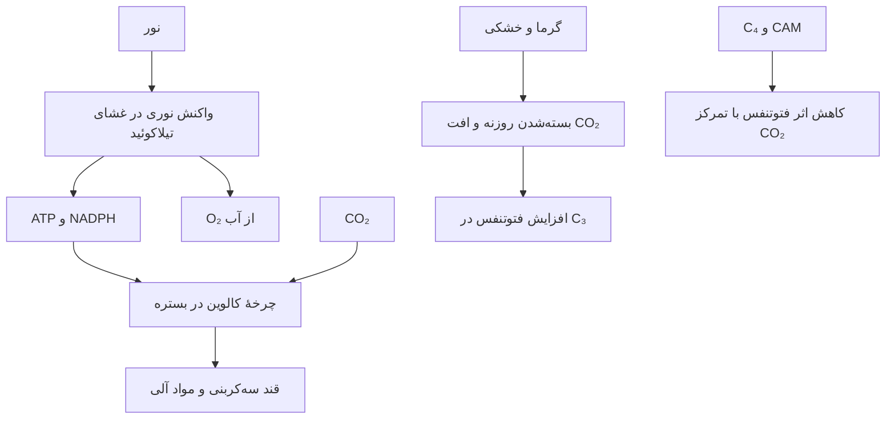

# چارچوب فصل ۱۲-۰۶ ـ از انرژی به ماده

> پایه: دوازدهم · زیست‌شناسی (۳) · سه گفتار: فتوسنتز (تبدیل انرژی نور به انرژی شیمیایی)، واکنش‌های فتوسنتزی، فتوسنتز در شرایط دشوار

## محدودهٔ محتوایی

| گفتار | پوشش |
|---|---|
| فتوسنتز و تبدیل انرژی نور | برگ و بافت‌های فتوسنتزی؛ ساختار سبزدیسه؛ بستره، تیلاکوئید، گرانوم؛ سبزینهٔ a و b و کاروتنوئیدها؛ طیف جذب و طیف کنش؛ آزمایش انگلمان؛ فتوسیستم‌های I و II و مراکز P700/P680 |
| واکنش‌های فتوسنتزی | تجزیهٔ نوری آب؛ مسیر الکترون؛ زنجیرهٔ انتقال الکترون؛ شیب پروتونی و شیمی‌اسمز؛ ATP و NADPH؛ فسفریلاسیون چرخه‌ای و غیرچرخه‌ای؛ چرخهٔ کالوین و مراحل تثبیت، کاهش و بازسازی؛ محاسبات CO₂/ATP/NADPH |
| فتوسنتز در شرایط دشوار | عوامل محدودکننده؛ روبیسکو و دو فعالیت آن؛ فتوتنفس؛ تأثیر گرما، خشکی و بسته‌شدن روزنه‌ها؛ مسیرهای C₃، C₄ و CAM؛ جداسازی مکانی و زمانی |

## اهداف یادگیری قابل سنجش

دانش‌آموز بتواند:
1. جایگاه واکنش‌های وابسته به نور و چرخهٔ کالوین را روی شکل سبزدیسه مشخص کند.
2. نقش رنگیزه‌های اصلی و کمکی را توضیح دهد و طیف جذب را از طیف کنش تشخیص دهد.
3. از آزمایش انگلمان نتیجه‌گیری درست و محدود به شواهد انجام دهد.
4. مسیر حرکت الکترون در فسفریلاسیون غیرچرخه‌ای و چرخه‌ای را مقایسه کند.
5. نقش تجزیهٔ آب، تجمع پروتون و ATPساز را در تولید ATP توضیح دهد.
6. تفاوت خروجی دو مسیر چرخه‌ای و غیرچرخه‌ای را بیان کند.
7. سه مرحلهٔ چرخهٔ کالوین و نقش روبیسکو و RuBP را شرح دهد.
8. برای یک یا دو G3P خالص، CO₂ و ATP و NADPH لازم را محاسبه کند.
9. ارتباط واکنش نوری و چرخهٔ کالوین را توضیح دهد.
10. شرایط افزایش فتوتنفس و اثر آن بر بازده تثبیت کربن را تحلیل کند.
11. C₃، C₄ و CAM را از نظر نخستین تثبیت CO₂، مکان، زمان و نمونه مقایسه کند.
12. از نمودار یا سناریوی آزمایشی دربارهٔ فتوسنتز استدلال کند.

## نقشهٔ مفهومی فصل

## دام‌های پرتکرار و راهبرد پاسخ

1. شمارهٔ فتوسیستم‌ها ترتیب زمانی نیست: PSII در مسیر غیرچرخه‌ای پیش از PSI قرار می‌گیرد.
2. P680 متعلق به PSII و P700 متعلق به PSI است.
3. اکسیژن آزادشده از آب می‌آید، نه CO₂.
4. فتولیز آب به PSII مربوط است؛ در مسیر چرخه‌ای رخ نمی‌دهد.
5. مسیر چرخه‌ای فقط ATP تولید می‌کند؛ نه NADPH و نه O₂.
6. مسیر غیرچرخه‌ای هر دو فتوسیستم را درگیر می‌کند و ATP، NADPH و O₂ به همراه دارد.
7. H⁺ در فضای درون تیلاکوئید تجمع می‌یابد؛ ATP در سمت بستره ساخته می‌شود.
8. چرخهٔ کالوین در بستره انجام می‌شود، نه در غشای تیلاکوئید.
9. واکنش تاریکی به معنی فرایند مخصوص شب نیست.
10. سه CO₂ برای یک G3P خالص لازم است؛ هزینهٔ آن ۹ ATP و ۶ NADPH است.
11. دو G3P خالص معادل شش کربن‌اند و ۱۸ ATP و ۱۲ NADPH نیاز دارند.
12. روبیسکو هم کربوکسیلاز است و هم اکسیژناز.
13. فتوتنفس در CO₂ کم و O₂ زیاد تشدید می‌شود.
14. بسته‌شدن روزنه‌ها در خشکی، CO₂ درون برگ را کاهش می‌دهد.
15. C₄ جداسازی مکانی دارد؛ میانبرگ تثبیت اولیه و غلاف آوند چرخهٔ کالوین.
16. CAM جداسازی زمانی دارد؛ تثبیت اولیه شب و چرخهٔ کالوین روز.
17. C₄ و CAM در تثبیت اولیه از PEP کربوکسیلاز استفاده می‌کنند، اما روبیسکو را در چرخهٔ کالوین حفظ می‌کنند.
18. CAM معمولاً روزنه‌هایش را شب باز می‌کند و مالات را ذخیره می‌کند.
19. طیف جذب رنگیزه با طیف کنش فتوسنتز یکسان نیست.
20. در آزمایش انگلمان، باکتری‌های هوازی شاخص تجمع اکسیژن‌اند.

## الگوی مطالعه و مرور

- **مرحلهٔ ۱:** شکل سبزدیسه و مسیر الکترون را از حفظ رسم کن.
- **مرحلهٔ ۲:** دو مسیر چرخه‌ای و غیرچرخه‌ای را در یک جدول مقایسه کن.
- **مرحلهٔ ۳:** چرخهٔ کالوین را سه‌مرحله‌ای رسم و محاسبات ۳ و ۶ CO₂ را تمرین کن.
- **مرحلهٔ ۴:** زنجیرهٔ علت و معلولی فتوتنفس را توضیح بده.
- **مرحلهٔ ۵:** جدول C₃/C₄/CAM را از حفظ بازسازی کن.
- **مرحلهٔ ۶:** شکل‌ها و گزینه‌های ترکیبی را با روش «مکان ← فرایند ← ماده/انرژی» تحلیل کن.

## ساختار بستهٔ آموزشی

| منبع | محتوا |
|---|---|
| درس‌نامه | شرح سه گفتار، محاسبات، دام‌ها و راهبرد تست |
| راهنمای دیداری | ۱۰ نقشه و جدول برای مکان‌ها، مسیرها و مقایسه‌ها |
| تمرین | ۳۵ سؤال چهارگزینه‌ای، درست/نادرست، تشریحی و چالشی با پاسخ |
| فلش‌کارت | ۵۵ کارت مرور مفهومی |

## منابع و راستی‌آزمایی

- کتاب درسی زیست‌شناسی (۳)، فصل ۶؛ نسخهٔ سال جاری از [chap.sch.ir](https://chap.sch.ir/).
- [شبکهٔ رشد ـ معرفی زیست‌شناسی (۳)](https://www.roshd.ir/olum/Content/کتاب-زیست‌شناسی-۳-پایه-دوازدهم).
- [1xAi ـ درسنامهٔ فصل ۶](https://mergedrop.1xai.ir/darsnameh/zist-davazdahom/fasl-6) برای تطبیق گفتارها و ترتیب موضوعات.
- [CalcSwiftly ـ نکات فصل ۶](https://calcswiftly.com/fa/konkur-biology-photosynthesis-12) برای محاسبات و مقایسهٔ مسیرها.
- [Azdars ـ واکنش‌های فتوسنتزی](https://azdars.com/خلاصه-درس-دوم-واکنشهای-فتوسنتزی-از-ف/) و [فتوسنتز در شرایط دشوار](https://azdars.com/خلاصه-درس-سوم-فتوسنتز-در-شرایط-دشوار-ا/) برای نکته‌های تستی تکمیلی.

> منابع غیردرسی برای روشن‌کردن دام‌ها و تمرین استدلال استفاده شده‌اند؛ در پاسخ امتحان، متن و شکل نسخهٔ رسمی کتاب همان سال معیار اصلی است.
