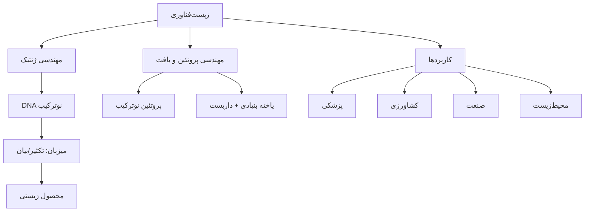

# چارچوب فصل ۱۲-۰۷ ـ فناوری‌های نوین زیستی

> پایه: دوازدهم · زیست‌شناسی (۳) · سه گفتار: زیست‌فناوری و مهندسی ژنتیک؛ فناوری مهندسی پروتئین و بافت؛ کاربردهای زیست‌فناوری.

## محدودهٔ محتوایی

| گفتار | پوشش |
|---|---|
| زیست‌فناوری و مهندسی ژنتیک | زیست‌فناوری سنتی و نوین؛ DNA نوترکیب؛ آنزیم محدودکننده و لیگاز؛ ناقل و پلاسمید؛ یاختهٔ میزبان؛ مراحل مهندسی ژنتیک؛ PCR؛ الکتروفورز ژل |
| فناوری مهندسی پروتئین و بافت | تولید پروتئین نوترکیب؛ پردازش انسولین؛ مهندسی پروتئین؛ یاخته‌های بنیادی؛ خودنوسازی و تمایز؛ داربست و عوامل رشد؛ مهندسی بافت |
| کاربردهای زیست‌فناوری | کاربرد پزشکی و تشخیص مولکولی؛ ژن‌درمانی؛ کاربرد کشاورزی و گیاه Bt؛ کشت مریستم؛ کاربرد صنعتی و محیط‌زیستی؛ زیست‌پالایی؛ دسته‌بندی رنگی؛ ایمنی و اخلاق زیستی |

## اهداف یادگیری
دانش‌آموز بتواند:
1. زیست‌فناوری را از مهندسی ژنتیک تفکیک کند.
2. نقش محدودکننده، لیگاز، ناقل و میزبان را توضیح دهد.
3. مراحل مهندسی ژنتیک را به ترتیب بیان کند.
4. مراحل PCR و نقش اجزای آن را شرح دهد.
5. از الکتروفورز دربارهٔ اندازهٔ تقریبی قطعات استنباط کند و محدودیتش را بشناسد.
6. ورود ژن، بیان ژن و تولید پروتئین فعال را جدا کند.
7. پردازش انسولین و نقش زنجیره‌های A و B و قطعهٔ C را توضیح دهد.
8. خودنوسازی و تمایز یاختهٔ بنیادی را مقایسه کند.
9. نقش یاخته، داربست و عوامل رشد را در مهندسی بافت شرح دهد.
10. کاربردهای پزشکی، کشاورزی، صنعتی و محیط‌زیستی را دسته‌بندی کند.
11. گیاه Bt و کشت مریستم را مقایسه کند.
12. دربارهٔ ایمنی و اخلاق زیستی بر پایهٔ شواهد استدلال کند.

## نقشهٔ مفهومی

## دام‌های پرتکرار
1. زیست‌فناوری گسترده‌تر از مهندسی ژنتیک است.
2. محدودکننده برش می‌دهد؛ لیگاز اتصال ایجاد می‌کند.
3. پلاسمید ناقل است، نه آنزیم.
4. ورود ژن تضمین‌کنندهٔ بیان نیست.
5. بیان ژن تضمین‌کنندهٔ پروتئین فعال نیست.
6. PCR تکثیر می‌کند؛ الکتروفورز جداسازی می‌کند.
7. DNA با بار منفی به قطب مثبت حرکت می‌کند.
8. قطعات کوچک‌تر معمولاً در ژل دورتر حرکت می‌کنند.
9. نوار ژل توالی دقیق را مشخص نمی‌کند.
10. آغازگرها اختصاصیت PCR را تعیین می‌کنند.
11. انسولین بالغ دو زنجیرهٔ A و B دارد.
12. همهٔ یاخته‌های بنیادی توان تمایز یکسان ندارند.
13. داربست با یاخته تفاوت دارد.
14. گیاه Bt ژن مربوط را از باکتری دریافت می‌کند.
15. کشت مریستم می‌تواند به تولید گیاه عاری از برخی ویروس‌ها کمک کند.
16. تشخیص مولکولی با درمان قطعی یکسان نیست.
17. رنگ‌های زیست‌فناوری حوزه‌های قراردادی را نشان می‌دهند.
18. ایمنی محصول زیستی باید موردی و مبتنی بر شواهد ارزیابی شود.

## الگوی مطالعه
- مرحلهٔ ۱: نقشهٔ مهندسی ژنتیک را از حفظ رسم کن.
- مرحلهٔ ۲: PCR و الکتروفورز را با فعل اصلی هرکدام مقایسه کن.
- مرحلهٔ ۳: از ژن تا پروتئین فعال و مثال انسولین را مرور کن.
- مرحلهٔ ۴: اجزای مهندسی بافت و نقش آن‌ها را تفکیک کن.
- مرحلهٔ ۵: کاربردها را در حوزه‌های پزشکی، کشاورزی، صنعت و محیط‌زیست طبقه‌بندی کن.
- مرحلهٔ ۶: تست سناریویی را با روش «فعل سؤال ← ابزار ← نتیجه» حل کن.

## ساختار بسته
| منبع | محتوا |
|---|---|
| درس‌نامه | سه گفتار، فرایندها، ۲۵ دام مفهومی |
| راهنمای دیداری | ۱۰ نمودار و جدول |
| تمرین | ۳۵ سؤال: ۱۸ چهارگزینه‌ای، ۸ درست/نادرست، ۶ تشریحی و ۳ چالشی |
| فلش‌کارت | ۵۶ کارت مرور مفهومی |

## منابع و راستی‌آزمایی
- کتاب درسی زیست‌شناسی (۳)، فصل ۷؛ نسخهٔ همان سال از [chap.sch.ir](https://chap.sch.ir/).
- [فهرست فصل‌ها و گفتارهای زیست‌شناسی دوازدهم](https://www.daneshchi.ir/zistshenasi-t12/) برای تطبیق سه گفتار.
- [1xAi ـ نمونه سؤال فصل ۷ با پاسخ تشریحی](https://1xai.ir/nemoone-soal/zist-davazdahom/fasl-7).
- [CalcSwiftly ـ تست مهندسی ژنتیک](https://calcswiftly.com/fa/konkur-biology-biotechnology-12-questions/).
- [Azdars ـ کاربردهای زیست‌فناوری](https://azdars.com/خلاصه-درس-سوم-کاربردهای-زیستفناوری/).

> منابع تکمیلی برای تمرین و دام‌ها هستند؛ متن و شکل‌های نسخهٔ رسمی کتاب معیار اصلی امتحان است.
