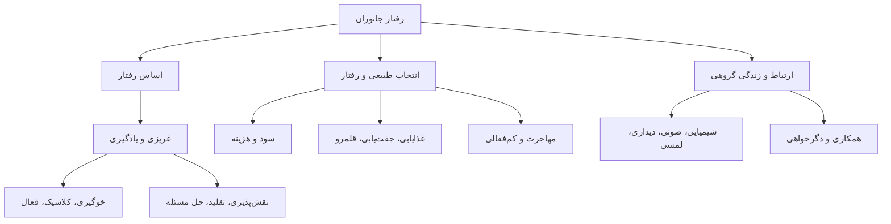

# چارچوب فصل ۱۲-۰۸ ـ رفتارهای جانوران

> پایهٔ دوازدهم · زیست‌شناسی (۳) · سه گفتار: اساس رفتار؛ انتخاب طبیعی و رفتار؛ ارتباط و زندگی گروهی.

## محدودهٔ محتوایی

| گفتار | پوشش |
|---|---|
| اساس رفتار | تعریف رفتار؛ سازوکار نزدیک و توضیح تکاملی؛ رفتار غریزی و یادگیری‌شده؛ خوگیری؛ شرطی‌شدن کلاسیک و فعال؛ نقش‌پذیری؛ تقلید؛ حل مسئله |
| انتخاب طبیعی و رفتار | سود و هزینه؛ اثر رفتار بر بقا و تولیدمثل؛ غذایابی بهینه؛ انتخاب جفت و سرمایه‌گذاری والدینی؛ قلمروخواهی؛ مهاجرت و جهت‌یابی؛ کم‌فعالی فصلی و خواب زمستانی |
| ارتباط و زندگی گروهی | پیام‌های شیمیایی، صوتی، دیداری و لمسی؛ فرومون؛ رقص زنبور؛ مزایا و هزینه‌های زندگی گروهی؛ همکاری؛ دگرخواهی و انتخاب خویشاوندی |

## اهداف یادگیری

دانش‌آموز بتواند:
1. رفتار را تعریف و محرک‌های درونی و بیرونی آن را مثال بزند.
2. پرسش‌های «چگونه» و «چرا» دربارهٔ رفتار را تفکیک کند.
3. رفتار غریزی و یادگیری‌شده را مقایسه کند.
4. خوگیری، شرطی‌شدن کلاسیک، شرطی‌شدن فعال، نقش‌پذیری، تقلید و حل مسئله را از روی مثال تشخیص دهد.
5. نقش محرک و پاسخ شرطی/غیرشرطی را در آزمایش پاولف مشخص کند.
6. سود و هزینهٔ رفتار را در ارتباط با بقا و تولیدمثل تحلیل کند.
7. نظریهٔ غذایابی بهینه را با مفهوم انرژی خالص توضیح دهد.
8. اثر انتخاب جفت، سرمایه‌گذاری والدینی و قلمروخواهی را بررسی کند.
9. مهاجرت و برخی نشانه‌های جهت‌یابی را توضیح دهد.
10. تغییرات سوخت‌وساز در خواب زمستانی را تشخیص دهد.
11. روش‌های ارتباط جانوران و نقش فرومون را مقایسه کند.
12. اطلاعات منتقل‌شده با رقص زنبور را توضیح دهد.
13. مزایا و هزینه‌های زندگی گروهی را ارزیابی کند.
14. دگرخواهی را از همکاری تفکیک و انتخاب خویشاوندی را شرح دهد.

## نقشهٔ مفهومی

## دام‌های پرتکرار
1. خوگیری نوعی یادگیری است، نه رفتار غریزی.
2. شرطی‌شدن کلاسیک پیوند دو محرک است؛ فعال پیوند رفتار و پیامد.
3. در پاولف، غذا محرک غیرشرطی و زنگ پس از یادگیری محرک شرطی است.
4. نقش‌پذیری به دورهٔ حساس وابسته است.
5. تقلید با هر نوع رفتار گروهی یکی نیست.
6. رفتار غریزی می‌تواند با تجربه تعدیل شود.
7. پرسش «چگونه» سازوکار نزدیک و «چرا» پیامد تکاملی را می‌سنجد.
8. انتخاب طبیعی فقط به بقا محدود نیست؛ موفقیت تولیدمثلی هم اهمیت دارد.
9. غذایابی بهینه بر انرژی خالص تکیه دارد، نه فقط انرژی خام.
10. قلمروخواهی هزینهٔ انرژی و خطر درگیری دارد.
11. مهاجرت با جابه‌جایی تصادفی یکسان نیست.
12. در خواب زمستانی عمیق سوخت‌وساز کاهش می‌یابد.
13. فرومون پیام شیمیایی بین افراد هم‌گونه است؛ هورمون درون بدن اثر می‌کند.
14. رقص زنبور می‌تواند جهت و فاصلهٔ منبع غذا را منتقل کند.
15. زندگی گروهی هم مزیت و هم هزینه دارد.
16. دگرخواهی برای کمک‌کننده هزینه دارد؛ همکاری لزوماً چنین نیست.
17. انتخاب خویشاوندی می‌تواند برخی رفتارهای دگرخواهانه را توضیح دهد.
18. دگرخواهی در تعریف زیستی به معنی نیت اخلاقی نیست.

## راهبرد مطالعه
- مرحلهٔ ۱: جدول انواع یادگیری را از حفظ بازسازی کن و برای هرکدام یک مثال تازه بساز.
- مرحلهٔ ۲: آزمایش پاولف را با برچسب محرک/پاسخ شرطی و غیرشرطی رسم کن.
- مرحلهٔ ۳: در مثال‌های غذایابی، انرژی دریافتی و هزینه را جداگانه حساب کن.
- مرحلهٔ ۴: برای هر رفتار، سود و هزینه را از دید فرد و گروه بنویس.
- مرحلهٔ ۵: فرومون/هورمون، همکاری/دگرخواهی و سازوکار نزدیک/توضیح تکاملی را مقایسه کن.
- مرحلهٔ ۶: سؤال‌های ترکیبی را با تعیین کلیدواژه و حذف گزینه‌های مطلق‌گرا حل کن.

## منابع و راستی‌آزمایی
- کتاب درسی زیست‌شناسی (۳)، فصل ۸، سه گفتار؛ متن و شکل‌های نسخهٔ رسمی همان سال مرجع اصلی‌اند.
- [شبکهٔ رشد ـ زیست‌شناسی (۳) پایهٔ دوازدهم](https://www.roshd.ir/olum/Content/کتاب-زیست‌شناسی-۳-پایه-دوازدهم) — معرفی رسمی کتاب.
- [1xAi ـ درس‌نامهٔ فصل ۸](https://1xai.ir/darsnameh/zist-davazdahom/fasl-8) — مرور گفتارها و مثال‌ها؛ منبع کمکی تولیدشده با هوش مصنوعی، نه جایگزین کتاب.
- [CalcSwiftly ـ درس‌نامه و نکات فصل ۸](https://calcswiftly.com/fa/konkur-biology-animal-behaviour-12/) — مقایسهٔ انواع یادگیری و نکات غذایابی و دگرخواهی.
- [CalcSwiftly ـ تست و پاسخ تشریحی فصل ۸](https://calcswiftly.com/fa/konkur-biology-animal-behaviour-12-questions/) — تمرین تحلیل گزینه و پاسخ.
- [از درس ـ نمونه تست فصل ۸](https://azdars.com/نمونه-سوالات-تستی-فصل8-رفتارهای-جانوران/) — بانک تست تکمیلی.

> منابع غیردرسی برای یافتن دام‌ها و تمرین تحلیلی استفاده شده‌اند؛ در تعارض احتمالی، متن و شکل کتاب درسی و تعریف علمی دقیق اولویت دارد.
