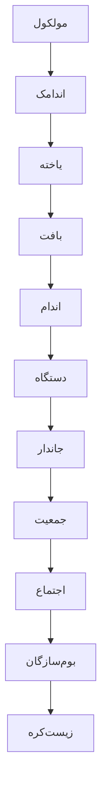
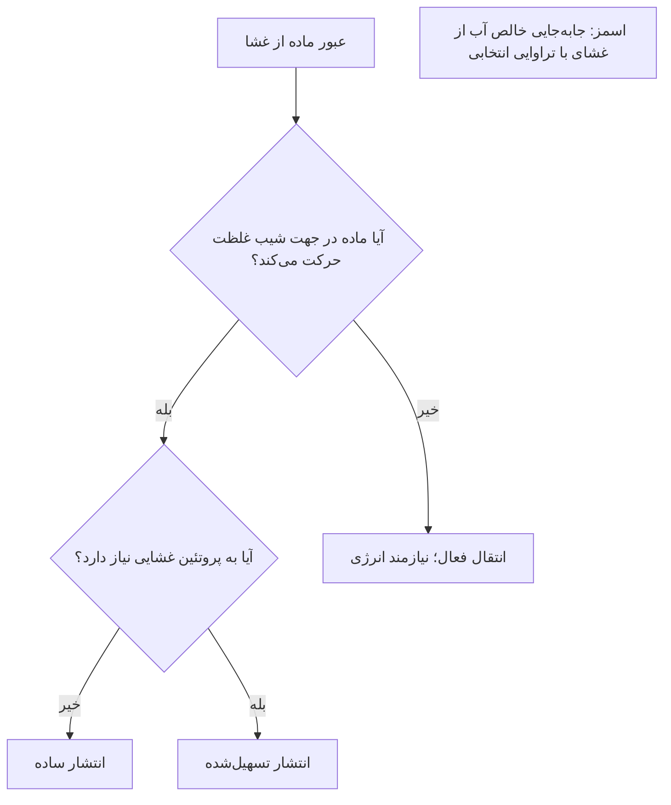

# یادگیری دیداری فصل ۱ زیست‌شناسی دهم — دنیای زنده

> **نوع محتوا:** نمودارهای متنیِ تألیفی برای یادگیری و مرور  
> **پایه و فصل:** دهم، فصل ۱  
> **وضعیت:** پیش‌نویس آموزشی؛ نیازمند بازبینی دبیر  
> **حقوق:** نمودارها از نو طراحی شده‌اند و تصویر کتاب درسی را بازتولید نمی‌کنند.

## ۱. از جزء تا کل: سطوح سازمان‌یابی حیات

این نمودار، رابطهٔ سازمان‌یابی را به‌صورت ساده نشان می‌دهد. در سطوح بوم‌شناختی، «جمعیت» به افراد یک گونه در یک محدوده، «اجتماع» به جمعیت‌های گونه‌های مختلف و «بوم‌سازگان» به اجتماع همراه با عوامل غیرزنده اشاره دارد.

**نکتهٔ مفهومی:** این زنجیره یک نقشهٔ آموزشیِ کلی است؛ همهٔ جانداران بافت، اندام یا دستگاه ندارند. برای نمونه، جانداران تک‌یاخته‌ای در سطح یاخته، یک جاندار کامل‌اند.

### تمایز سه سطح بوم‌شناختی

| سطح | چه چیزهایی را شامل می‌شود؟ | مثال جنگل |
|---|---|---|
| جمعیت | افراد یک گونه | همهٔ بلوط‌های یک محدوده |
| اجتماع | جمعیت‌های گونه‌های گوناگون | بلوط‌ها، پرندگان، حشرات و قارچ‌ها |
| بوم‌سازگان | اجتماع + عوامل غیرزنده و برهم‌کنش‌ها | جانداران به‌همراه آب، خاک، نور و دما |

## ۲. راه‌های عبور مواد از غشای یاخته

**راهنمای تشخیص:**

- **انتشار ساده:** حرکت خالص ذرات در جهت شیب غلظت، بدون مصرف مستقیم انرژی و بدون کمک پروتئین ناقل.
- **انتشار تسهیل‌شده:** حرکت در جهت شیب غلظت با کمک پروتئین غشایی؛ استفاده از پروتئین به‌تنهایی به معنی انتقال فعال نیست.
- **انتقال فعال:** جابه‌جایی ماده برخلاف شیب غلظت یا شیب الکتروشیمیایی با صرف انرژی.
- **اسمز:** حرکت خالص آب از غشای با تراوایی انتخابی؛ در مقایسهٔ دو محلول، آب به‌طور خالص به‌سمت محلول با غلظت بیشتر مواد حل‌شده حرکت می‌کند.

> نکته: نمودار، تصمیم‌گیری ساده‌شده برای دسته‌بندی فرایندهای پایه است. در بررسی‌های دقیق‌تر باید نوع ماده، ویژگی غشا و شیب الکتروشیمیایی نیز در نظر گرفته شود.

## ۳. از یاخته تا بافت و اندام

**مثال:** یاخته‌های ماهیچه‌ای در ساخت بافت ماهیچه‌ای مشارکت می‌کنند؛ بافت ماهیچه‌ای در کنار بافت‌های دیگر بخشی از اندام‌هایی مانند قلب را می‌سازد.

## ۴. چهار گروه اصلی بافت جانوری

| نوع بافت | نقش‌های شاخص | نمونه |
|---|---|---|
| پوششی | پوشاندن سطح‌ها، حفاظت و در برخی نواحی جذب یا ترشح | پوشش سطح بدن و پوشش درونی لولهٔ گوارش |
| پیوندی | اتصال، پشتیبانی، ذخیره یا انتقال | استخوان، غضروف، چربی و خون |
| ماهیچه‌ای | انقباض و ایجاد نیرو و حرکت | ماهیچهٔ اسکلتی و ماهیچهٔ قلبی |
| عصبی | دریافت، پردازش و انتقال پیام | مغز، نخاع و عصب |

## ۵. چک‌لیست خواندن شکل در آزمون

1. عنوان و زیرنویس شکل را بخوان.
2. اجزا و برچسب‌ها را یکی‌یکی مشخص کن.
3. جهت پیکان‌ها و ترتیب مراحل را بررسی کن.
4. رابطهٔ ساختار و کارکرد را توضیح بده.
5. از شکل نتیجه‌ای فراتر از اطلاعات داده‌شده نگیر.

## منبع و یادداشت ویرایشی

- کتاب مبنا: زیست‌شناسی (۱)، پایه دهم، کد ۱۱۰۲۱۶؛ نسخهٔ در دسترس با مشخصات «چاپ دهم، ۱۴۰۴».
- مرجع دریافت و تطبیق نسخهٔ رسمی: [پایگاه کتاب‌های درسی](https://chap.sch.ir/).
- نمودارها و جدول‌های این صفحه تألیفی‌اند؛ شمارهٔ صفحهٔ کتاب برای هر شکل باید پس از تطبیق با فایل رسمیِ سال تحصیلی مورد استفاده درج شود.
