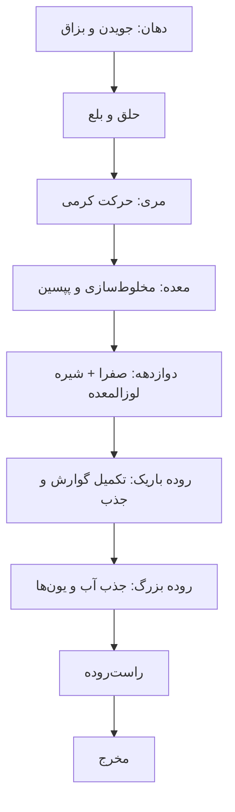
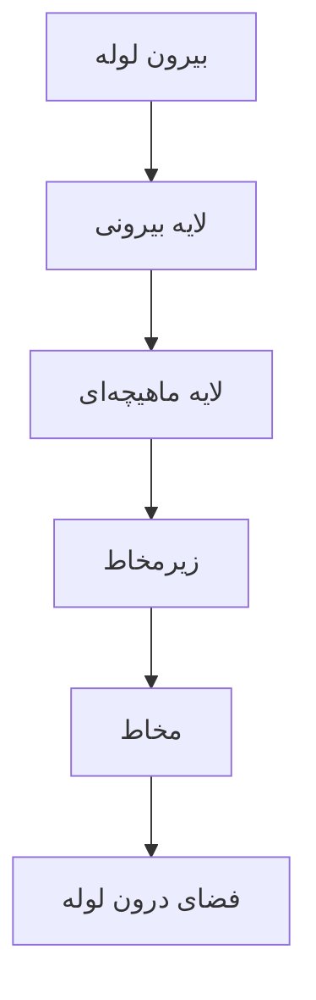
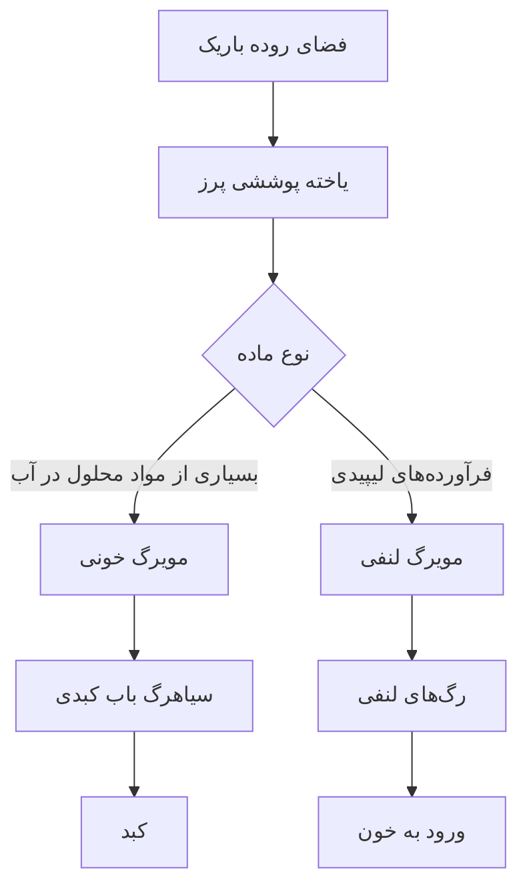
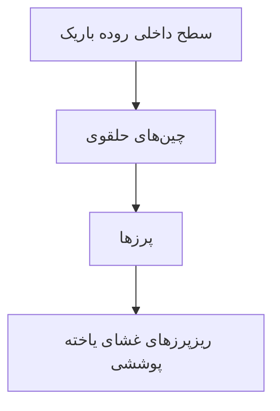
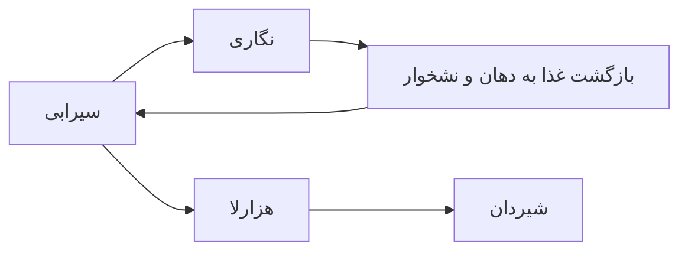

# راهنمای دیداری فصل ۲ زیست دهم — گوارش و جذب مواد

> نمودارها و جدول‌های این صفحه تألیفی‌اند و برای یادگیری روابط و مسیرها طراحی شده‌اند. برای جزئیات شکل‌های رسمی، چاپ یازدهم ۱۴۰۵ کتاب زیست‌شناسی (۱) را ببینید.

## ۱. مسیر عبور غذا

## ۲. چهار لایهٔ دیوارهٔ لولهٔ گوارش

به خاطر بسپارید: ترتیب از بیرون به داخل است. در بیشتر بخش‌ها لایهٔ ماهیچه‌ای شامل حلقوی و طولی است؛ معده یک لایهٔ مورب هم دارد.

## ۳. مقایسهٔ حرکت‌ها

| ویژگی | حرکت کرمی | حرکت قطعه‌قطعه‌کننده |
|---|---|---|
| الگو | موج انقباضی در امتداد لوله | انقباض‌های متناوب در قطعات |
| اثر اصلی | پیش‌راندن محتویات | مخلوط‌سازی و خردشدن بیشتر |
| نکته | در برخورد به بنداره می‌تواند مخلوط‌سازی کند | تماس محتویات با مخاط و شیره‌ها را افزایش می‌دهد |

## ۴. ترشحات کلیدی

| منبع | ترشح / ماده | کارکرد شاخص |
|---|---|---|
| غده‌های بزاقی | بزاق و آمیلاز | مرطوب‌سازی و آغاز گوارش نشاسته |
| معده، یاخته‌های اصلی | پپسینوژن | پیش‌ساز پپسین |
| معده، یاخته‌های کناری | HCl و عامل داخلی | محیط اسیدی/فعال‌سازی پپسین؛ کمک به جذب B₁₂ |
| کبد | صفرا | امولسیون‌سازی چربی؛ فاقد آنزیم |
| لوزالمعده | شیرهٔ لوزالمعده | آنزیم‌های گوارشی و بیکربنات |
| رودهٔ باریک | شیرهٔ روده | کمک به تکمیل گوارش |

## ۵. مسیر جذب مواد

**یادآوری:** مسیر دقیق برخی مولکول‌ها جزئیات بیشتری دارد؛ این نمودار، مقایسهٔ آموزشی مسیر غالب را نشان می‌دهد.

## ۶. سطوح افزایش‌دهندهٔ سطح جذب

- چین حلقوی: چین‌خوردگی بزرگ دیواره.
- پرز: برجستگی بافتی انگشت‌مانند.
- ریزپرز: چین میکروسکوپی غشای یاختهٔ پوششی.

درون هر پرز، شبکهٔ مویرگی خونی و مویرگ لنفی وجود دارد.

## ۷. الگوهای گوارش در جانداران

| نمونه | ساختار | نوع/ویژگی گوارش |
|---|---|---|
| پارامسی | واکوئول غذایی و گوارشی | درون‌یاخته‌ای |
| هیدر | حفره با یک دهانه | ابتدا برون‌یاخته‌ای، سپس درون‌یاخته‌ای |
| کرم کدو | فاقد لولهٔ گوارش | جذب از سطح بدن |
| ملخ | لولهٔ گوارش تخصص‌یافته | چینه‌دان، پیش‌معده، معده و روده |
| پرندهٔ دانه‌خوار | چینه‌دان و سنگدان | ذخیره/نرم‌سازی و آسیاب مکانیکی |
| نشخوارکننده | معدهٔ چهارقسمتی | میکروب‌های همزیست در تجزیهٔ سلولز نقش دارند |

## ۸. معدهٔ نشخوارکنندگان

این نمودار شماتیک است؛ مسیر واقعی عبور غذا و بازگشت لقمه را با شکل کتاب تطبیق دهید.

## ۹. چک‌لیست تحلیل شکل در آزمون

- [ ] عنوان شکل و نوع برش/نمای دید را بخوان.
- [ ] سمت فضای داخلی لوله و سمت بیرونی را مشخص کن.
- [ ] ترتیب لایه‌ها را از بیرون به داخل بنویس.
- [ ] در پرز، مویرگ خونی را از مویرگ لنفی تشخیص بده.
- [ ] مسیر فلش‌ها را از مبدأ تا مقصد دنبال کن.
- [ ] ترشح هر اندام را با محل ورود آن به لوله مرتبط کن.
- [ ] در مقایسهٔ جانداران، تعداد دهانه‌ها و محل گوارش را بررسی کن.

## منابع و یادداشت

- کتاب زیست‌شناسی (۱)، کد ۱۱۰۲۱۶، چاپ یازدهم ۱۴۰۵، فصل ۲، به‌ویژه شکل‌های مربوط به دیوارهٔ لوله، حرکات، غده‌های معده، پرز روده و تنوع گوارش.
- فهرست منابع تکمیلی و تاریخ دسترسی: [منابع فصل ۲](../../../10-curated-resources/grade-10/chapter-02/sources.md).
