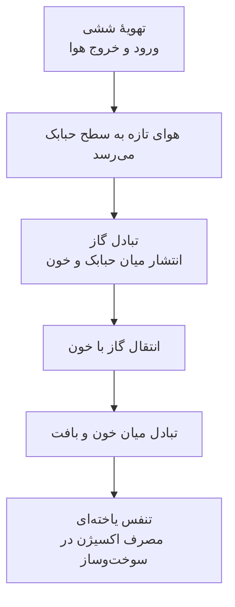
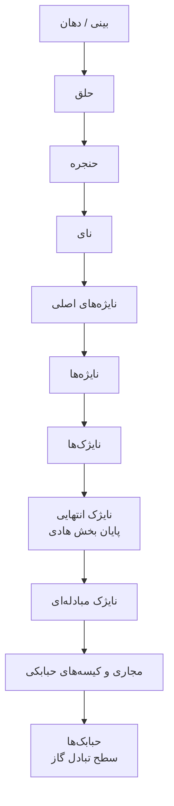
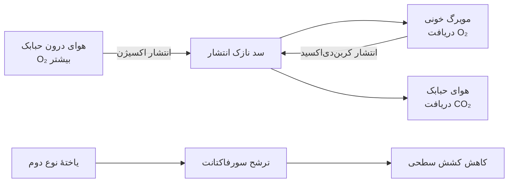
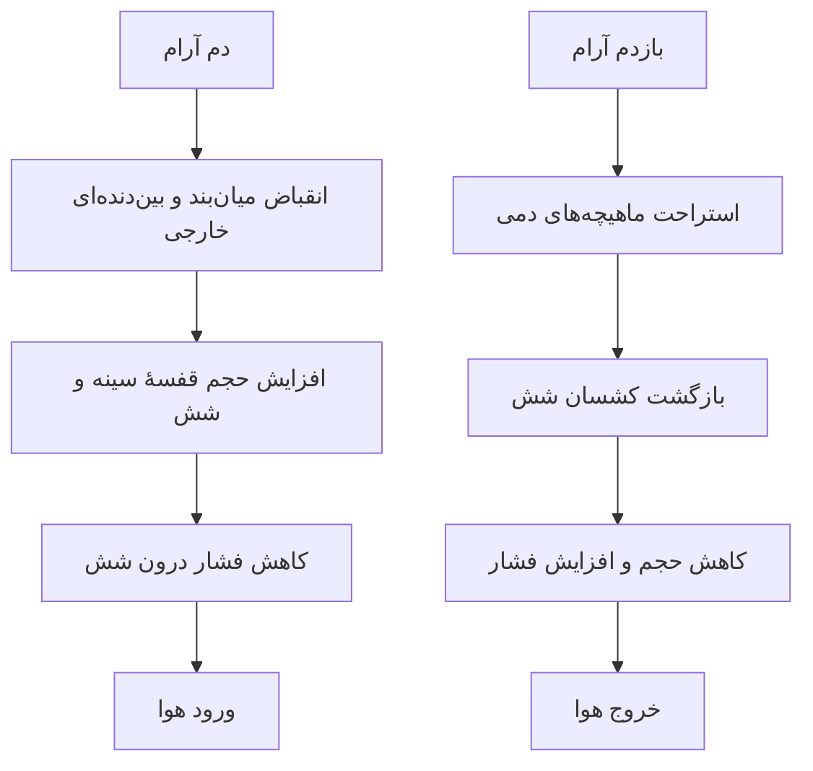
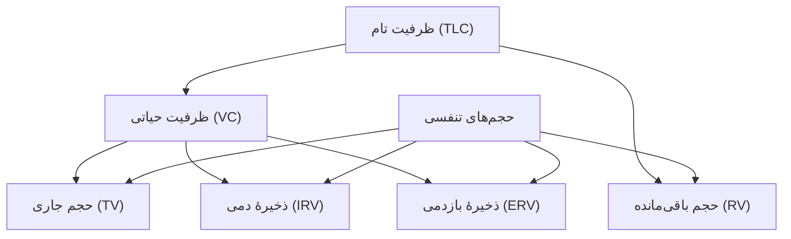

# راهنمای دیداری فصل ۳ زیست دهم: تبادلات گازی

> این راهنما شامل نمودارها و جدول‌های تألیفی است. برای شکل‌های کتاب، نسخهٔ رسمی همان سال را جداگانه بررسی کنید؛ هیچ تصویر کتاب یا ناشر دیگری در این صفحه بازنشر نشده است.

## ۱. سه فرایند را از هم جدا کن

**نکته:** این نمودار مسیر وابستگی فرایندها را نشان می‌دهد، نه اینکه همهٔ مراحل فقط در یک لحظه یا یک اندام رخ دهند.

## ۲. مسیر عبور هوا در انسان

| بخش هادی | بخش مبادله‌ای |
|---|---|
| هدایت هوا | تبادل گاز با خون |
| گرم و مرطوب کردن | سطح مرطوب و نازک |
| پاک‌سازی با مخاط و مژک | حبابک و مویرگ فراوان |
| تا نایژک انتهایی | از نایژک مبادله‌ای به بعد |

## ۳. بزرگ‌نمایی مفهومی حبابک

سه ویژگی را کنار هم به یاد بسپار: **سطح زیاد + سد نازک + مویرگ فراوان**. سورفاکتانت نیز به بازماندن حبابک‌ها کمک می‌کند.

## ۴. حمل گازها در خون

| گاز | شکل غالب انتقال | نکتهٔ کلیدی |
|---|---|---|
| اکسیژن | اتصال به هموگلوبین گویچهٔ قرمز | در بافت‌ها از هموگلوبین جدا می‌شود |
| کربن‌دی‌اکسید | یون بیکربنات | بخشی محلول یا متصل به هموگلوبین است |
| کربن‌مونوکسید | اتصال قوی به هموگلوبین | جایگاه اکسیژن را اشغال می‌کند؛ گازی سمی است |

**یادآوری:** CO₂ و CO را با هم اشتباه نکنید.

## ۵. دم و بازدم: زنجیرهٔ حجم و فشار

| ویژگی | دم آرام | بازدم آرام |
|---|---|---|
| میان‌بند | منقبض و مسطح‌تر | استراحت |
| حجم قفسهٔ سینه | افزایش | کاهش |
| فشار درون شش | کاهش | افزایش |
| جریان هوا | به داخل | به بیرون |
| ماهیت | فعال | عمدتاً غیرفعال |

## ۶. نقشهٔ حجم‌ها و ظرفیت‌ها

[
VC = TV + IRV + ERV
]

[
TLC = VC + RV
]

**دام آزمونی:** حجم باقی‌مانده در ظرفیت حیاتی نیست، اما در ظرفیت تام هست.

## ۷. روش‌های تبادل گاز در جانوران

| روش | نمونه | مسیر گاز | نقش گردش مواد |
|---|---|---|---|
| انتشار از سطح بدن | هیدر | محیط ↔ سطح بدن/یاخته | انتقال مستقیم در فاصله‌های کوتاه |
| نایدیسی | حشرات | منفذ تنفسی ← نایدیس ← نزدیکی یاخته | نقش اصلی حمل گاز را ندارد |
| پوستی | کرم خاکی | محیط ↔ پوست مرطوب ↔ مویرگ | در انتقال گاز نقش دارد |
| آبششی | ماهی | آب ↔ تیغه‌های آبششی ↔ خون | انتقال گاز با خون |
| ششی | انسان و قورباغه | هوا ↔ سطح شش ↔ خون | انتقال گاز با خون |

## ۸. مقایسهٔ جریان و تهویه در نمونه‌ها

- **حشره:** نایدیس‌ها تا نزدیک یاخته‌ها پیش می‌روند.
- **کرم خاکی:** سطح پوست باید مرطوب بماند و زیر آن مویرگ وجود دارد.
- **ماهی:** آب و خون در آبشش در جهت مخالف حرکت می‌کنند.
- **قورباغه:** تهویهٔ شش با فشار مثبت انجام می‌شود.
- **انسان:** تهویه با افزایش حجم قفسهٔ سینه و فشار منفی درون شش انجام می‌شود.
- **پرنده:** کیسه‌های هوادار به تهویه کمک می‌کنند؛ سطح تبادل در شش است.

## ۹. خطاهای دیداری پرتکرار

1. نایژک انتهایی را با نایژک مبادله‌ای اشتباه نکن.
2. حبابک را با کیسهٔ هوادار پرندگان یکی ندان.
3. فضای مرده را با حجم باقی‌مانده یکی ندان.
4. جهت انتشار اکسیژن و کربن‌دی‌اکسید در شش را برعکس نکن.
5. حرکت هوا در دم را نتیجهٔ «مکش فعال شش» به‌تنهایی ندان؛ تغییر حجم قفسهٔ سینه و فشار درون شش علت اصلی است.
6. در حشرات، نقش نایدیس‌ها را با انتقال گاز در خون مهره‌داران یکی ندان.

## توضیح جایگزین

این صفحه به صورت متنی توضیح می‌دهد: هوا از بینی یا دهان به حلق، حنجره، نای و شاخه‌های آن می‌رسد؛ بخش هادی هوا را آماده می‌کند و بخش حبابکی تبادل را انجام می‌دهد. اکسیژن وارد خون و عمدتاً به هموگلوبین متصل می‌شود؛ کربن‌دی‌اکسید عمدتاً به شکل بیکربنات حمل می‌شود. دم با افزایش حجم قفسهٔ سینه و کاهش فشار درون شش همراه است؛ بازدم آرام عمدتاً با بازگشت کشسان رخ می‌دهد. روش‌های تبادل در جانوران شامل انتشار سطحی، نایدیسی، پوستی، آبششی و ششی است.

## منبع و بازبینی

محتوا به زبان مستقل بر پایهٔ ساختار فصل کتاب درسی و منابع فهرست‌شده در [منابع فصل ۳](../../../10-curated-resources/grade-10/chapter-03/sources.md) تهیه شده است. نمودارها بازنمایی مفهومی تألیفی‌اند و جایگزین شکل‌های رسمی کتاب نیستند.
