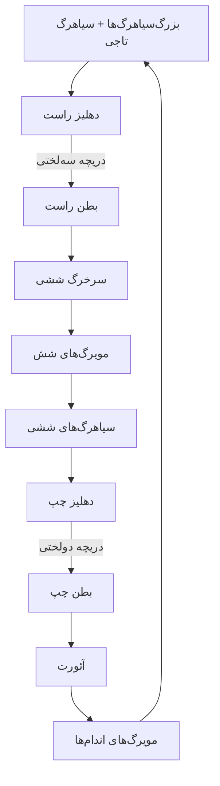
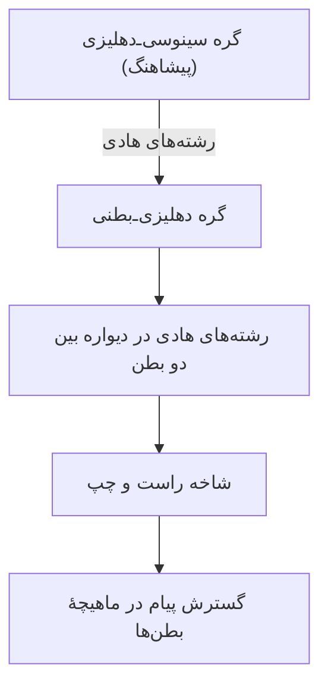
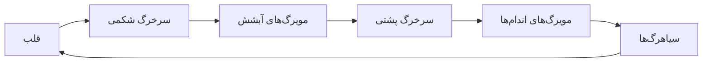

# راهنمای دیداری فصل ۴ — گردش مواد در بدن

این صفحه برای خواندن شکل‌ها و ردیابی مسیرهاست؛ در تست‌های ترکیبی، فلش و محل اتصال رگ گاهی از حفظ‌کردن یک پاراگراف مهم‌تر است.

## ۱) مسیر خون در قلب انسان


**دو استثنای رنگی را فراموش نکن:** سرخرگ ششی خون کم‌اکسیژن را از قلب خارج می‌کند؛ سیاهرگ ششی خون پر‌اکسیژن را به قلب بازمی‌گرداند. اسم رگ را جهت جریان تعیین می‌کند، نه رنگ خون.

## ۲) چهار دریچه؛ چهار جایگاه
| جایگاه | نام | در چه رویدادی بسته می‌شود؟ |
|---|---|---|
| دهلیز راست ـ بطن راست | سه‌لختی | آغاز انقباض بطن |
| دهلیز چپ ـ بطن چپ | دولختی | آغاز انقباض بطن |
| ابتدای سرخرگ ششی | سینی ششی | آغاز استراحت بطن |
| ابتدای آئورت | سینی آئورتی | آغاز استراحت بطن |

## ۳) لایه‌های قلب؛ از داخل به خارج
```
خون داخل حفره
    ↓
درون‌شامه (داخلی؛ مشارکت در دریچه)
    ↓
میان‌شامه / ماهیچه قلب (میانی؛ ضخیم‌ترین)
    ↓
برون‌شامه (بیرونیِ دیواره)
    ↓
فضای دارای مایع
    ↓
پیراشامه (پوشش پیرامونی)
```

## ۴) شبکهٔ هادی؛ مسیر پیام

مکان‌یابی:
- SA: دیوارهٔ پشتی دهلیز راست، زیر منفذ بزرگ‌سیاهرگ زبرین.
- AV: دیوارهٔ پشتی دهلیز راست، عقب دریچهٔ سه‌لختی.
- بین ماهیچهٔ دهلیز و بطن بافت پیوندی عایق وجود دارد.

## ۵) چرخهٔ قلبی
| مرحله | مدت تقریبی | رخداد کلیدی |
|---|---:|---|
| استراحت عمومی | ۰٫۴ ثانیه | ورود خون سیاهرگی به دهلیزها |
| انقباض دهلیزی | ۰٫۱ ثانیه | تکمیل پرشدن بطن‌ها |
| انقباض بطنی | ۰٫۳ ثانیه | خروج خون به سرخرگ‌ها |
| **کل چرخه** | **۰٫۸ ثانیه** | **۶۰ ÷ ۰٫۸ = ۷۵ ضربان در دقیقه** |

نوار قلب: P = فعالیت الکتریکی دهلیزها؛ QRS = فعالیت الکتریکی بطن‌ها؛ T = بازگشت بطن‌ها به حالت استراحت.

## ۶) دیوارهٔ رگ‌ها
| رگ | لایهٔ داخلی | لایهٔ میانی | ویژگی کلیدی |
|---|---|---|---|
| سرخرگ | بافت پوششی + غشای پایه | ماهیچه صاف و کشسانی بیشتر | ضخیم، تحمل فشار، نبض |
| مویرگ | یک لایه بافت پوششی + غشای پایه | ندارد | تبادل |
| سیاهرگ | بافت پوششی + غشای پایه | نازک‌تر | حفره بزرگ‌تر، دریچه در بسیاری از آن‌ها |

## ۷) سه نوع مویرگ
| نوع | طرح ذهنی دیواره | نمونه |
|---|---|---|
| پیوسته | اتصالات نزدیک و پیوسته | دستگاه عصبی مرکزی |
| منفذدار | منافذ در یاخته‌ها، غشای پایه ضخیم | کلیه |
| ناپیوسته | حفره‌های بین یاخته‌ای، غشای پایه ناقص | جگر |

**دام:** در مویرگ منفذدار، وجود منفذ به معنی عبور آزاد پروتئین‌های درشت نیست؛ غشای پایهٔ ضخیم عبور آن‌ها را محدود می‌کند.

## ۸) تبادل در مویرگ
```
ابتدای سرخرگی مویرگ:
فشار خون > فشار اسمزی
→ خروج بخشی از خوناب به مایع میان‌بافتی

در طول مویرگ:
فشار خون کاهش می‌یابد

انتهای سیاهرگی مویرگ:
فشار اسمزی > فشار خون
→ بازگشت آب و مواد به مویرگ
```
اختلال در بازگشت مایع می‌تواند به ادم/خیز منجر شود.

## ۹) بازگشت وریدی
سه کمک را کنار هم به خاطر بسپار:
1. انقباض ماهیچه‌های اسکلتی اطراف سیاهرگ؛
2. دریچه‌های لانه‌کبوتری برای جلوگیری از برگشت؛
3. فشار مکشی قفسهٔ سینه هنگام دم.

## ۱۰) مقایسهٔ سامانه‌های گردش مواد
| جاندار | سازوکار | رگ/مویرگ | نکته |
|---|---|---|---|
| تک‌یاخته‌ای | انتشار از سطح یاخته | ندارد | تبادل مستقیم با محیط |
| اسفنج | جریان آب | سامانهٔ خونی ندارد | یاختهٔ یقه‌دار تاژک‌دار |
| هیدر | حفرهٔ گوارشی | سامانهٔ خونی ندارد | گوارش + گردش مواد |
| پلاناریا | حفرهٔ گوارشی منشعب | سامانهٔ خونی ندارد | انشعابات نزدیک یاخته‌ها |
| ملخ | گردش باز | مویرگ ندارد | همولنف وارد فضای بدن می‌شود |
| کرم خاکی | گردش بسته | رگ و مویرگ دارد | تبادل با مایع میان‌بافتی |
| ماهی | گردش بسته، ساده | دارد | قلب دوحفره‌ای |
| دوزیست بالغ | گردش بسته، مضاعف | دارد | دو دهلیز، یک بطن |
| پرنده/پستاندار | گردش بسته، مضاعف | دارد | قلب چهارحفره‌ای |

## ۱۱) نمودار مسیر ماهی

در یک دور، خون یک بار از قلب می‌گذرد؛ پس گردش ساده است.

## چک‌لیست خواندن شکل
- [ ] سمت راست و چپ قلب را از دید خود شکل تشخیص داده‌ام، نه از سمت بدن خودم.
- [ ] هر رگ را بر اساس جهت نسبت به قلب نام‌گذاری کرده‌ام.
- [ ] محل هر دریچه را با حفره/سرخرگ مجاور تطبیق داده‌ام.
- [ ] گره SA و AV را جابه‌جا نکرده‌ام.
- [ ] در نمودار مویرگ، سرخرگی و سیاهرگی را از جهت جریان تشخیص داده‌ام.
- [ ] در گردش ماهی، بازگشت به قلب بین آبشش و اندام‌ها اضافه نکرده‌ام.

> شوخی کوتاه: اگر فلش شکل را برعکس بخوانی، قلبت هنوز کار می‌کند؛ اما گزینه‌ات احتمالاً نه!
