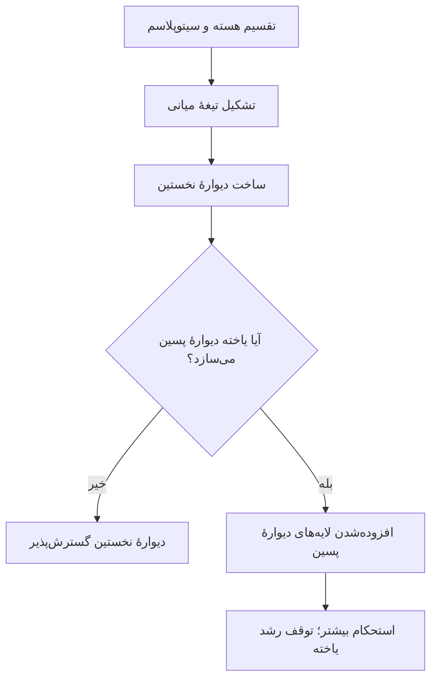
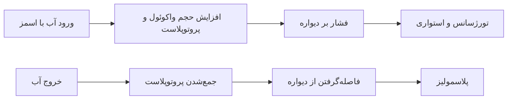
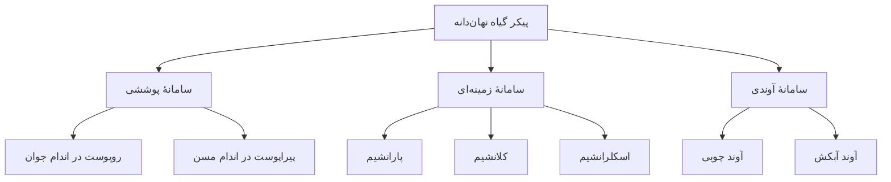
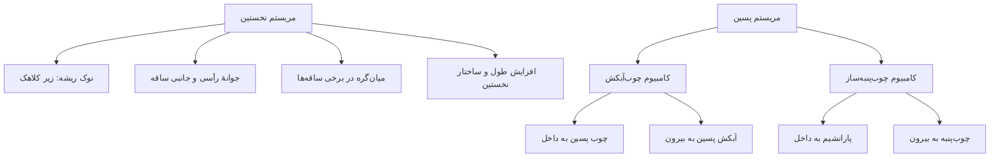
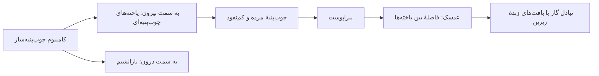

# راهنمای دیداری فصل ۶ زیست دهم — از یاخته تا گیاه

> این راهنما برای بازسازی شکل‌ها از حافظه نیست؛ برای خواندن دقیق شکل کتاب و اتصال برچسب‌ها به عملکرد است. طرح‌ها شماتیک و تألیفی‌اند.

## ۱) لایه‌های دیوارهٔ یاخته‌ای

| لایه | مادهٔ شاخص | نکتهٔ شکل |
|---|---|---|
| تیغهٔ میانی | پکتین | بین دو یاخته؛ نقش چسباننده |
| دیوارهٔ نخستین | پکتین و سلولز | گسترش‌پذیر |
| دیوارهٔ پسین | لایه‌های سلولزی متراکم | لایه‌ها نسبت به هم زاویه دارند؛ مانع رشد |

**دو برچسبی که قاطی می‌شوند:** لانه = ناحیهٔ نازک دیواره؛ پلاسمودسم = کانال ارتباطی سیتوپلاسمی در دیواره.

## ۲) تورژسانس در برابر پلاسمولیز

| وضعیت | جهت خالص آب | شکل پروتوپلاست | پیامد |
|---|---|---|---|
| تورژسانس | ورود به یاخته | حجیم و فشرده به دیواره | استواری اندام غیرچوبی |
| پلاسمولیز | خروج از یاخته | جمع‌شده و جدا از دیواره | پژمردگی؛ حالت طولانی می‌تواند مرگ یاخته را در پی داشته باشد |

## ۳) محل ذخیره و رنگ: واکوئول یا دیسه؟

| ساختار | ماده/رنگ | مثال |
|---|---|---|
| واکوئول | آنتوسیانین | کلم بنفش، چغندر قرمز |
| واکوئول | پروتئین ذخیره‌ای مانند گلوتن | گندم و جو |
| سبزدیسه | سبزینه | بافت سبز |
| رنگ‌دیسه | کاروتنوئید، مانند کاروتن | هویج نارنجی |
| نشادیسه | نشاسته | سیب‌زمینی |

نکته: رنگ قرمز یا بنفشِ آنتوسیانینی با رنگ نارنجیِ کاروتنوئیدی یک منشأ یاخته‌ای ندارد.

## ۴) سه سامانهٔ بافتی گیاه

| سامانه | جایگاه کلی | وظیفهٔ شاخص | برچسب‌های مهم |
|---|---|---|---|
| پوششی | سطح اندام | حفاظت و کاهش اتلاف آب | روپوست، پوستک، روزنه، کرک، تار کشنده |
| زمینه‌ای | بین روپوست و آوند | پرکردن، ذخیره، فتوسنتز، استحکام | پارانشیم، کلانشیم، اسکلرانشیم |
| آوندی | دسته‌های انتقالی | جابه‌جایی مواد | چوب و آبکش، فیبر و پارانشیم همراه |

## ۵) مقایسهٔ سه بافت زمینه‌ای

| ویژگی | پارانشیم | کلانشیم | اسکلرانشیم |
|---|---|---|---|
| دیوارهٔ شاخص | نخستین نازک | نخستین ضخیم | پسین ضخیم و چوبی |
| پروتوپلاست بالغ | زنده | زنده | مرده |
| رشد اندام | در ترمیم و فعالیت‌های زنده مشارکت دارد | مانع رشد نیست | سخت و استحکامی |
| سرنخ آزمونی | ذخیره، فتوسنتز، ترمیم | استحکام انعطاف‌پذیر | لیگنین، اسکلرئید، فیبر |

- پارانشیم: رایج‌ترین بافت زمینه‌ای؛ دیوارهٔ نازک و چوبی‌نشده.
- کلانشیم: معمولاً زیر روپوست؛ دیوارهٔ نخستین ضخیم و بدون دیوارهٔ پسین.
- اسکلرانشیم: اسکلرئید کوتاه؛ فیبر دراز؛ سختی دانه‌مانند گلابی.

## ۶) آوند چوبی و آبکش

| ویژگی | آوند چوبی | آوند آبکش |
|---|---|---|
| یاختهٔ اصلی انتقالی | تراکئید یا عنصر آوندی | یاختهٔ لولهٔ آبکش |
| وضعیت زنده‌بودن | مرده | زنده |
| هسته | ندارد؛ پروتوپلاست از بین رفته | ندارد؛ سیتوپلاسم باقی است |
| دیواره | چوبی‌شده با لیگنین | نخستین سلولزی |
| نشانهٔ ساختاری | عناصر آوندی با حذف دیوارهٔ عرضی، لولهٔ پیوسته می‌سازند | صفحهٔ آبکشی؛ یاختهٔ همراه در نهان‌دانگان |

**دام:** بی‌هسته‌بودن به‌تنهایی معیار مرگ نیست. سرنوشت پروتوپلاست را هم بررسی کن.

## ۷) مریستم نخستین و پسین

| ساختار | محل/محصول | نتیجه |
|---|---|---|
| مریستم نوک ریشه | نزدیک انتها و زیر کلاهک | رشد طولی ریشه |
| جوانهٔ رأسی | انتهای ساقه | رشد طولی و برگ/شاخهٔ جدید |
| جوانهٔ جانبی | کنار ساقه | شاخه‌زایی |
| کامبیوم چوب‌آبکش | بین چوب و آبکش نخستین | چوب پسین داخل؛ آبکش پسین خارج |
| کامبیوم چوب‌پنبه‌ساز | در زمینهٔ ساقه و ریشه | پارانشیم داخل؛ چوب‌پنبه خارج؛ تشکیل پیراپوست |

## ۸) پیراپوست و عدسک

چوب‌پنبهٔ لیپیدی و کم‌نفوذ، مانع عبور آب و گازهاست؛ عدسک مسیر تبادل گاز را فراهم می‌کند. در شکل، عدسک را با روزنه اشتباه نگیرید.

## ۹) سازش ساختاری با محیط

| محیط/نمونه | مسئله | سازش ساختاری | اثر |
|---|---|---|---|
| خشک — خرزهره | اتلاف آب | پوستک ضخیم؛ روزنهٔ فرورفته؛ کرک | حفظ رطوبت پیرامون روزنه و کاهش تبخیر |
| خشک — برخی گیاهان | کمبود آب | پلی‌ساکاریدهای واکوئولی | جذب و ذخیرهٔ آب |
| آبزی | کمبود اکسیژن در اندام غوطه‌ور | پارانشیم هوادار | فضاهای هوایی فراوان |
| حرا | کمبود اکسیژن در گل و آب | شش‌ریشه بیرون‌زده از سطح آب | جذب اکسیژن |

## ۱۰) چک‌لیست شکل‌خوانی کنکور
- [ ] در شکل دیواره، تیغهٔ میانی را از دیوارهٔ نخستین و پسین جدا کردم.
- [ ] لانه را با پلاسمودسم یکی نگرفتم.
- [ ] در شکل تورژسانس/پلاسمولیز، جهت آب و جایگاه پروتوپلاست را هم‌زمان خواندم.
- [ ] رنگ هویج، کلم بنفش و سیب‌زمینی را به ساختار درست نسبت دادم.
- [ ] سه سامانهٔ بافتی را از روی جایگاه تشخیص دادم.
- [ ] در مقایسهٔ چوب و آبکش، زنده‌بودن و وجود هسته را جداگانه سنجیدم.
- [ ] جهت تولیدات هر کامبیوم را از «داخل/خارج» مشخص کردم.
- [ ] عدسک، روزنه و شش‌ریشه را از نظر محل و عملکرد تفکیک کردم.

**نکتهٔ آزمونی:** شکل‌های برش عرضی ریشه و ساقهٔ تک‌لپه و دولپه را عیناً از کتاب خود مرور کن؛ در این راهنما جایگزین تصویری آن‌ها ساخته نشده است.
