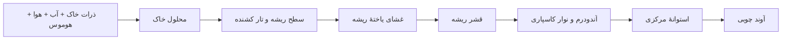
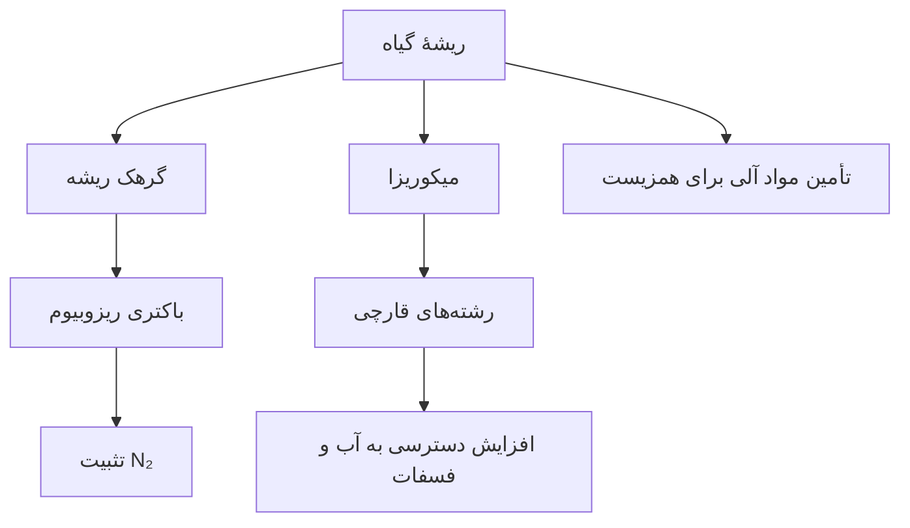
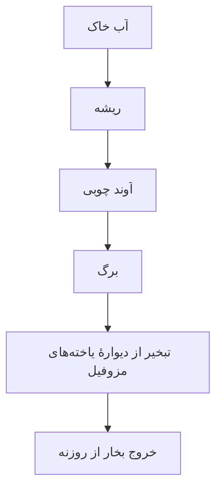
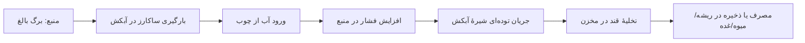

# راهنمای دیداری فصل ۷ — جذب و انتقال مواد در گیاهان

## ۱) از خاک تا یاختهٔ ریشه

**نکتهٔ شکل‌خوانی:** تار کشنده سطح تماس را افزایش می‌دهد؛ نوار کاسپاری در آندودرم مسیر آپوپلاستی را می‌بندد و عبور غشایی را ضروری می‌کند.

## ۲) دو مسیر شعاعی آب
| ویژگی | آپوپلاستی | سیمپلاستی |
|---|---|---|
| مسیر | دیواره و فضای بین‌یاخته‌ای | سیتوپلاسم یاخته‌ها |
| عبور اولیه از غشا | برای ورود به مسیر لازم نیست | لازم است |
| اتصال بین یاخته‌ها | ندارد؛ مسیر دیواره‌ای | پلاسمودسم |
| اثر نوار کاسپاری | مسدود می‌شود | از مسیر سیتوپلاسمی عبور می‌کند |

## ۳) نیتروژن: سه مفهوم که نباید قاطی شوند
| فرایند | مادهٔ آغازین | نتیجه/نقش |
|---|---|---|
| تثبیت نیتروژن | N₂ هوا | تبدیل به ترکیبات نیتروژنی به‌وسیلهٔ برخی پروکاریوت‌ها |
| جذب نیترات | یون NO₃⁻ محلول خاک | ورود یون به ریشه |
| جذب آمونیوم | یون NH₄⁺ محلول خاک | ورود یون به ریشه |

## ۴) همزیستی‌ها

**دام:** میکوریزا را به تثبیت نیتروژن نسبت ندهید؛ نقش شاخص آن افزایش جذب آب و یون‌ها، به‌ویژه فسفات است.

## ۵) مسیر آب در گیاه

تعرق در برگ، کشش ایجاد می‌کند؛ هم‌چسبی آب پیوستگی ستون را حفظ می‌کند و دگرچسبی به دیوارهٔ چوب کمک می‌کند.

## ۶) باز و بسته‌شدن روزنه
| وضعیت یاختهٔ نگهبان | وضعیت روزنه | پیامد معمول |
|---|---|---|
| تورژسانس بیشتر | بازتر | ورود CO₂ و خروج بخار آب بیشتر |
| تورژسانس کمتر | بسته‌تر | کاهش خروج آب و محدودشدن ورود CO₂ |

عوامل محیطی را تک‌به‌تک و با توجه به وضعیت آب گیاه تحلیل کنید؛ اثر باد یا دما می‌تواند با بسته‌شدن روزنه در شرایط تنش آبی تعدیل شود.

## ۷) انتقال در آبکش: منبع به مخزن

منبع و مخزن نقش‌اند، نه اندام‌های ثابت. یک برگ در زمان فتوسنتز منبع است؛ اندام ذخیره‌ای هنگام آزادسازی ذخیره نیز می‌تواند منبع شود.

## ۸) مقایسهٔ نهایی چوب و آبکش
| ویژگی | آوند چوبی | آوند آبکش |
|---|---|---|
| محمولهٔ اصلی | آب و مواد معدنی | قندها و مواد آلی |
| نیروی شاخص | کشش تعرقی | اختلاف فشار |
| یاختهٔ رسانا در بلوغ | مرده | زنده، بی‌هسته |
| جهت کلی | رو به بالا از ریشه | منبع به مخزن |

## ۹) چک‌لیست شکل‌خوانی کنکور
- [ ] نوار کاسپاری را در آندودرم پیدا می‌کنم.
- [ ] مسیر آپوپلاستی را از سیمپلاستی تشخیص می‌دهم.
- [ ] پیکان آب را از خاک تا چوب و سپس برگ دنبال می‌کنم.
- [ ] منبع و مخزن را از روی وضعیت تولید/مصرف قند تعیین می‌کنم.
- [ ] جهت انتقال آبکش را بدون فرض «همیشه بالا» یا «همیشه پایین» استنتاج می‌کنم.

*تمام نمودارها شماتیک و تألیفی‌اند و جایگزین شکل‌های رسمی کتاب نیستند.*
