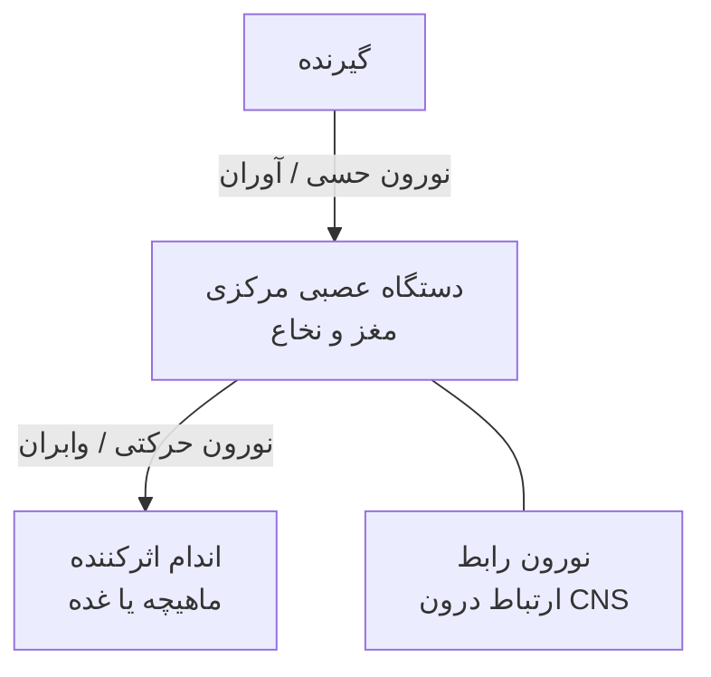
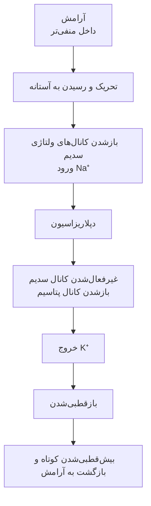
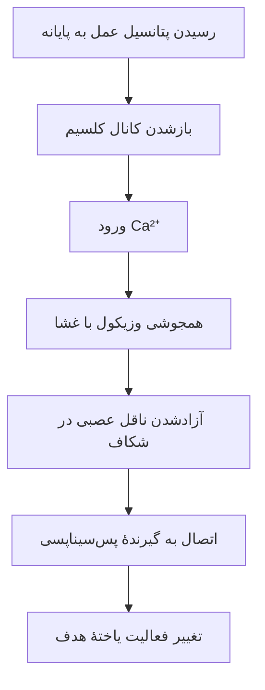
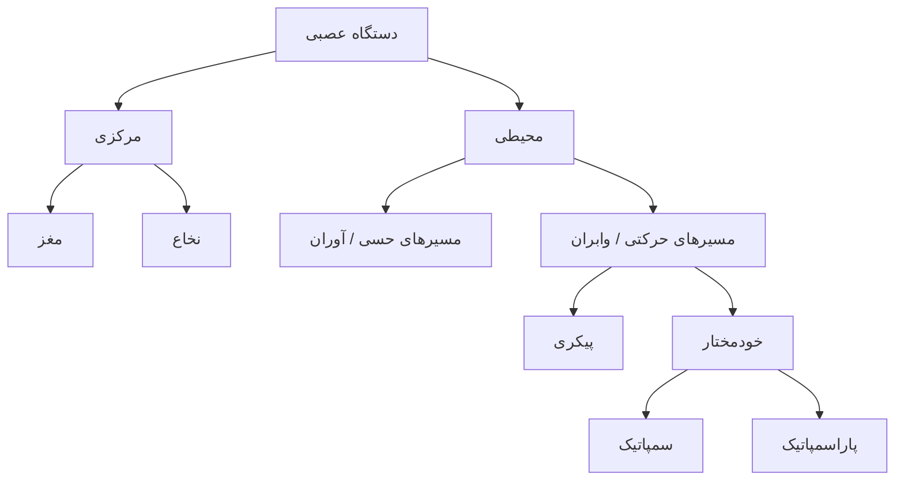

# راهنمای دیداری فصل ۱ زیست‌شناسی یازدهم — تنظیم عصبی

> نمودارها و جدول‌های این صفحه تألیفی‌اند و برای یادگیری طراحی شده‌اند؛ جایگزین شکل‌های کتاب درسی نیستند. شمارهٔ شکل و صفحهٔ کتاب را فقط پس از تطبیق با چاپ رسمی همان سال اضافه کنید.

## ۱. مسیر معمول پیام در یک نورون

**دام شکل‌خوانی:** پیکان مسیر معمول انتقال اطلاعات را نشان می‌دهد؛ شکل نورون‌ها و محل دریافت پیام در همهٔ انواع نورون‌ها یکسان نیست.

## ۲. مقایسهٔ نورون‌ها بر اساس جهت پیام

- آوران: اطلاعات را به مرکز می‌آورد.
- وابران: فرمان را از مرکز به اثرکننده می‌برد.
- رابط: ارتباط نورونی و پردازش را در CNS برقرار می‌کند.

## ۳. میلین و گره‌های رانویه

| آسهٔ بدون میلین | آسهٔ میلین‌دار |
|---|---|
| تغییر ولتاژ در بخش‌های مجاور غشا پیوسته پیش می‌رود | پتانسیل عمل در گره‌ها بازتولید می‌شود |
| هدایت پیوسته | هدایت جهشی |
| معمولاً کندتر | معمولاً سریع‌تر |

**نکتهٔ دقیق:** پیام واقعاً از فضای خالی «نمی‌پرد». جریان موضعی در زیر میلین، ناحیهٔ گرهٔ بعدی را به آستانه می‌رساند.

## ۴. پتانسیل آرامش: چه چیزی کجا بیشتر است؟

| مورد | داخل نورون | بیرون نورون |
|---|---|---|
| سدیم (Na⁺) | کمتر | بیشتر |
| پتاسیم (K⁺) | بیشتر | کمتر |
| بار نسبی در حالت آرامش | منفی‌تر | مثبت‌تر |

پمپ سدیم ـ پتاسیم در هر چرخه با مصرف ATP، **۳ Na⁺ را بیرون** و **۲ K⁺ را داخل** می‌برد. کانال‌های نشت پتاسیم و نفوذپذیری انتخابی غشا نیز در پتانسیل آرامش نقش مهم دارند.

## ۵. توالی پتانسیل عمل

**رمز کوتاه:** سدیم داخل می‌آید و غشا را کمتر منفی می‌کند؛ پتاسیم خارج می‌شود و غشا را دوباره منفی می‌کند.

## ۶. سیناپس شیمیایی در شش گام

**دام:** کلسیم محرک مهم آزادسازی ناقل از پایانهٔ پیش‌سیناپسی است؛ ناقل عصبی سپس به گیرندهٔ پس‌سیناپسی متصل می‌شود.

## ۷. نقشهٔ سازمان دستگاه عصبی

## ۸. قوس انعکاسی

**نکته:** مسیر ساده‌شده است. در بسیاری از انعکاس‌ها نورون رابط وجود دارد؛ در برخی مدارها ارتباط حسی و حرکتی می‌تواند مستقیم‌تر باشد.

## ۹. حفاظت از مغز و نخاع

از خارج به داخل:

1. استخوان: جمجمه یا ستون مهره
2. سخت‌شامه
3. عنکبوتیه
4. فضای زیرعنکبوتیه و مایع مغزی ـ نخاعی
5. نرم‌شامه
6. بافت عصبی مرکزی

مننژ سه پرده است، نه سه استخوان. مایع مغزی ـ نخاعی نقش ضربه‌گیر دارد.

## ۱۰. دام‌های شکل‌محور

- گرهٔ رانویه را با قطعهٔ میلین اشتباه نکن.
- جهت آوران و وابران را نسبت به CNS تعیین کن.
- در پمپ، ۳ سدیم خارج و ۲ پتاسیم داخل می‌رود.
- ورود Na⁺ با دپلاریزاسیون و خروج K⁺ با بازقطبی‌شدن پیوند دارد.
- در سیناپس شیمیایی، پیش‌سیناپسی ناقل آزاد می‌کند و پس‌سیناپسی گیرنده دارد.
- مخچه را با بصل‌النخاع یکی ندان: هماهنگی و تعادل در برابر تنظیم برخی کارکردهای حیاتی.

## منابع

- [کتاب رسمی درسی — پایگاه کتاب‌های درسی](https://chap.sch.ir/)
- [OpenStax Biology — How Neurons Communicate](https://openstax.org/books/biology/pages/35-2-how-neurons-communicate)
- [دفتر انتشارات رشد — تشریح مباحث فصل تنظیم عصبی](https://samanketab.roshdmag.ir/fa/article/24527/%D8%AA%D8%B4%D8%B1%DB%8C%D8%AD-%D9%85%D8%A8%D8%A7%D8%AD%D8%AB%DB%8C-%D8%A7%D8%B2-%D9%81%D8%B5%D9%84-%D8%AA%D9%86%D8%B8%DB%8C%D9%85-%D8%B9%D8%B5%D8%A8%DB%8C-%DA%A9%D8%AA%D8%A7%D8%A8-%D8%B2%DB%8C%D8%B3%D8%AA-%D8%B4%D9%86%D8%A7%D8%B3%DB%8C-%DB%B2/)
