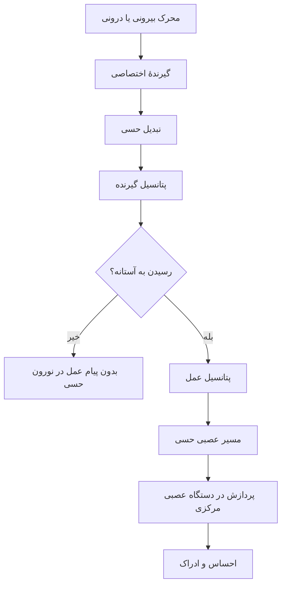
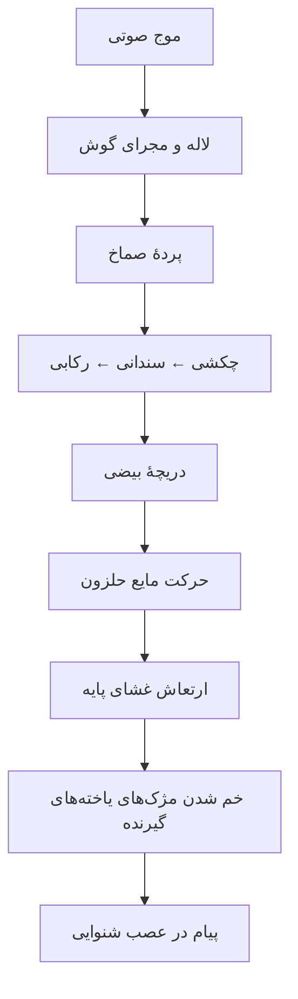
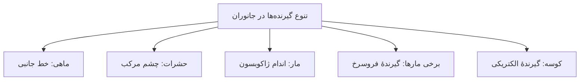

# راهنمای دیداری — فصل ۲: حواس

این نمودارها تألیفی‌اند و برای مرور روابط و مسیرها طراحی شده‌اند.

## ۱) از محرک تا ادراک

## ۲) طبقه‌بندی گیرنده‌ها بر اساس محرک

| محرک | گیرنده | نمونهٔ حس |
|---|---|---|
| فشار/کشش/ارتعاش | مکانیکی | لمس، شنوایی، تعادل |
| مواد شیمیایی | شیمیایی | بویایی، چشایی |
| نور | نوری | بینایی |
| دما | دمایی | گرما و سرما |
| آسیب بالقوه | درد | درد |
| غلظت محلول | اسمزی | تنظیم آب بدن |

## ۳) ساختمان کلی چشم و مسیر نور

**ساختارهای اطراف مسیر:** عنبیه اندازهٔ مردمک را تغییر می‌دهد؛ جسم مژگانی و تارهای آویزی در تطابق عدسی نقش دارند؛ صلبیه محافظ است و مشیمیه رگ‌دار است.

## ۴) تطابق عدسی

| دیدن جسم نزدیک | دیدن جسم دور |
|---|---|
| ماهیچهٔ مژگانی منقبض | ماهیچهٔ مژگانی شل |
| کشش تارهای آویزی کمتر | کشش تارهای آویزی بیشتر |
| عدسی گردتر و محدب‌تر | عدسی تخت‌تر |
| شکست نور بیشتر | شکست نور کمتر |

## ۵) از صدا تا عصب شنوایی

## ۶) شنوایی در برابر تعادل

| شنوایی | تعادل |
|---|---|
| بخش حلزونی گوش | کیسه‌ها، اوتریکول/ساکول و مجاری نیم‌دایره |
| ارتعاش ناشی از صدا | شتاب خطی، گرانش یا چرخش سر |
| یاخته‌های مژک‌دار | یاخته‌های مژک‌دار |
| عصب شنوایی | شاخهٔ دهلیزی عصب دهلیزی‌حلزونی |

## ۷) جانوران و حس‌های ویژه

## چک سریع شکل‌خوانی
- اگر ساختار، مژک و حرکت مایع دارد، احتمالاً گیرندهٔ مکانیکی است.
- اگر نقطهٔ خروج عصب بینایی نشان داده شده، آن ناحیه نقطهٔ کور است.
- اگر سؤال دربارهٔ تغییر تحدب عدسی است، ماهیچهٔ مژگانی و تارهای آویزی را در نظر بگیر.
- اگر مجرای نیم‌دایره در شکل دیده می‌شود، موضوع اصلی تعادل چرخشی است؛ نه شنیدن صدا.
