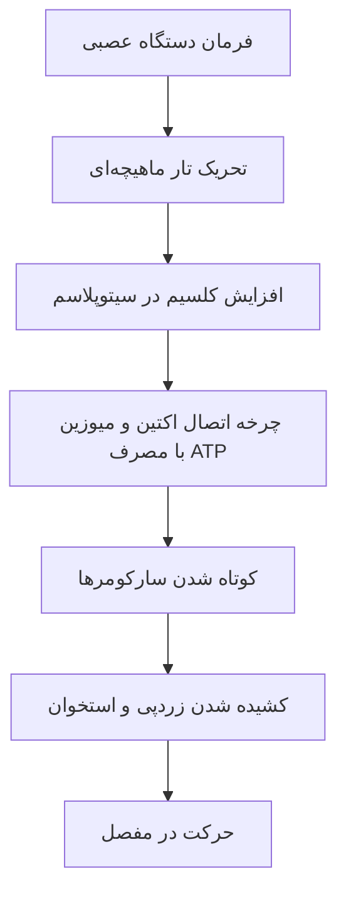
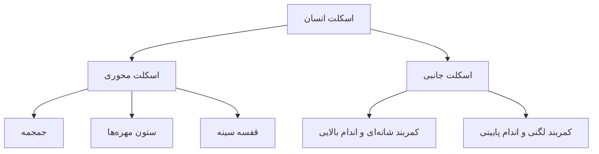
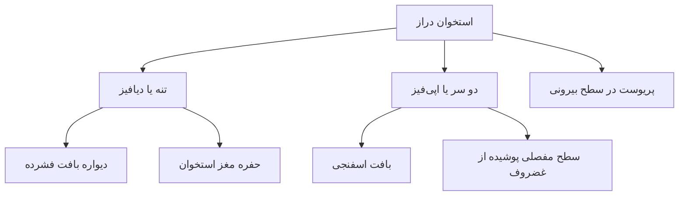
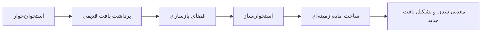
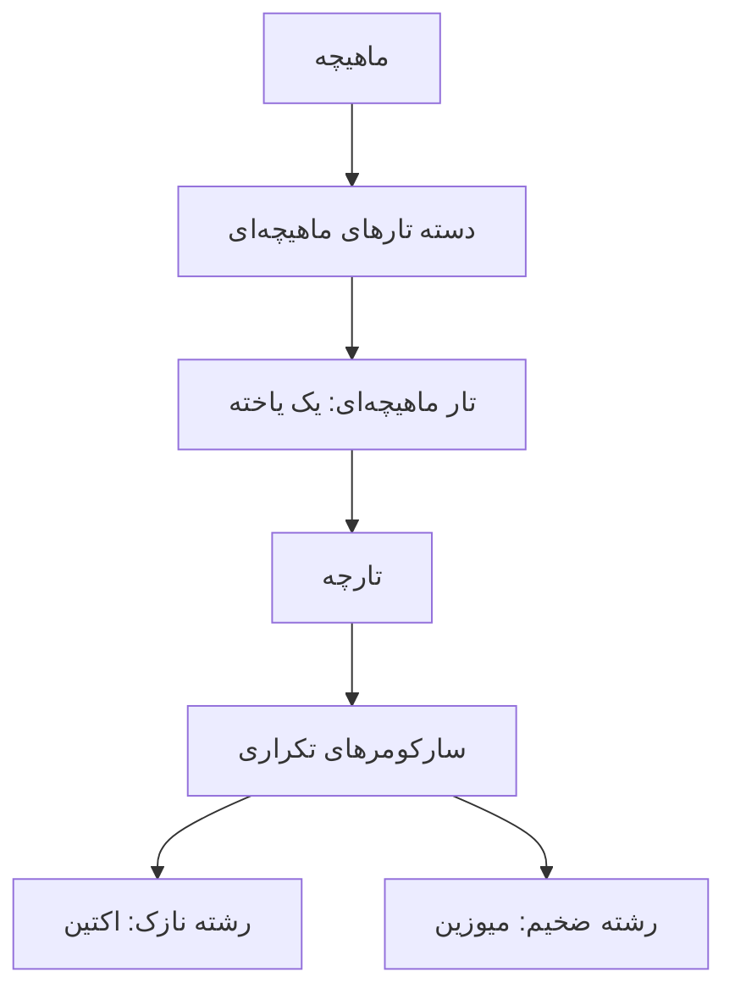
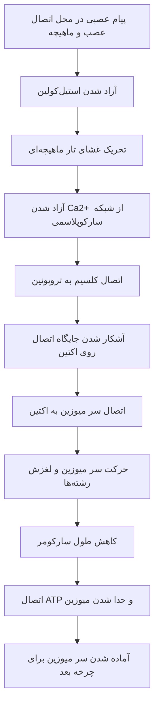

# راهنمای دیداری فصل ۳ — دستگاه حرکتی

## ۱) همکاری اجزای دستگاه حرکتی

## ۲) نقشهٔ اسکلت انسان

## ۳) ساختار استخوان دراز

## ۴) بازسازی بافت استخوانی

## ۵) از ماهیچه تا سارکومر

## ۶) چرخهٔ انقباض ماهیچه

## ۷) مقایسهٔ اتصال‌ها

| ساختار | اتصال یا جایگاه | کار اصلی |
|---|---|---|
| رباط | استخوان به استخوان | پایداری مفصل |
| زردپی | ماهیچه به استخوان | انتقال نیروی ماهیچه |
| غضروف مفصلی | سطح انتهایی استخوان | کاهش اصطکاک و توزیع فشار |
| دیسک بین‌مهره‌ای | میان مهره‌ها | جذب فشار و کمک به انعطاف ستون مهره‌ها |

## ۸) نکتهٔ تصویری سارکومر

- خطوط Z مرزهای سارکومرند و هنگام انقباض به هم نزدیک می‌شوند.
- رشته‌های نازک اکتین به سمت مرکز سارکومر لغزش می‌کنند.
- رشته‌های ضخیم میوزین در مرکز قرار دارند.
- طول خود رشته‌های اکتین و میوزین در مدل لغزش ثابت می‌ماند؛ میزان هم‌پوشانی آن‌ها تغییر می‌کند.

## ۹) چک سریع خودآزمایی

1. کدام استخوان‌ها در اسکلت محوری قرار می‌گیرند؟
2. تفاوت رباط و زردپی چیست؟
3. کدام سلول‌ها بافت استخوانی را می‌سازند و کدام آن را برداشت می‌کنند؟
4. کلسیم چه تغییری در تنظیم اتصال اکتین و میوزین ایجاد می‌کند؟
5. در انقباض، طول سارکومر تغییر می‌کند یا طول رشته‌های اکتین و میوزین؟

پاسخ‌های کوتاه

۱. جمجمه، ستون مهره‌ها، دنده‌ها و جناغ.  
۲. رباط استخوان را به استخوان و زردپی ماهیچه را به استخوان وصل می‌کند.  
۳. استخوان‌ساز می‌سازد و استخوان‌خوار برداشت می‌کند.  
۴. با اتصال به تروپونین، جایگاه اتصال روی اکتین را در دسترس قرار می‌دهد.  
۵. سارکومر کوتاه می‌شود؛ خود رشته‌ها کوتاه نمی‌شوند.

