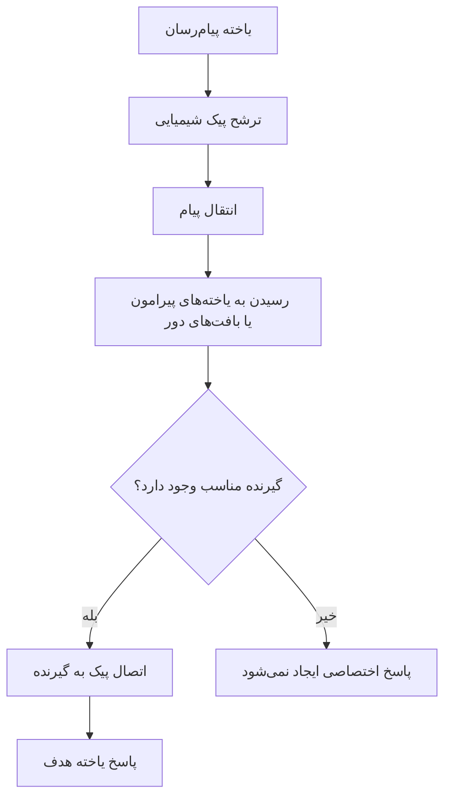
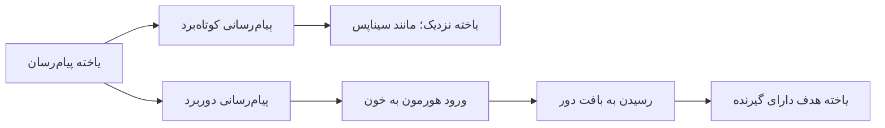
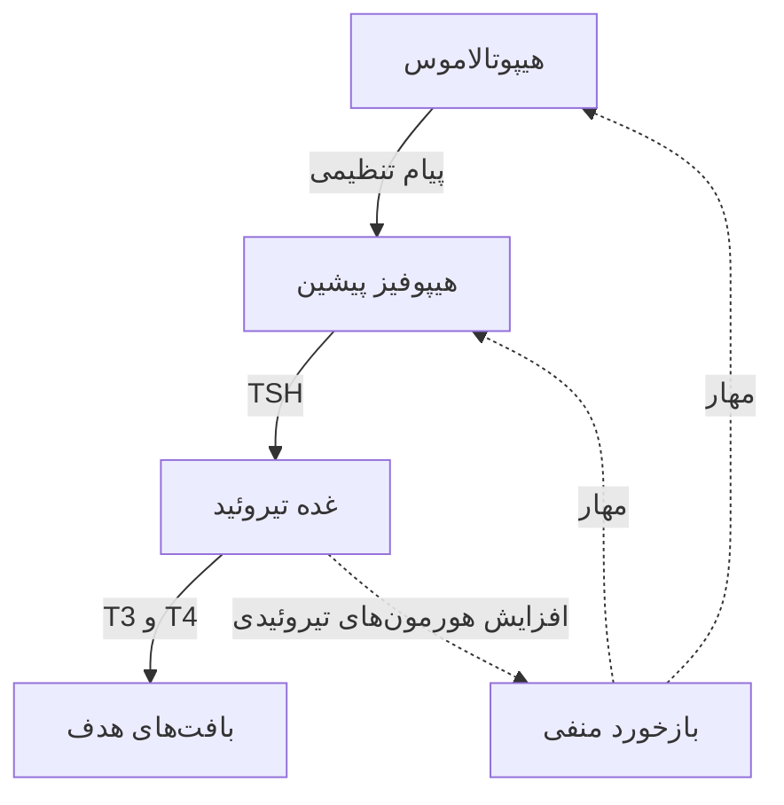
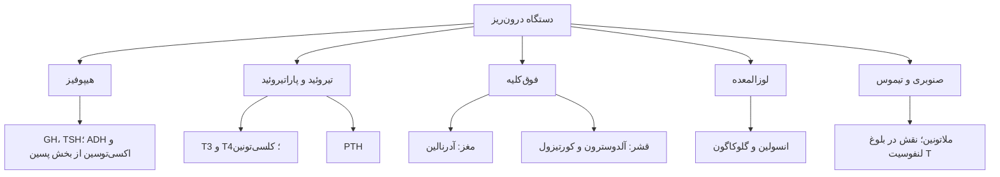
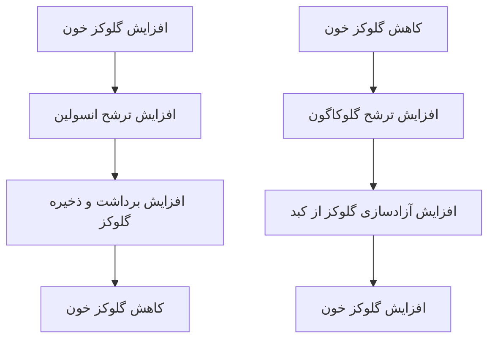

# راهنمای دیداری فصل ۴ — تنظیم شیمیایی

## ۱) مسیر پیام‌رسانی شیمیایی

## ۲) ارتباط کوتاه‌برد و دوربرد

## ۳) غدهٔ درون‌ریز و برون‌ریز

| ویژگی | درون‌ریز | برون‌ریز |
|---|---|---|
| مجرا | ندارد | دارد |
| مسیر ترشح | مایع میان‌بافتی و خون | سطح یا حفرهٔ بدن |
| نمونه | تیروئید | بزاقی و عرق |
| محصول نمونه | هورمون | بزاق، عرق یا آنزیم |

**استثنای آموزشی مهم:** لوزالمعده هم بخش درون‌ریز (جزایر لانگرهانس) و هم بخش برون‌ریز (ترشح آنزیم‌های گوارشی) دارد.

## ۴) محور هیپوتالاموس ـ هیپوفیز ـ تیروئید

## ۵) هیپوفیز پیشین و پسین

| بخش | سرنوشت هورمون |
|---|---|
| پیشین | هورمون‌هایی مانند GH و TSH را می‌سازد و ترشح می‌کند |
| پسین | ADH و اکسی‌توسین ساخته‌شده در هیپوتالاموس را ذخیره و آزاد می‌کند |

## ۶) غده‌ها و هورمون‌های شاخص

## ۷) تنظیم گلوکز خون

## ۸) تنظیم کلسیم خون

- کاهش کلسیم خون ← افزایش ترشح PTH ← افزایش کلسیم خون.
- افزایش کلسیم خون می‌تواند ترشح کلسی‌تونین را افزایش دهد؛ کلسی‌تونین در جهت کاهش کلسیم خون عمل می‌کند.

## ۹) خودآزمایی دیداری

۱. چرا همهٔ یاخته‌هایی که در معرض هورمون قرار می‌گیرند الزاماً پاسخ نمی‌دهند؟  
۲. کدام بخش هیپوفیز ADH را می‌سازد؟  
۳. اثر کلی انسولین بر گلوکز خون چیست؟  
۴. کدام هورمون در پاسخ به کاهش کلسیم خون افزایش می‌یابد؟  
۵. بازخورد منفی در محور تیروئید چه چیزی را مهار می‌کند؟

پاسخ‌ها

۱. فقط یاخته‌های دارای گیرندهٔ مناسب پاسخ می‌دهند.  
۲. ADH در هیپوتالاموس ساخته و در هیپوفیز پسین ذخیره و آزاد می‌شود.  
۳. کاهش گلوکز خون.  
۴. PTH.  
۵. افزایش T3 و T4 فعالیت هیپوتالاموس و هیپوفیز را مهار می‌کند.

