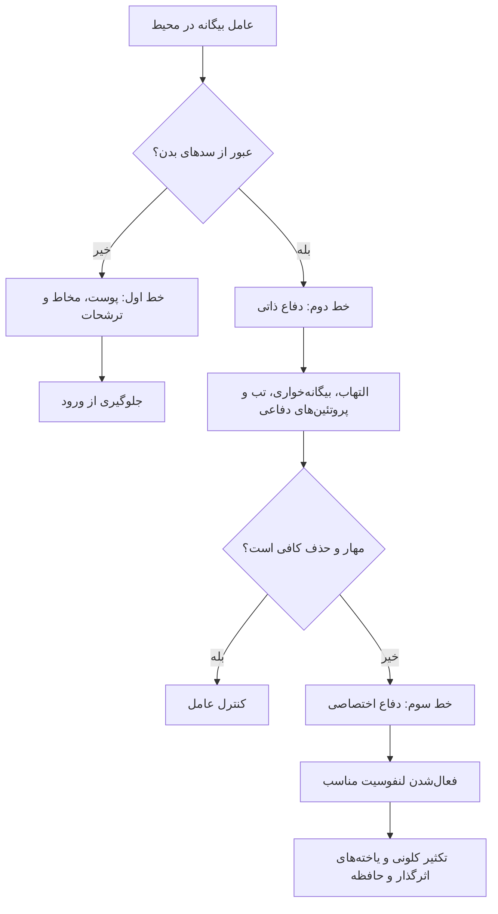
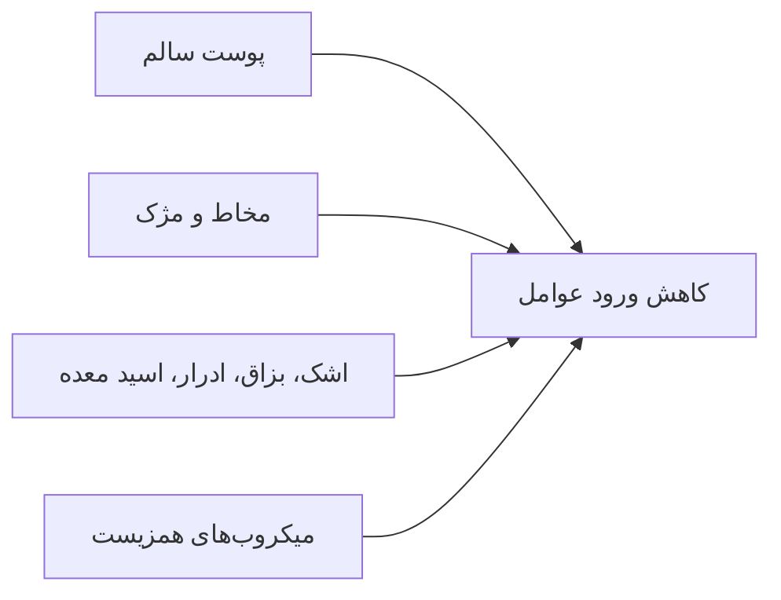
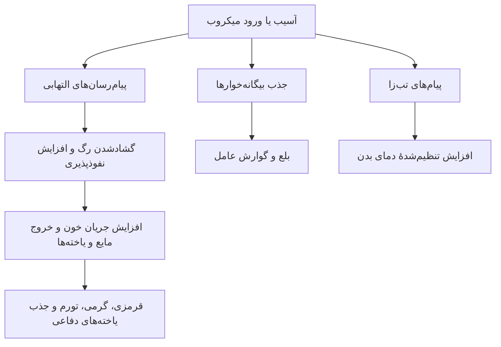
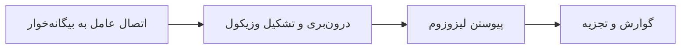
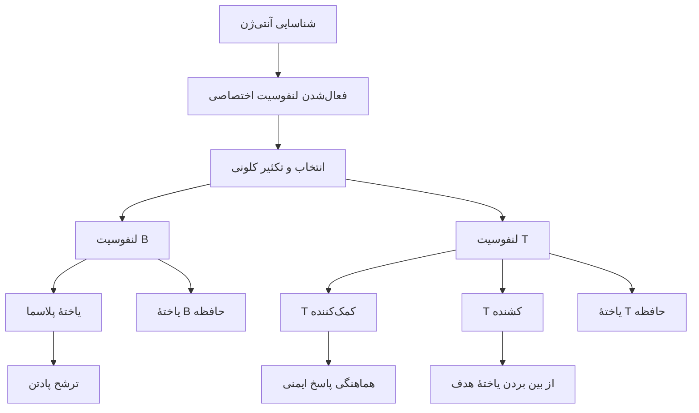
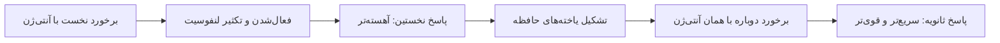

# راهنمای دیداری فصل ۵: ایمنی

## سه خط دفاعی

## خط اول: سدهای دفاعی

| ساختار | کارکرد اصلی |
|---|---|
| پوست | سد فیزیکی |
| مخاط | به دام انداختن ذرات |
| مژک تنفسی | جابه‌جایی مخاط به سوی حلق |
| لیزوزیم | آسیب به دیوارهٔ برخی باکتری‌ها |
| اسید معده | از بین بردن بسیاری از میکروب‌های بلعیده‌شده |

## خط دوم: پاسخ‌های ذاتی

## بیگانه‌خواری در چهار گام

## خط سوم: دو بازوی پاسخ اختصاصی

## پاسخ نخستین در برابر پاسخ ثانویه

## فعال یا غیرفعال؟

| وضعیت | دسته |
|---|---|
| بدن پس از ابتلا خودش پاسخ می‌سازد | فعال طبیعی |
| واکسن و ساخته‌شدن پاسخ توسط بدن | فعال مصنوعی |
| دریافت پادتن از مادر | غیرفعال طبیعی |
| تزریق پادتن آماده | غیرفعال مصنوعی |

## خودآزمایی دیداری

- کدام خط دفاعی پیش از ورود عامل عمل می‌کند؟
- کدام یاخته پادتن ترشح می‌کند؟
- تفاوت کار T کمک‌کننده و T کشنده چیست؟
- چرا پاسخ ثانویه سریع‌تر است؟
- واکسن در کدام دسته از ایمنی قرار می‌گیرد؟
