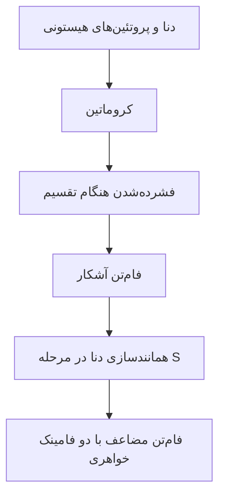
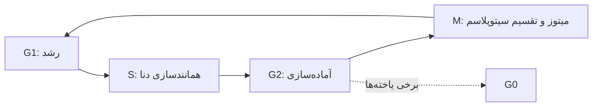
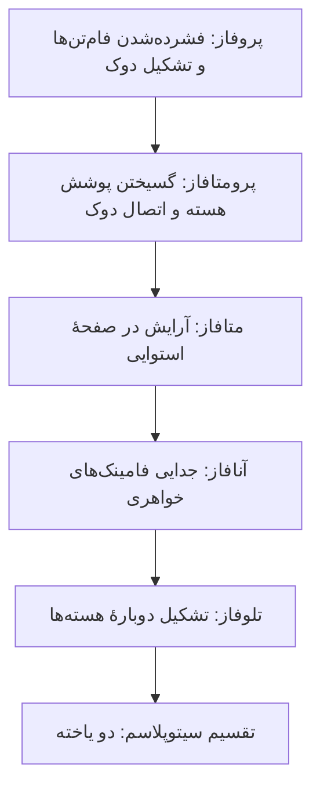
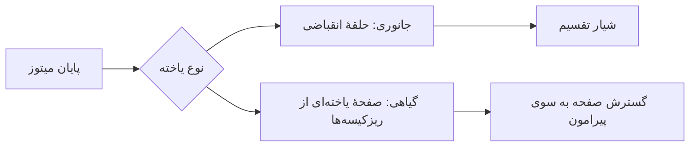
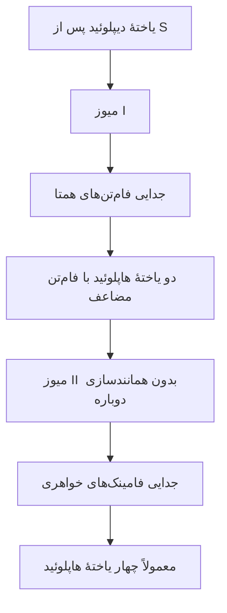

# راهنمای دیداری فصل ۶: تقسیم یاخته

## از کروماتین تا فام‌تن مضاعف

## چرخهٔ یاخته‌ای

## مراحل میتوز

## تفاوت تقسیم سیتوپلاسم جانوری و گیاهی

## میوز در دو تقسیم

## جایگاه رخدادهای مهم میوز

| رخداد | مرحله |
|---|---|
| جفت‌شدن همتاها | پروفاز I |
| کراسینگ‌اور | پروفاز I |
| آرایش جفت‌های همتا | متافاز I |
| جدایی همتاها | آنافاز I |
| جدایی فامینک‌های خواهری | آنافاز II |

## یک مثال عددی

اگر یاختهٔ آغازین (2n=6) باشد:

- پیش از همانندسازی: ۶ فام‌تن، هر کدام یک فامینک.
- پس از S: ۶ فام‌تن، ۱۲ فامینک.
- پس از میوز I: در هر یاخته ۳ فام‌تن مضاعف، یعنی ۶ فامینک.
- پس از میوز II: در هر یاخته ۳ فام‌تن تک‌فامینکی؛ معمولاً چهار یاختهٔ هاپلوئید.

## پرسش‌های تصویری

- در کدام مرحله همتاها از هم جدا می‌شوند؟
- در کدام مرحله فامینک‌های خواهری از هم جدا می‌شوند؟
- کراسینگ‌اور میان کدام فامینک‌ها رخ می‌دهد؟
- چرا پس از مرحلهٔ S عدد فام‌تنی تغییر نمی‌کند؟
