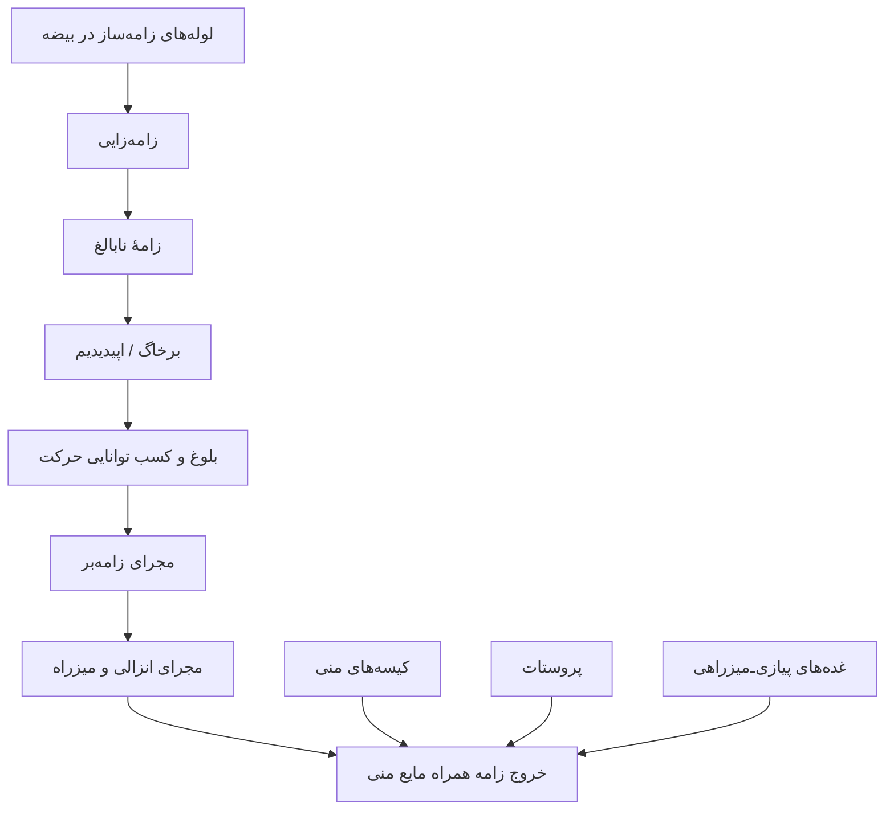
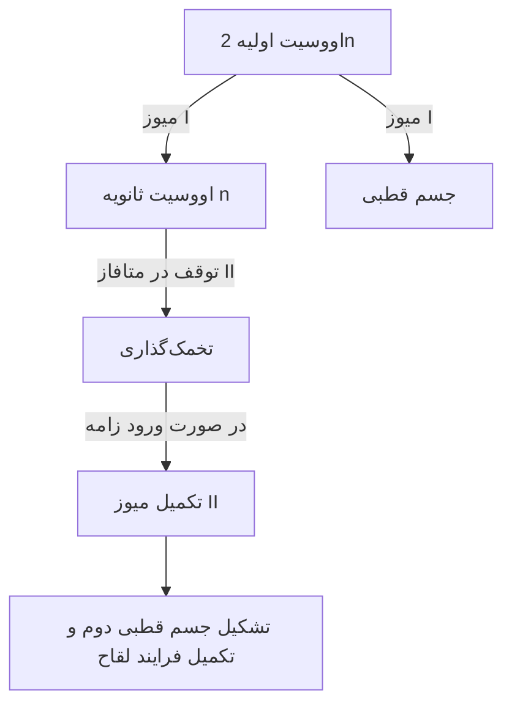
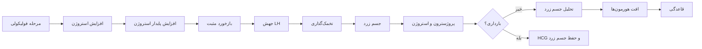
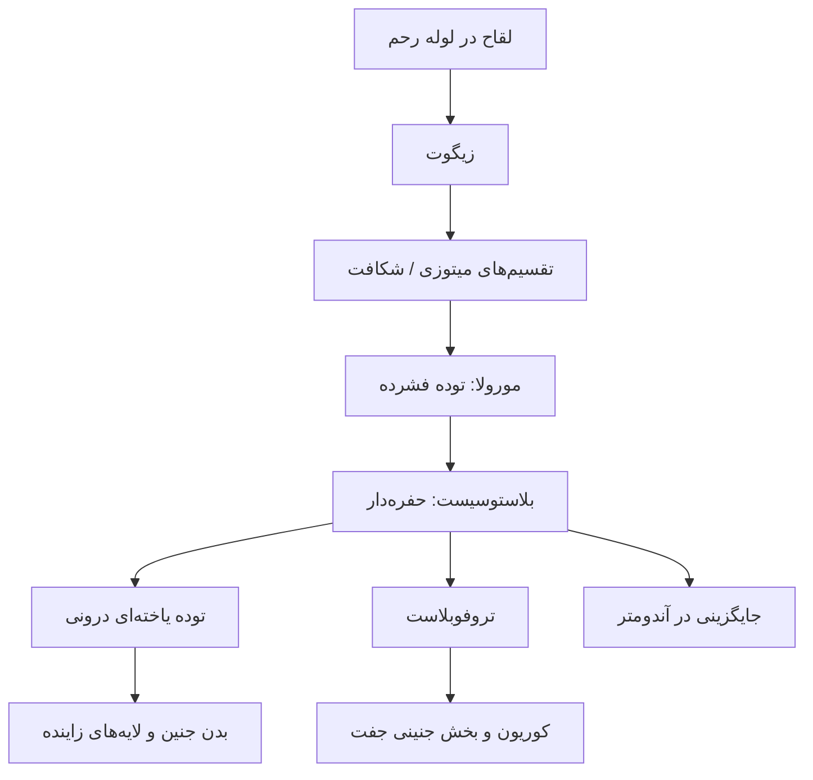
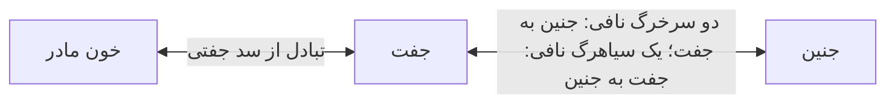

# راهنمای دیداری فصل هفتم: تولیدمثل

این صفحه برای مرور سریع مسیرها و مقایسه‌هاست. برای جزئیات و استثناها، درس‌نامهٔ فصل را هم بخوان.

## ۱. دستگاه تولیدمثل در مرد

### سلول‌ها و هورمون‌ها

| پیام/هورمون | هدف | پیامد |
|---|---|---|
| FSH | سرتولی | پشتیبانی از زامه‌زایی و تمایز |
| LH | لایدیگ/بینابینی | ترشح تستوسترون |
| تستوسترون | بافت‌های هدف و محور تنظیمی | صفات ثانویه، فعالیت تولیدمثلی، بازخورد |

## ۲. زامه‌زایی در برابر تخمک‌زایی

| ویژگی | زامه‌زایی | تخمک‌زایی |
|---|---|---|
| محل | لوله‌های زامه‌ساز بیضه | تخمدان |
| تقسیم سیتوپلاسم | تقریباً برابر | نابرابر |
| محصول معمول از یک یاختهٔ اولیه | چهار یاختهٔ هاپلوئید که تمایز می‌یابند | یک یاختهٔ بزرگ و جسم‌های قطبی |
| زمان‌بندی | از بلوغ به بعد پیوسته‌تر | آغاز در دورهٔ جنینی؛ توقف‌ها و ادامهٔ چرخه‌ای |
| توقف میوز | الگوی توقف طولانی مشابه اووسیت ندارد | پروفاز I و سپس متافاز II |

**یادت بماند:** در انسان، یاختهٔ آزادشده در تخمک‌گذاری اووسیت ثانویه است، نه تخمکِ تکمیل‌کنندهٔ میوز II.

## ۳. چرخهٔ تخمدانی و رحمی؛ دو نمودار، نه یک نمودار

| زمان نمونه در چرخهٔ ۲۸روزه | تخمدان | رحم |
|---|---|---|
| آغاز چرخه | رشد فولیکول | قاعدگی |
| پیش از نیمه | افزایش استروژن و بلوغ فولیکول | بازسازی آندومتر |
| حدود روز ۱۴ | جهش LH و تخمک‌گذاری | ادامهٔ ضخیم شدن |
| پس از تخمک‌گذاری | جسم زرد | مرحلهٔ ترشحی و آمادگی برای جایگزینی |
| پایان، اگر بارداری رخ ندهد | تحلیل جسم زرد | افت هورمون‌ها و آغاز قاعدگی |

## ۴. مسیر آغاز رشد جنین

### سه واژه که نباید جابه‌جا شوند

<box>
  <row align="start" gap={3}>
    <box flex="1">
      **مورولا**

      <text color="secondary" size="sm">تودهٔ فشردهٔ یاخته‌ها؛ حفرهٔ بزرگ مشخص ندارد.</text>
    </box>
    <box flex="1">
      **بلاستوسیست**

      <text color="secondary" size="sm">ساختار حفره‌دار با تودهٔ درونی و تروفوبلاست.</text>
    </box>
    <box flex="1">
      **جایگزینی**

      <text color="secondary" size="sm">نفوذ بلاستوسیست در دیوارهٔ رحم؛ رویدادی پس از لقاح.</text>
    </box>
  </row>
</box>

## ۵. جفت و بند ناف

- اکسیژن و مواد غذایی: مادر ← جفت ← جنین
- کربن‌دی‌اکسید و مواد دفعی: جنین ← جفت ← مادر
- خون مادر و جنین معمولاً مستقیماً با هم مخلوط نمی‌شوند.
- جفت مانع مطلق نیست؛ برخی مواد زیان‌آور و عوامل بیماری‌زا می‌توانند عبور کنند.

## ۶. تولیدمثل در جانوران؛ مقایسهٔ سریع

| روش | محل لقاح | منبع عمدهٔ تغذیهٔ جنین | مثال |
|---|---|---|---|
| لقاح خارجی | بیرون بدن | ذخیرهٔ تخم؛ گاهی محیط | بسیاری از ماهیان و دوزیستان |
| لقاح داخلی + تخم‌گذاری | داخل بدن؛ رشد بیرون | زرده | پرندگان و بسیاری از خزندگان |
| تخم‌زنده‌زایی | داخل بدن | عمدتاً ذخیرهٔ تخم | برخی ماهیان و خزندگان |
| زنده‌زایی جفت‌دار | داخل بدن | تبادل با مادر از جفت | انسان و بیشتر پستانداران |

### چند دام مفهومی

- نرماده بودن ≠ خودلقاحی حتمی
- بکرزایی ≠ هاپلوئیدی حتمی
- لقاح داخلی ≠ زنده‌زایی
- تولد زنده ≠ تغذیهٔ مستقیم از مادر
- رشد غیرمستقیم = مرحلهٔ لاروی و دگردیسی
- اسبک ماهی: لقاح/نگهداری جنین در کیسهٔ زایشی نر

## ۷. خودآزمایی ۳۰ ثانیه‌ای

1. کدام یاختهٔ بیضه تستوسترون می‌سازد؟ **لایدیگ**
2. کدام هورمون تخمک‌گذاری را تحریک می‌کند؟ **جهش LH**
3. لقاح، جایگزینی و تخمک‌گذاری به ترتیب کجا رخ می‌دهند؟ **لولهٔ رحم، دیوارهٔ رحم، تخمدان**
4. کدام مرحله حفره‌دار است؟ **بلاستوسیست**
5. HCG چه چیزی را حفظ می‌کند؟ **جسم زرد**
6. دوقلوهای ناهمسان از چند لقاح پدید می‌آیند؟ **دو لقاح**
