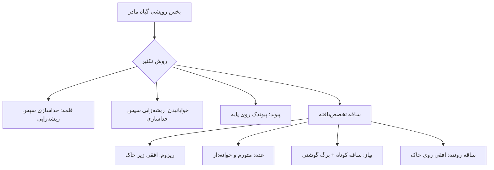
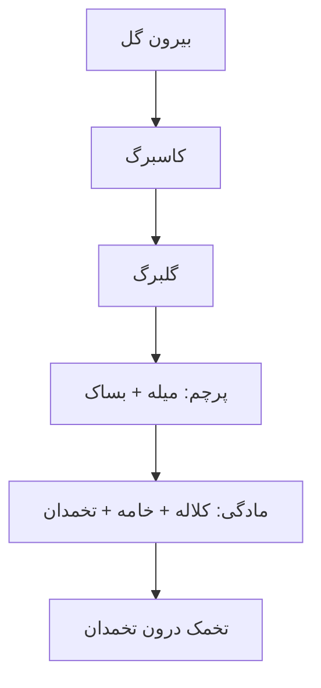
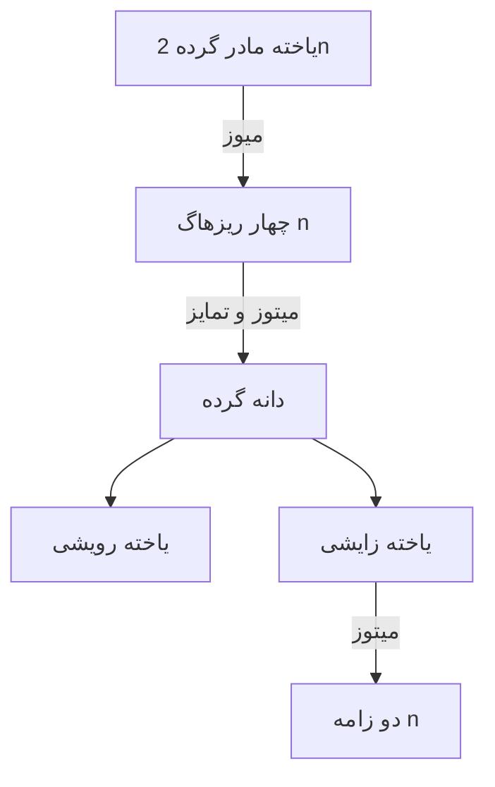
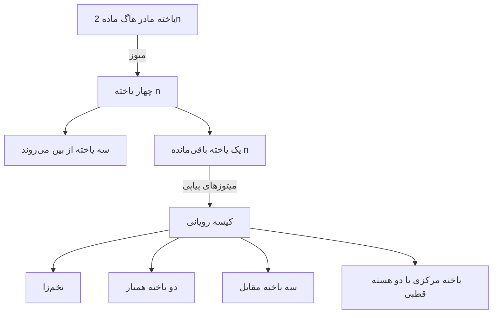
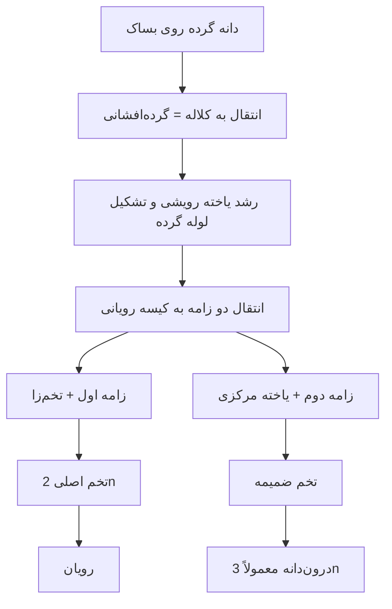
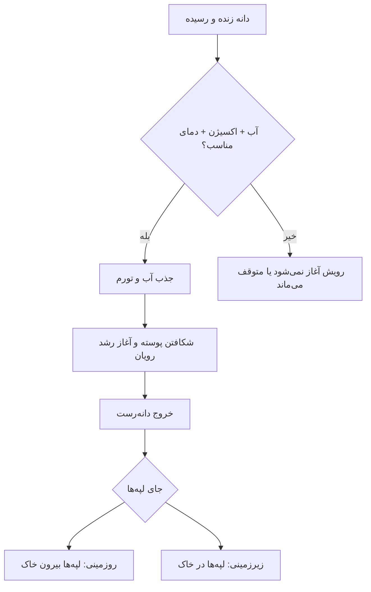

# راهنمای دیداری فصل هشتم: تولیدمثل نهان‌دانگان

## ۱. تکثیر رویشی

| اندام | تصویر ذهنی | مثال |
|---|---|---|
| ریزوم | راهروی زیرزمینی افقی | زنبق |
| غده | ساقهٔ بادکرده با چشم | سیب‌زمینی |
| پیاز | ساقه کوتاه با لایه‌های برگ گوشتی | پیاز، لاله |
| ساقه رونده | شاخه روی خاک که در گره‌ها گیاه تازه می‌سازد | توت‌فرنگی |

## ۲. چهار حلقهٔ گل

**حواست باشد:** کامل/ناکامل = داشتن چهار حلقه؛ دوجنسی/تک‌جنسی = داشتن هر دو اندام زایشی یا فقط یکی.

## ۳. تشکیل دانهٔ گرده

## ۴. تشکیل کیسهٔ رویانی

در الگوی رایج: ۷ یاخته و ۸ هسته.

## ۵. گرده‌افشانی تا لقاح مضاعف

## ۶. از گل تا دانه و میوه

| ساختار پیشین | محصول |
|---|---|
| تخمک | دانه |
| پوشش تخمک | پوسته دانه |
| تخم اصلی | رویان |
| تخم ضمیمه | درون‌دانه |
| تخمدان | میوه |
| دیواره تخمدان | دیواره میوه |

## ۷. رویش دانه

## ۸. مقایسه‌های سریع برای تست

| دو مفهوم | فرق یک‌خطی |
|---|---|
| گرده‌افشانی / لقاح | انتقال گرده / آمیزش گامت‌ها |
| تخمک / تخم‌زا | ساختار در تخمدان / گامت ماده در کیسه رویانی |
| تخم اصلی / تخم ضمیمه | منشأ رویان / منشأ درون‌دانه |
| ریزوم / ساقه رونده | زیر خاک / روی خاک |
| قلمه / خوابانیدن | جداسازی قبل ریشه‌زایی / بعد ریشه‌زایی |
| میوه حقیقی / کاذب | از تخمدان / با مشارکت بخش‌های دیگر گل |
| رویش روزمینی / زیرزمینی | لپه بیرون خاک / لپه در خاک |
