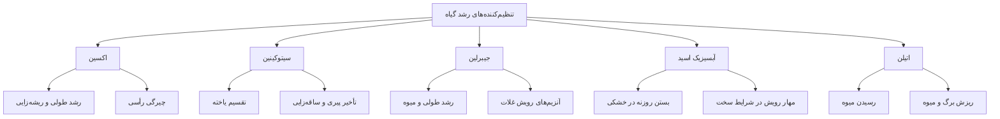
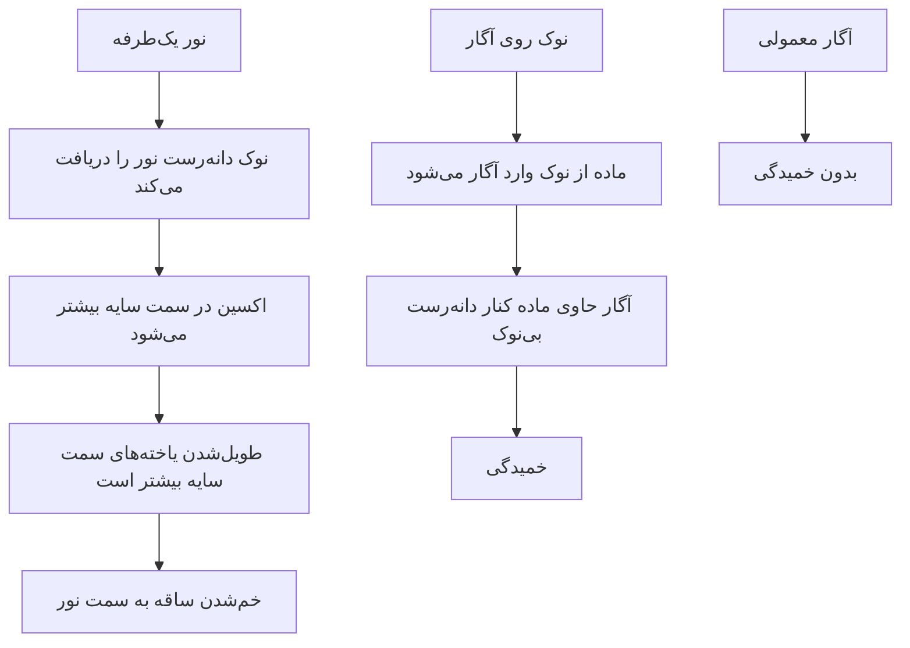
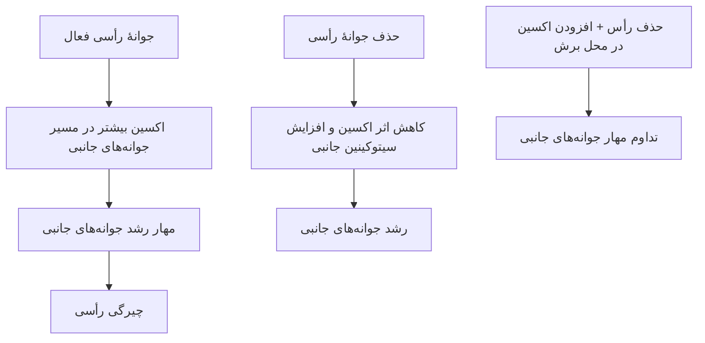
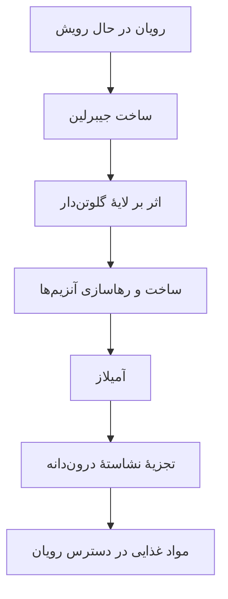
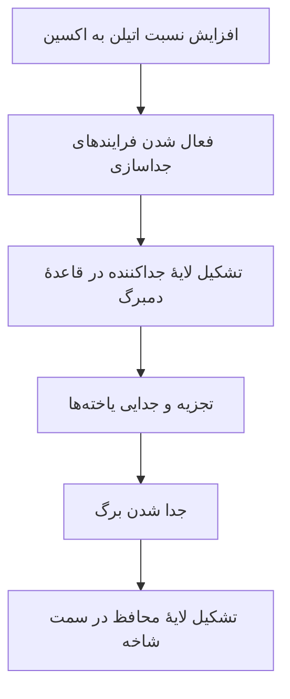
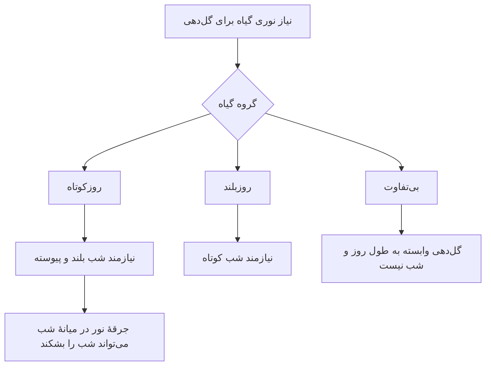
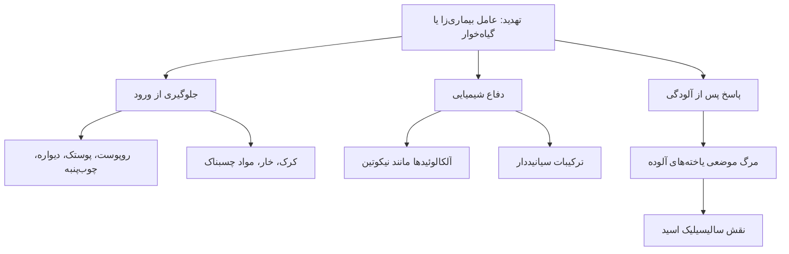

# راهنمای دیداری فصل نهم: پاسخ گیاهان به محرک‌ها

## ۱) نقشهٔ پنج تنظیم‌کنندهٔ رشد

## ۲) آزمایش‌های کشف اکسین

## ۳) چیرگی رأسی و نقش دو هورمون

## ۴) زنجیرهٔ رویش دانهٔ غلات

## ۵) ریزش برگ؛ نسبت هورمون‌ها و لایهٔ جداکننده

## ۶) دورهٔ نوری؛ شب را بشمار

## ۷) پاسخ‌های حرکتی را قاطی نکن

| پاسخ | محرک | سازوکار اصلی | نتیجه |
|---|---|---|---|
| نورگرایی ساقه | نور یک‌طرفه | رشد طولی نامتقارن | خم به سمت نور |
| زمین‌گرایی ریشه | گرانش | رشد جهت‌دار | رشد همسو با گرانش |
| زمین‌گرایی ساقه | گرانش | رشد جهت‌دار | رشد خلاف گرانش |
| پیچش ساقهٔ مو | تماس با تکیه‌گاه | کاهش رشد سمت تماس | پیچش دور تکیه‌گاه |
| تا شدن برگ حساس | ضربه/تماس | تغییر تورژسانس | تا شدن سریع برگچه‌ها |
| بسته شدن تلهٔ گوشت‌خوار | تماس حشره با کرک‌ها | تحریک و پیام | بسته شدن برگ |

## ۸) دفاع گیاه؛ سه لایهٔ مفهومی

## مرور یک‌نگاهی

| سرنخ در سؤال | پاسخ سریع |
|---|---|
| قلمه و ریشه‌زایی | اکسین |
| تقسیم یاخته و تأخیر پیری | سیتوکینین |
| آمیلاز در دانهٔ غلات | جیبرلین |
| خشکی و بسته شدن روزنه | آبسیزیک اسید |
| رسیدن میوه و گاز | اتیلن |
| روزکوتاه | شب بلند |
| ریشه در جهت گرانش | زمین‌گرایی مثبت |
| تا شدن گیاه حساس | تغییر تورژسانس |
| مرگ یاخته‌ای دفاعی | سالیسیلیک اسید |

**یادآوری:** در نمودارها، پیکان به معنی رابطهٔ علّی یا توالی فرایند است؛ برای پاسخ به تست، هر مرحله را با متن و شکل کتاب تطبیق بده.
