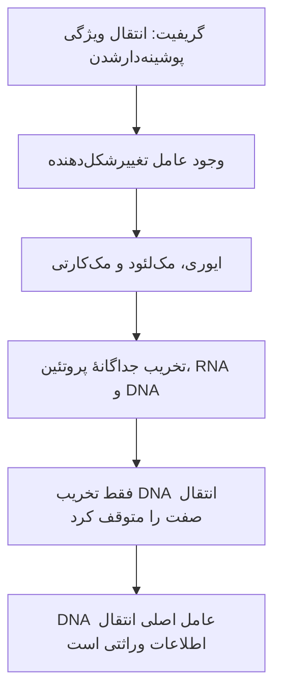
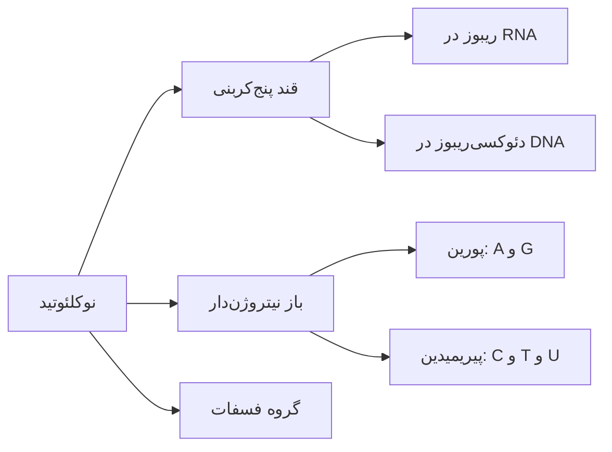
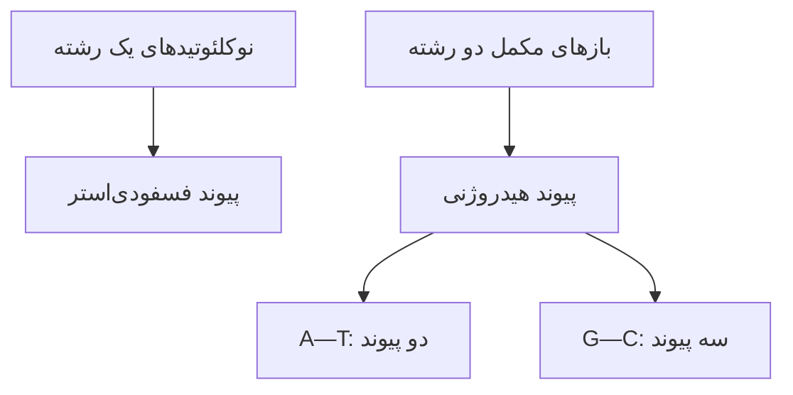
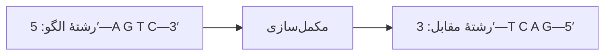
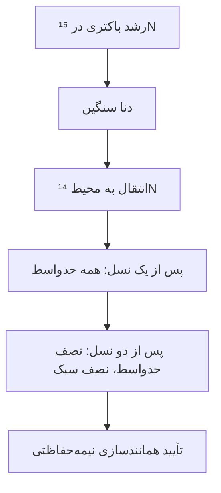
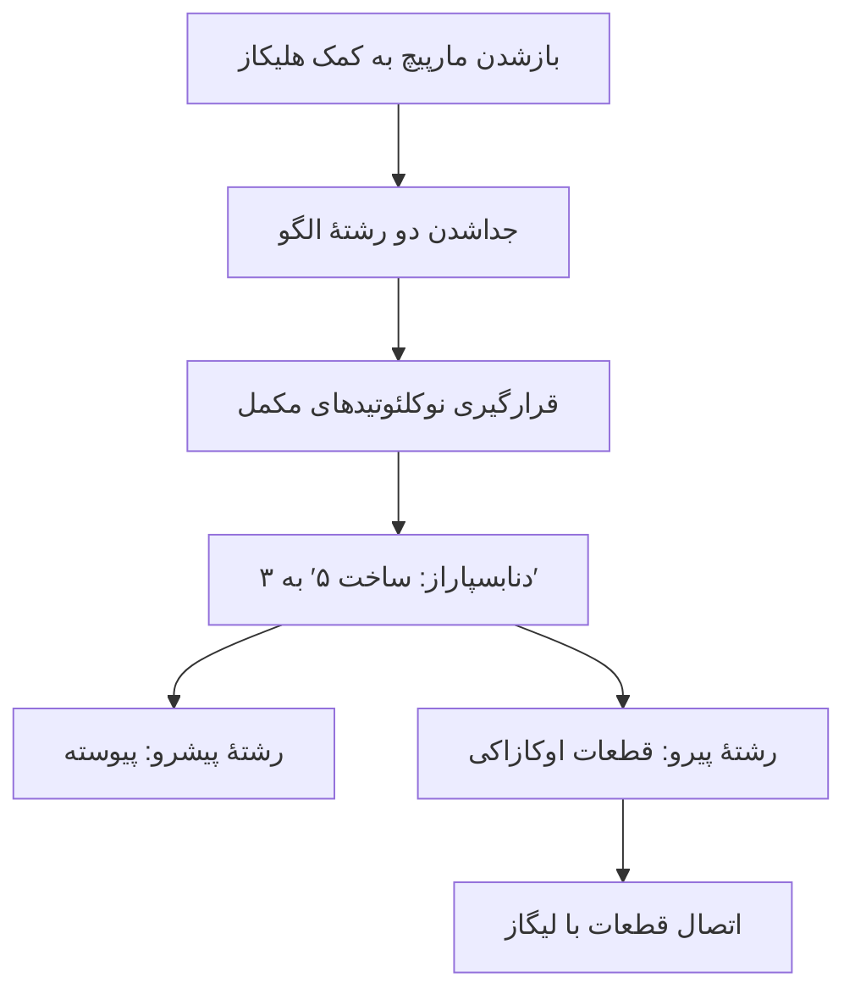
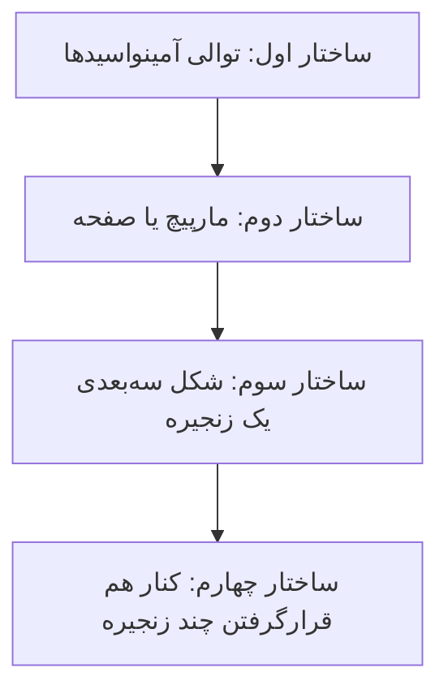
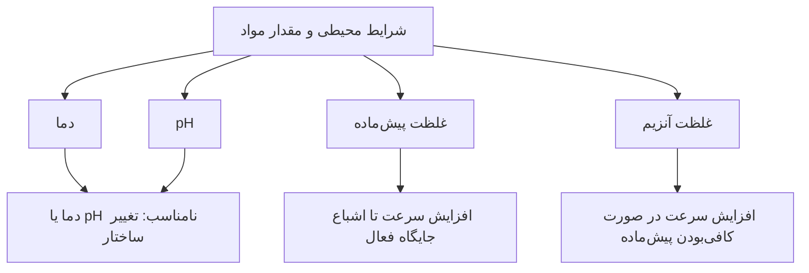
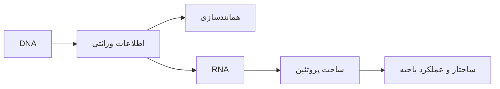

# راهنمای دیداری فصل ۱ ـ مولکول‌های اطلاعاتی

## ۱) از آزمایش‌ها تا شناسایی دنا

## ۲) ساختار نوکلئوتید

## ۳) اتصال درون رشته و بین دو رشته

- فسفودی‌استر: ستون قندـفسفاتِ یک رشته را می‌سازد.
- هیدروژنی: بازهای مکملِ دو رشته را روبه‌روی هم نگه می‌دارد.
- دو رشتهٔ دنا پادموازی‌اند.

## ۴) مکمل‌بودن و محاسبه

| داده | نتیجه |
|---|---|
| A = ۲۶٪ در دنای دورشته‌ای | T = ۲۶٪ |
| باقی‌مانده = ۴۸٪ | G = C = ۲۴٪ |
| ۴۰ جفت A–T و ۶۰ جفت G–C | ۲۶۰ پیوند هیدروژنی |

## ۵) آزمایش مزلسون و استال

هر دنا پس از همانندسازی، یک رشتهٔ قدیمی و یک رشتهٔ تازه دارد.

## ۶) همانندسازی در چنگال

## ۷) سطوح ساختار پروتئین

| سطح | کلید تشخیص در سؤال |
|---|---|
| اول | ترتیب آمینواسیدها |
| دوم | مارپیچ آلفا / صفحهٔ بتا، پیوند هیدروژنی |
| سوم | تاخوردگی سه‌بعدی یک زنجیره |
| چهارم | چند زیرواحد پلی‌پپتیدی |

## ۸) اثر شرایط بر آنزیم

## ۹) سه نمودار را قاطی نکن

- **دما:** افزایش تا نقطهٔ بهینه؛ سپس افت ناشی از اختلال ساختاری.
- **pH:** هر آنزیم محدودهٔ بهینهٔ خودش را دارد.
- **غلظت پیش‌ماده:** افزایش سرعت و سپس نزدیک‌شدن به حالت اشباع.

## ۱۰) نقشهٔ ارتباطی فصل

این نقشه برای اتصال فصل ۱ به فصل ۲ است: در فصل بعد، رونویسی و ترجمه با جزئیات بیشتری بررسی می‌شوند.
