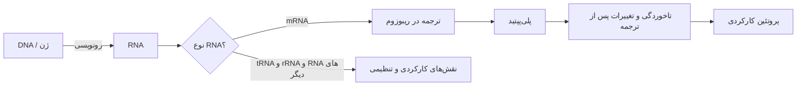
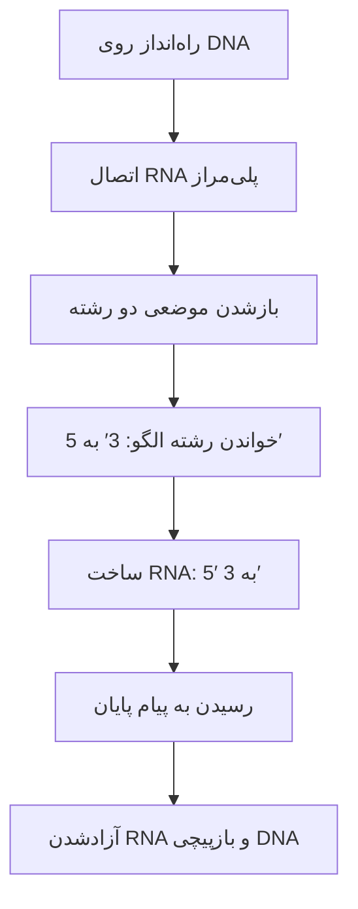
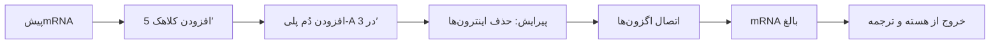
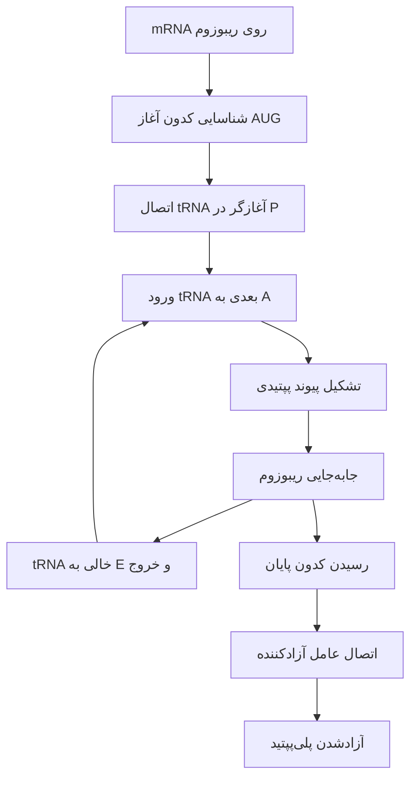
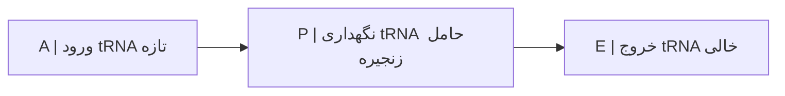
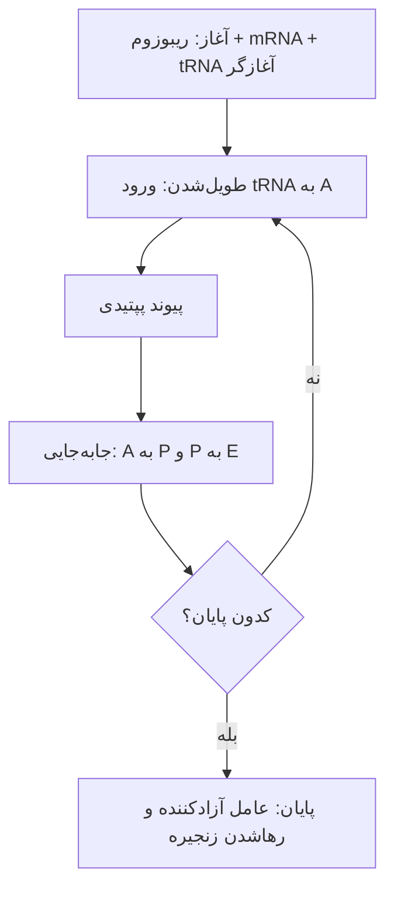
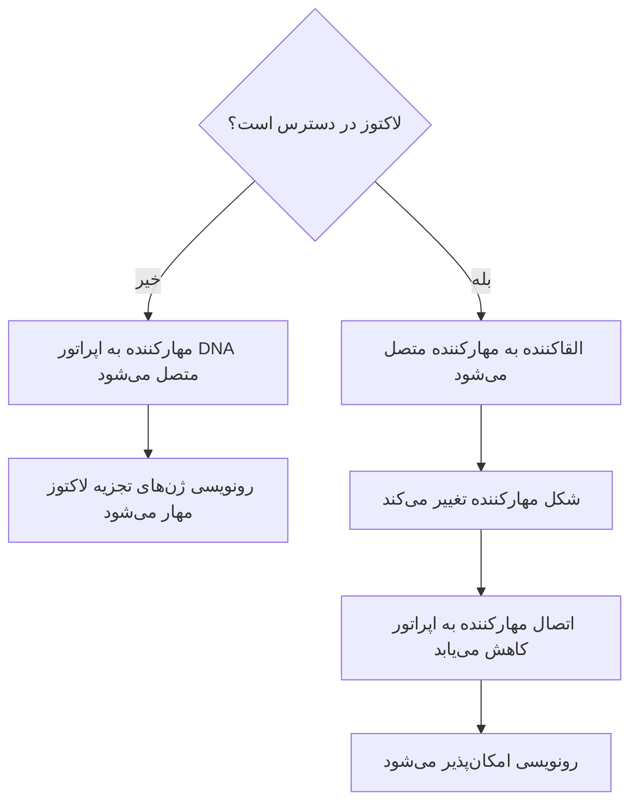
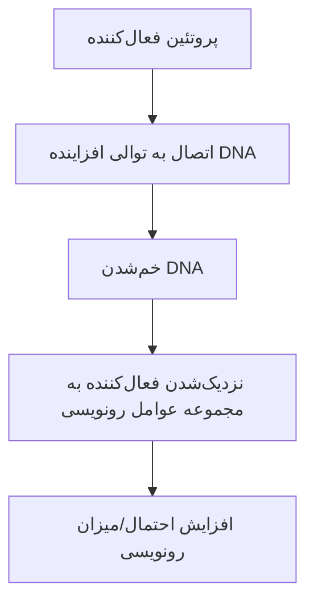
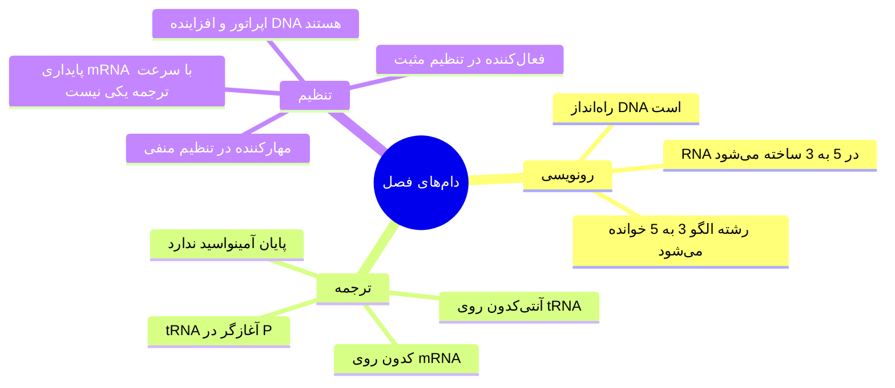

# راهنمای دیداری فصل ۲ ـ جریان اطلاعات در یاخته

این صفحه برای تبدیل متن فصل به چند مدل ذهنی طراحی شده است. هر نمودار را با کتاب درسی تطبیق بده و بعد بدون نگاه‌کردن، از نو رسم کن.

## ۱) نمای کلی جریان اطلاعات

**نکتهٔ دام‌دار:** همهٔ RNAها ترجمه نمی‌شوند؛ محصول بعضی ژن‌ها خود RNA کارکردی است.

## ۲) رونویسی؛ جهت را روی کاغذ مشخص کن

- RNA مکمل رشتهٔ الگو است.
- RNA با رشتهٔ غیرالگو، به‌جز T/U، هم‌توالی است.
- راه‌انداز بخشی از DNA و معمولاً بیرون از RNA رونویسی‌شده است.

## ۳) پردازش پیش‌mRNA یوکاریوتی

**به خاطر بسپار:** کلاهک، دُم و پیرایش را به همهٔ RNAها تعمیم نده؛ این الگوی ساده‌شده برای بسیاری از mRNAهای یوکاریوتی است.

## ۴) ترجمه؛ از کدون تا پلی‌پپتید

## ۵) جایگاه‌های A، P و E

| جایگاه | معنی | چیزی که باید به خاطر بسپاری |
|---|---|---|
| A | Aminoacyl | ورود tRNA حامل آمینواسید جدید |
| P | Peptidyl | tRNA حامل زنجیرهٔ در حال رشد |
| E | Exit | خروج tRNA بدون آمینواسید |

**استثنای آغاز:** tRNA آغازگر در مرحلهٔ آغاز در P قرار می‌گیرد؛ پس «همه از A شروع می‌کنند» درست نیست.

## ۶) چرخهٔ سه‌مرحله‌ای ترجمه

## ۷) تنظیم منفی اپرون لاکتوز

لاکتوز به اپراتور متصل نمی‌شود؛ پروتئین مهارکننده هدف اتصال القاکننده است. در سازوکار طبیعی، آلولاکتوز القاکنندهٔ مستقیم است.

## ۸) تنظیم مثبت؛ فعال‌کننده و افزاینده

## ۹) مقایسهٔ پروکاریوت و یوکاریوت

| ویژگی | پروکاریوت | یوکاریوت |
|---|---|---|
| هستهٔ غشادار | ندارد | دارد |
| محل رونویسی | ناحیهٔ سیتوپلاسمی | هسته |
| محل ترجمه | سیتوپلاسم | سیتوپلاسم/سطح شبکه زبر |
| هم‌زمانی رونویسی و ترجمه | ممکن است | معمولاً جدا |
| پردازش mRNA | عموماً ساده‌تر | کلاهک، دُم و پیرایش در بسیاری از mRNAها |

## ۱۰) نقشهٔ دام‌ها

## خودآزمایی دیداری

1. بدون نگاه‌کردن، مسیر رونویسی را با جهت ۵′ و ۳′ رسم کن.
2. سه جایگاه ریبوزوم را با نقش هرکدام برچسب بزن.
3. اپرون لاکتوز را در دو حالت حضور و نبود لاکتوز بکش.
4. روی یک mRNA فرضی ۱۲ کدونی، کدون پایان را مشخص کن و تعداد آمینواسیدها را به دست آور.
5. تفاوت تنظیم منفی و مثبت را با یک پروتئین و یک فلش نشان بده.
