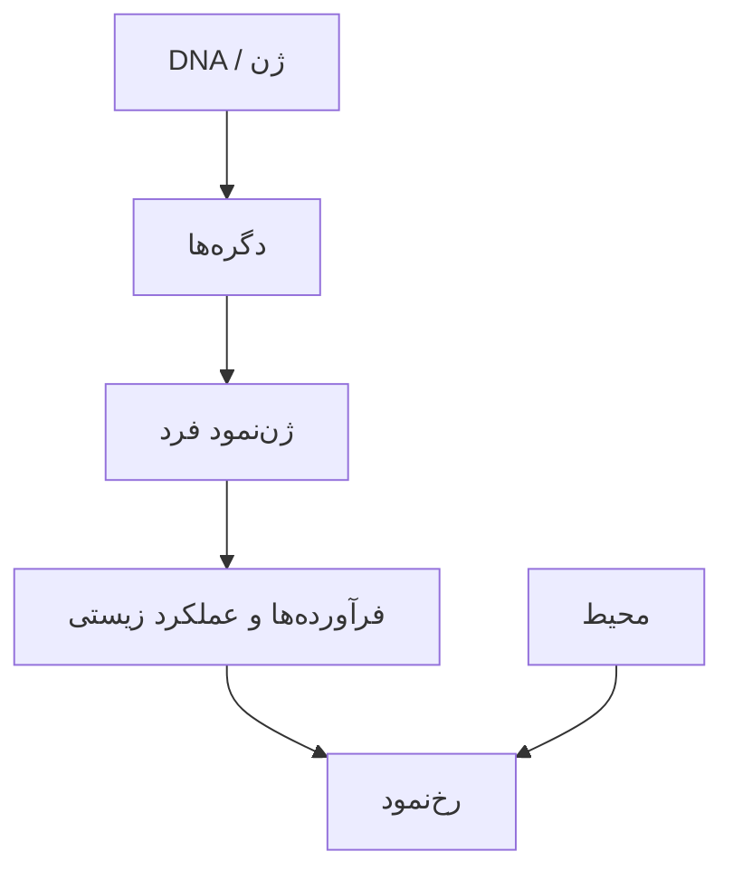
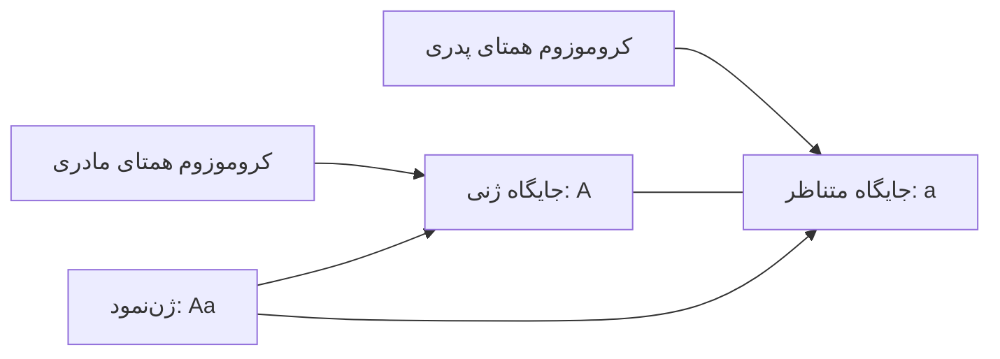
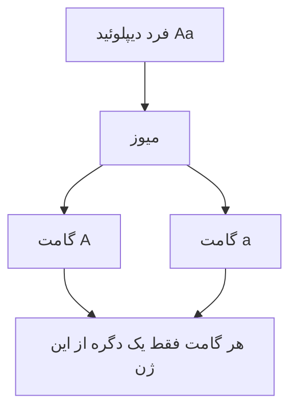
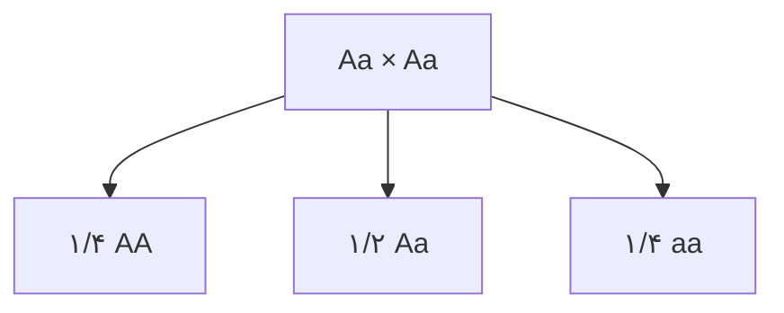
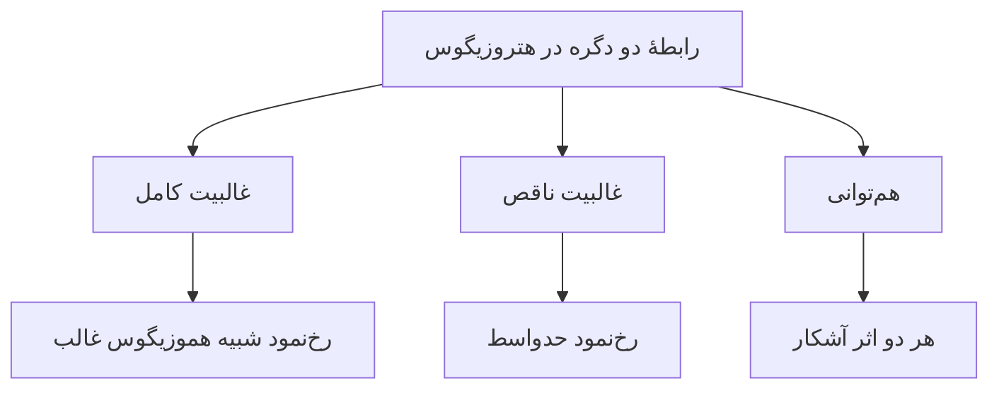
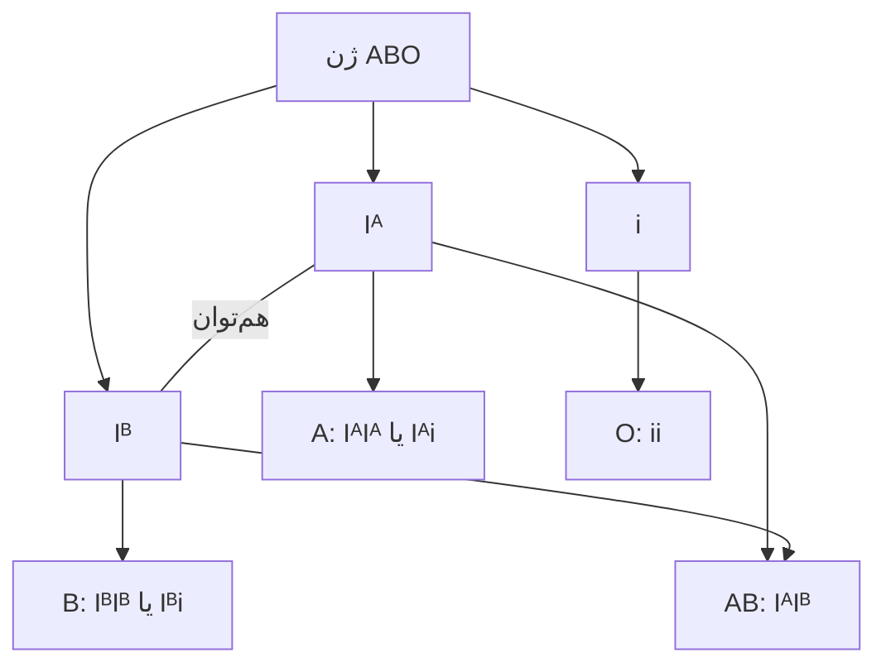
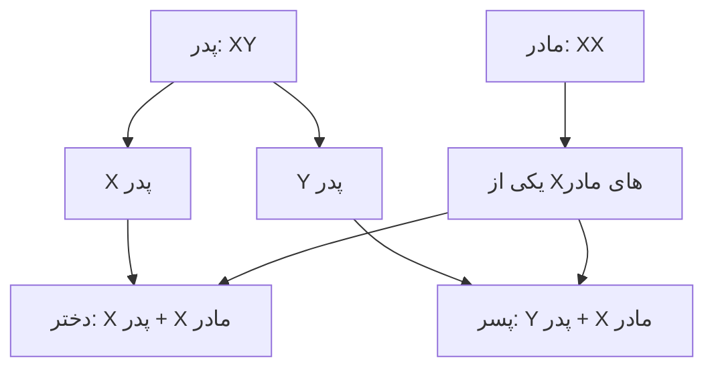
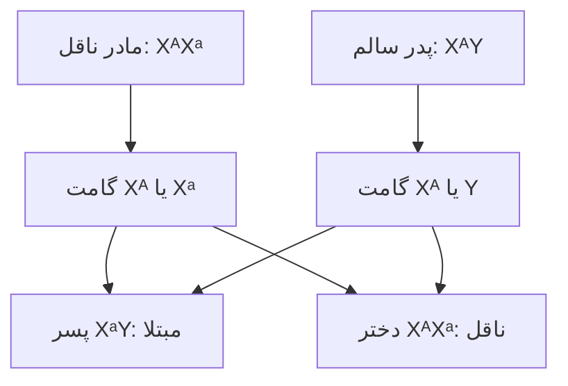
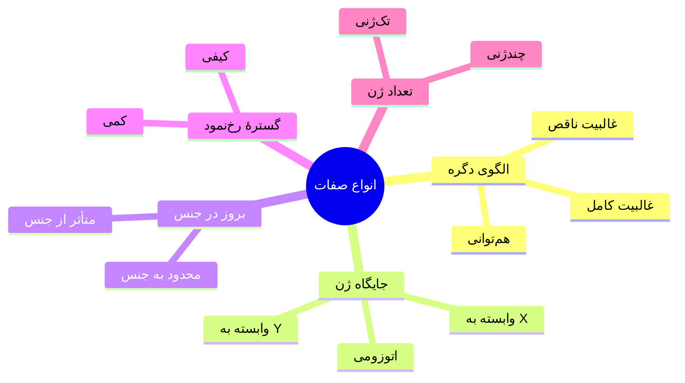
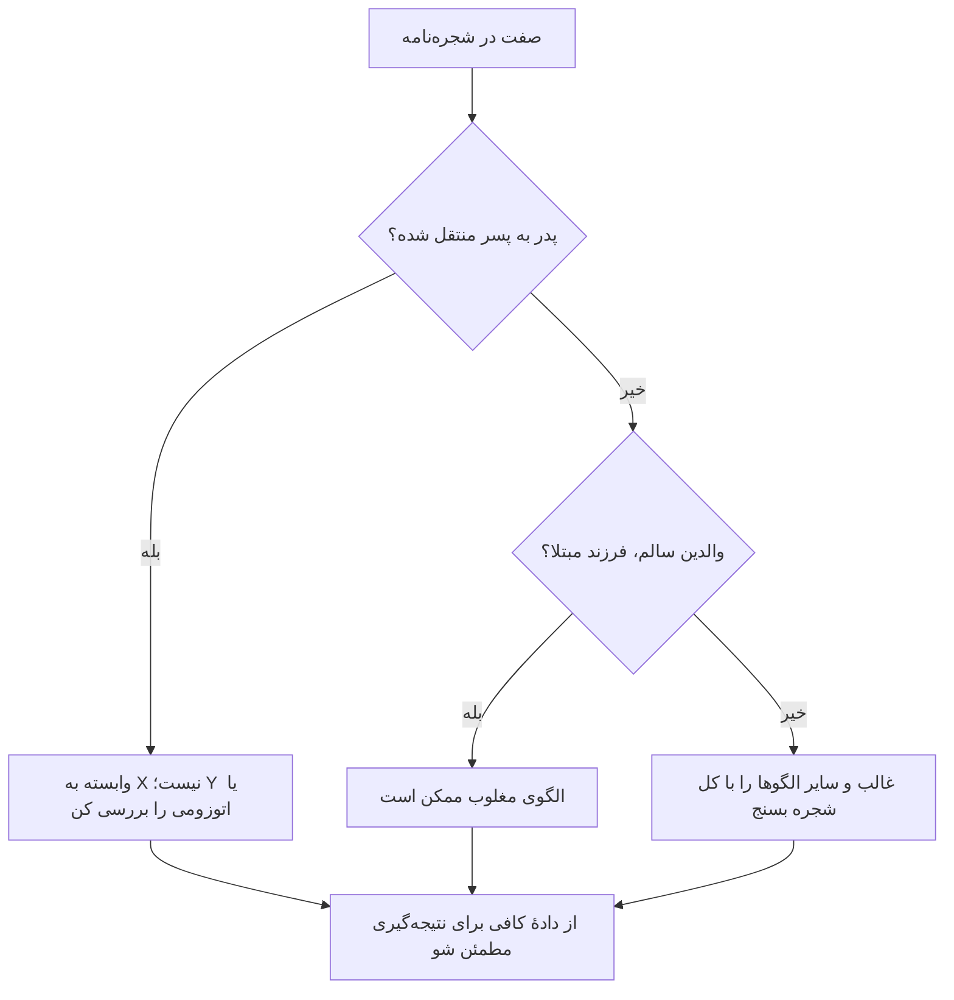

# راهنمای دیداری فصل ۳ ـ انتقال اطلاعات در نسل‌ها

این نمودارها را فقط تماشا نکن؛ هرکدام را یک بار بدون نگاه‌کردن دوباره رسم کن. در ژنتیک، یک حرف کوچک مثل i می‌تواند کل جواب را عوض کند. 😅

## ۱) از DNA تا رخ‌نمود

ژن‌نمود و محیط هر دو می‌توانند در شکل‌گیری رخ‌نمود نقش داشته باشند.

## ۲) جایگاه دگره‌ها روی کروموزوم‌های همتا

دگره‌ها در جایگاه‌های متناظر قرار دارند؛ یکی روی هر کروموزوم همتا.

## ۳) قانون تفکیک و تشکیل گامت

در مدل ساده، سهم گامت A و a برابر است؛ احتمال‌ها را با تضمین تعداد فرزندان اشتباه نگیر.

## ۴) مربع پانت برای Aa × Aa

|  | A | a |
|---|---|---|
| **A** | AA | Aa |
| **a** | Aa | aa |

در غالبیت کامل، رخ‌نمود غالب ۳/۴ و مغلوب ۱/۴ است. در غالبیت ناقص، سه ژن‌نمود سه رخ‌نمود متفاوت دارند.

## ۵) سه رابطهٔ دگره‌ای

## ۶) گروه خونی ABO

سه دگره در جمعیت وجود دارد، ولی هر فرد معمولاً دو دگره در این جایگاه دارد.

## ۷) انتقال کروموزوم X و Y

نکتهٔ طلایی: پدر X را به دختر و Y را به پسر می‌دهد؛ پسر X را از مادر می‌گیرد.

## ۸) وراثت مغلوب وابسته به X

در این تلاقی، احتمال مبتلاشدن هر پسر ۱/۲ است؛ احتمال را در جمعیت فرضی با تعداد قطعی اشتباه نکن.

## ۹) انواع صفات بر اساس الگوی وراثت

این دسته‌بندی‌ها محورهای متفاوت‌اند؛ یک صفت می‌تواند هم‌زمان در چند دسته قرار گیرد.

## ۱۰) محدود به جنس در برابر متأثر از جنس

| محدود به جنس | متأثر از جنس |
|---|---|
| بروز فقط در یک جنس | در هر دو جنس ممکن است بروز کند |
| ژن می‌تواند اتوزومی باشد | ژن می‌تواند اتوزومی باشد |
| مثال آموزشی: تولید شیر | مثال آموزشی: الگوی طاسی |

## ۱۱) شجره‌نامه‌خوانی

یک نشانه به‌تنهایی تشخیص قطعی نیست؛ همهٔ نسل‌ها و هر دو جنس را بررسی کن.

## ۱۲) کارت مرور یک‌نگاهی

| اگر دیدی… | سریع به یاد بیاور… |
|---|---|
| Aa | هتروزیگوس |
| AA یا aa | هموزیگوس |
| AB | هم‌توانی Iᴬ و Iᴮ |
| صورتی از قرمز × سفید | غالبیت ناقص |
| پدر → دختر، نه پسر | انتقال X |
| پدر → پسر | با وراثت وابسته به Y سازگار است |
| قد و وزن | اغلب چندژنی و چندعاملی |
| گروه خونی | صفت کیفی با چنددگره‌ای در ABO |

## روش استفاده

۱. نمودار را بخوان. ۲. صفحه را ببند. ۳. از حافظه رسم کن. ۴. یک مثال تازه بساز. ۵. هرجا جهت انتقال یا جایگاه دگره را اشتباه کردی، همان بخش درس‌نامه را دوباره بخوان.
