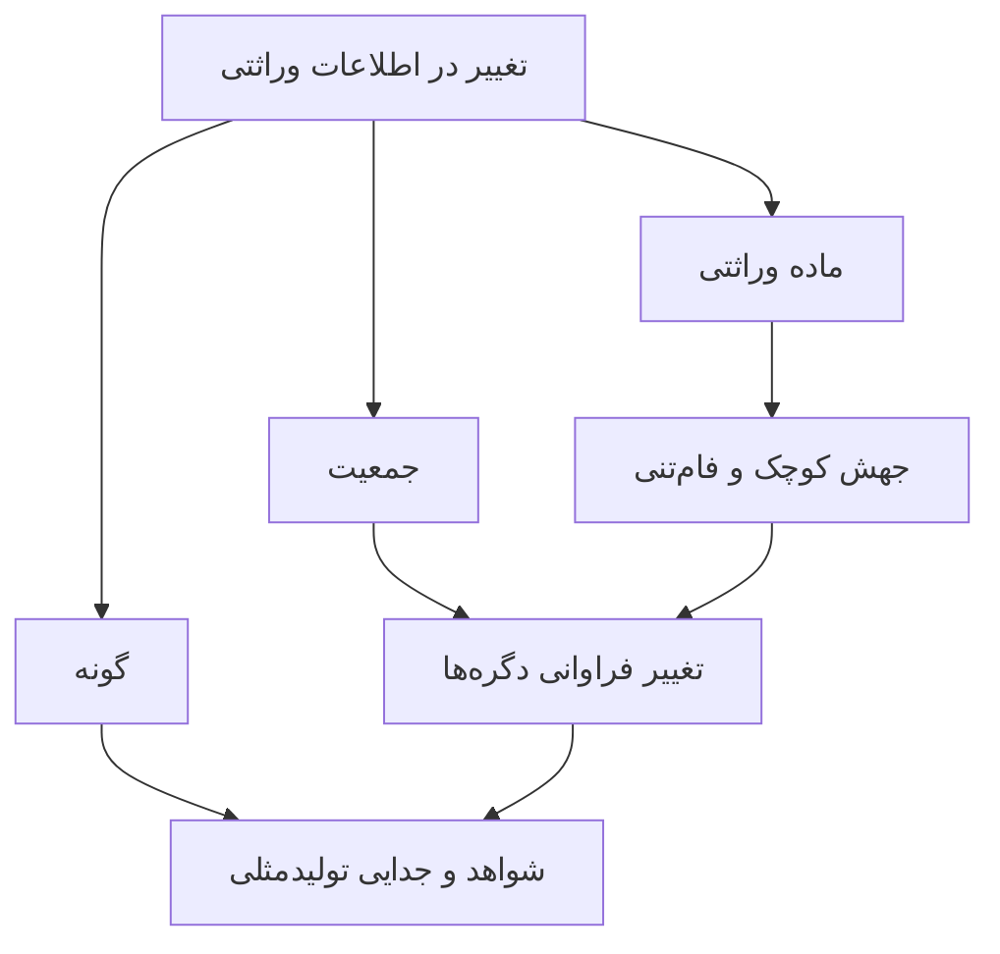
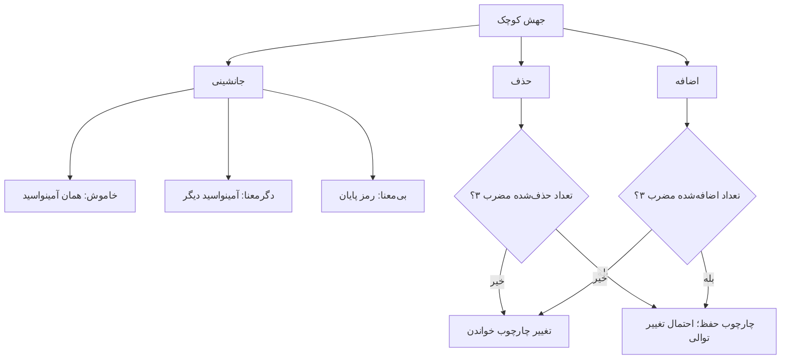
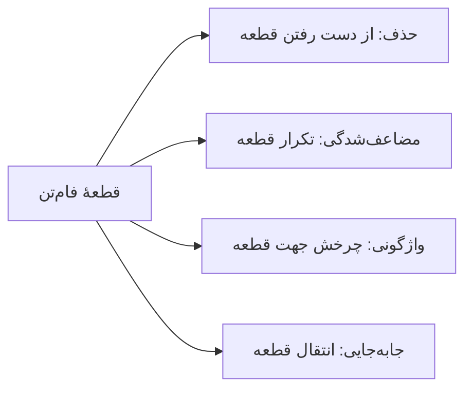
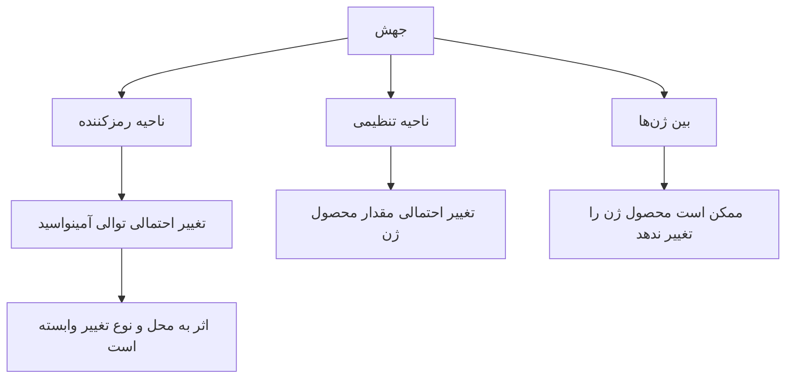
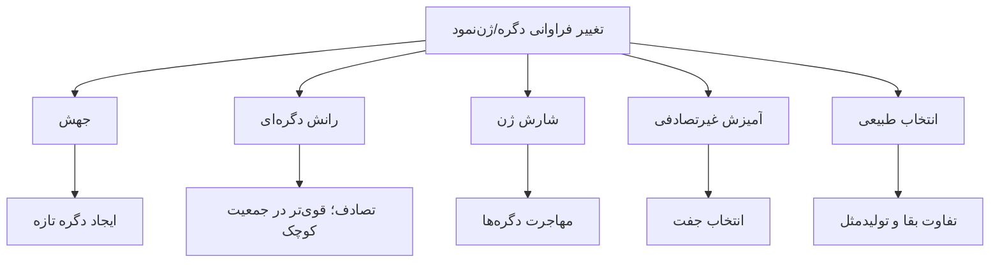
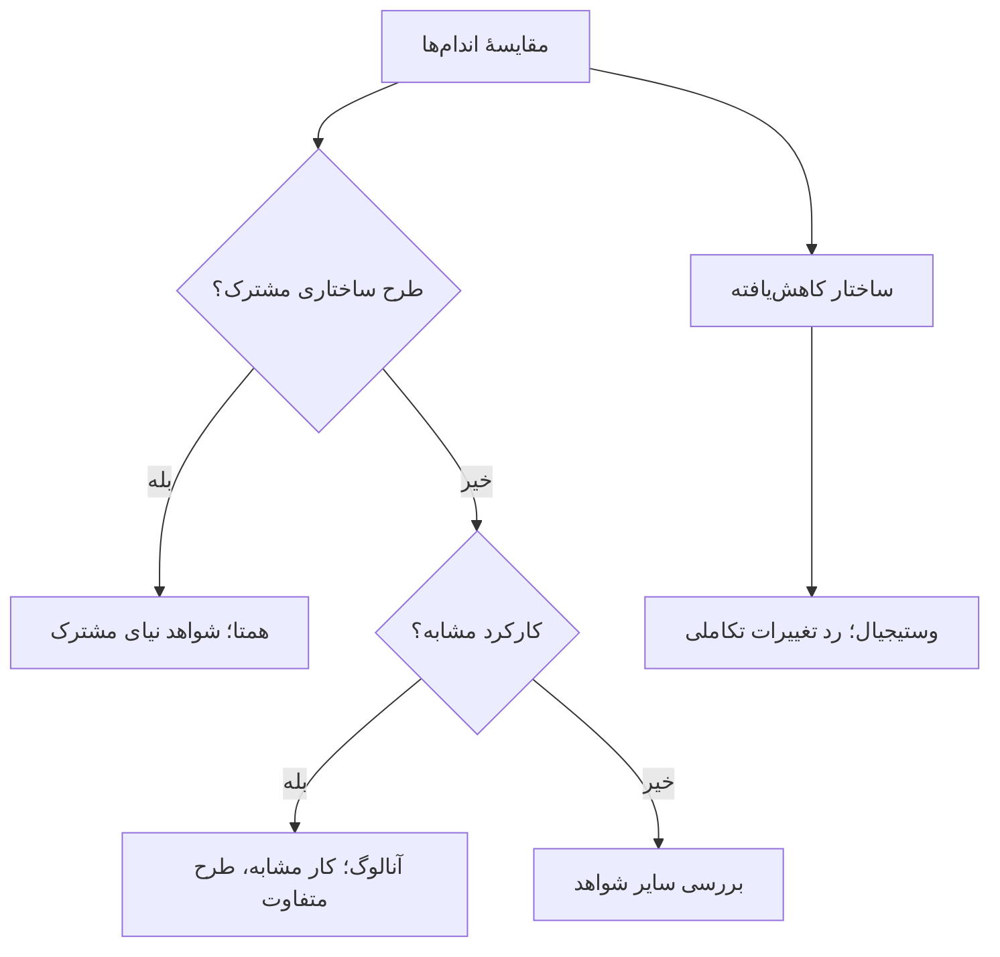
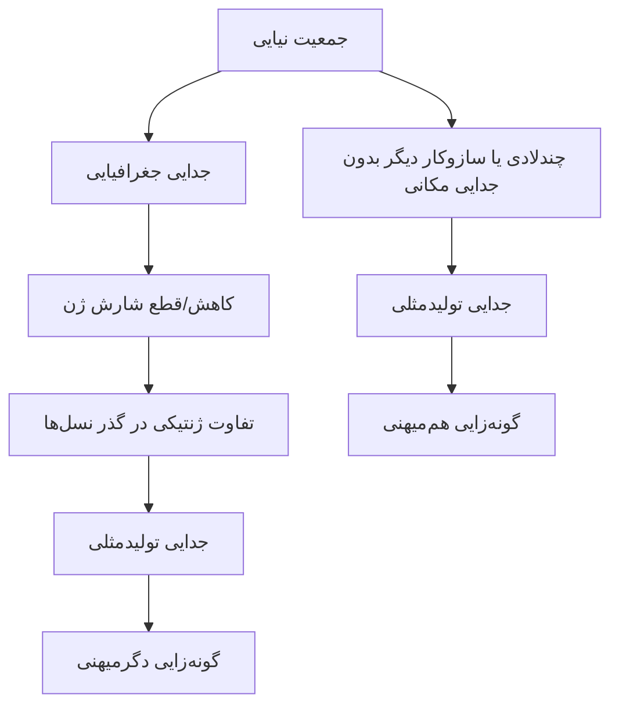
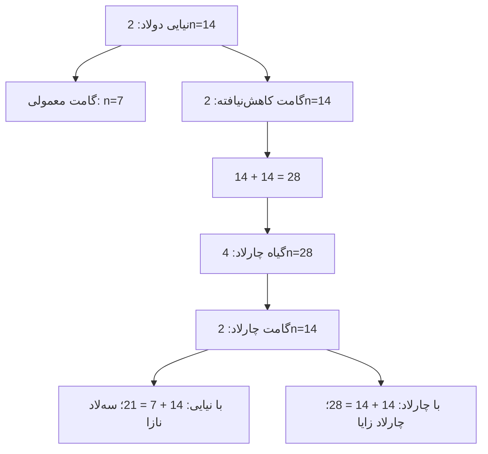

# راهنمای دیداری فصل ۴ ـ تغییر در اطلاعات وراثتی

نقشه‌ها را از بالا به پایین بخوان؛ هر نمودار یک زنجیرهٔ استدلالی را نشان می‌دهد.

## ۱) نقشهٔ کل فصل

## ۲) طبقه‌بندی جهش‌های کوچک

## ۳) چهار نوع ناهنجاری ساختاری فام‌تن

| نوع | قبل | بعد |
|---|---|---|
| حذف | ABCDEFG | ABCEFG |
| مضاعف‌شدگی | ABCDEFG | ABCDDEFG |
| واژگونی | ABCDEFG | ABEDCFG |
| جابه‌جایی | ABCD + WXYZ | ABYZ + W XCD |

این رشته‌ها فقط مدل شماتیک‌اند؛ در جابه‌جایی، قطعه می‌تواند به فام‌تن دیگر یا جای دیگری از همان فام‌تن منتقل شود.

## ۴) محل جهش و پیامد

## ۵) عوامل برهم‌زنندهٔ تعادل ژنی

## ۶) جهش، نوترکیبی و انتخاب طبیعی را قاطی نکن

| فرایند | کار اصلی | دگرهٔ جدید می‌سازد؟ |
|---|---|---|
| جهش | تغییر توالی DNA | بله، می‌تواند |
| نوترکیبی | جابه‌جایی ترکیب دگره‌های موجود | نه |
| آرایش مستقل | ترکیب متفاوت فام‌تن‌های مادری/پدری در گامت | نه |
| انتخاب طبیعی | تفاوت موفقیت بقا و تولیدمثل | نه؛ فراوانی‌ها را تغییر می‌دهد |

## ۷) همتا، آنالوگ، وستیجیال

## ۸) دو مسیر گونه‌زایی

## ۹) مثال عددی چندلادی گل مغربی

## ۱۰) چک‌لیست تشخیص سریع تست

| اگر در صورت سؤال دیدی… | به این مفهوم فکر کن |
|---|---|
| رمز عوض شده، آمینواسید همان است | جهش خاموش |
| رمز پایان زودرس | جهش بی‌معنا |
| حذف ۲ نوکلئوتید | تغییر چارچوب |
| تریزومی ۲۱ | ناهنجاری عددی |
| UV و دو تیمین مجاور | دوپار تیمین |
| سیل و بقای تصادفی | رانش دگره‌ای |
| مهاجرت افراد بین جمعیت‌ها | شارش ژن |
| باکتری مقاوم بعد از مصرف پادزیست | انتخاب طبیعی |
| مبادلهٔ قطعه میان فامینک‌های غیرخواهری | نوترکیبی |
| دست انسان و بالهٔ دلفین | ساختار همتا |
| بال پرنده و بال حشره | ساختار آنالوگ |
| رودخانه جمعیت را جدا کرده | آغاز احتمالی دگرمیهنی؛ نه اثبات گونه‌زایی |
| 4n در کنار 2n | احتمال جدایی تولیدمثلی ناشی از چندلادی |
