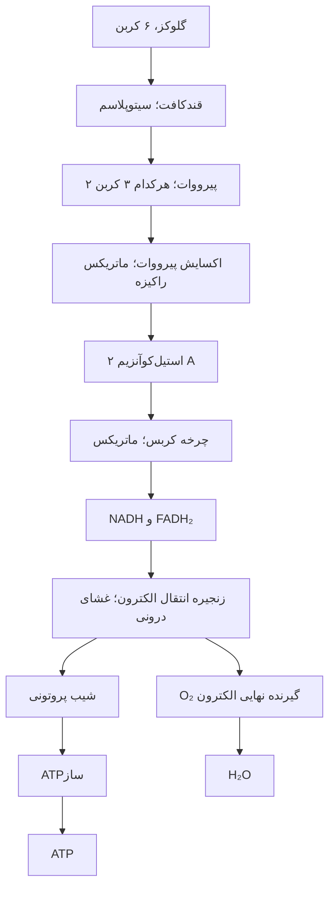
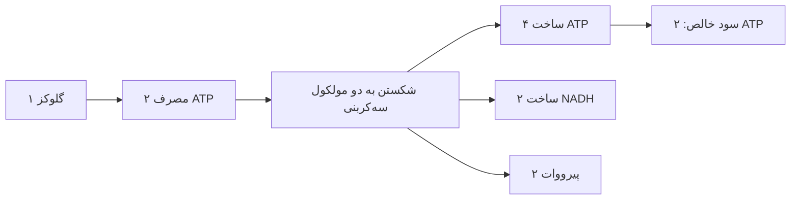
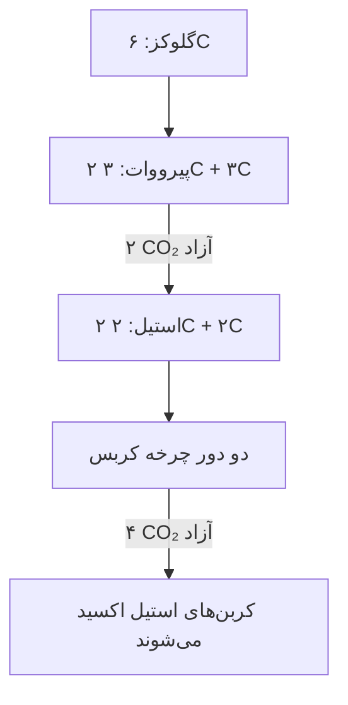
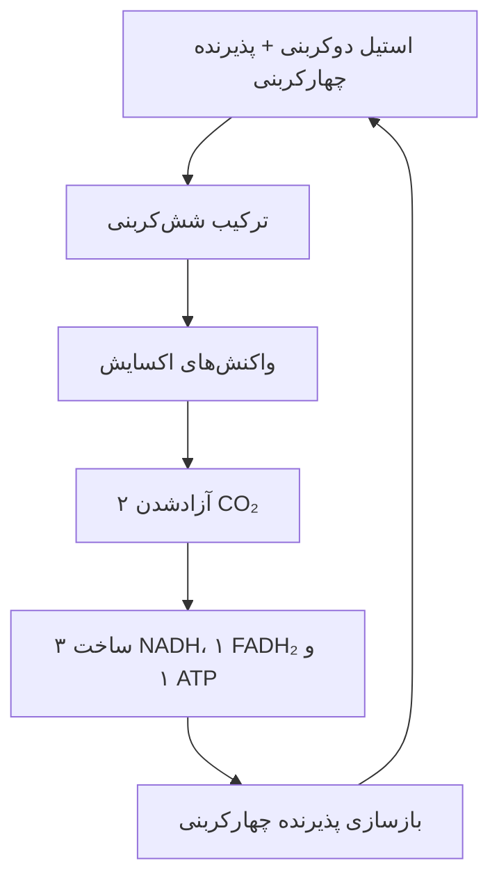
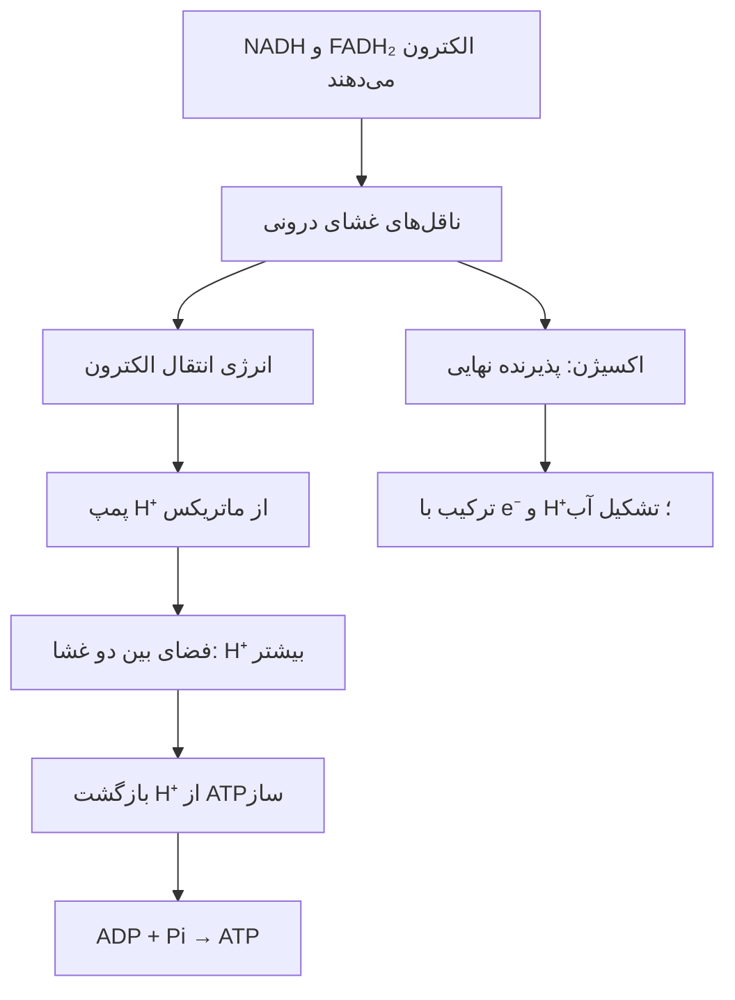
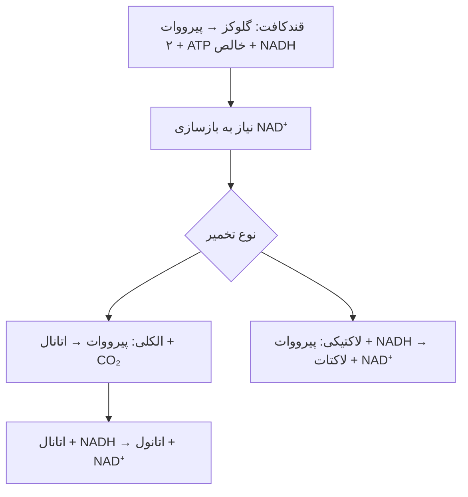
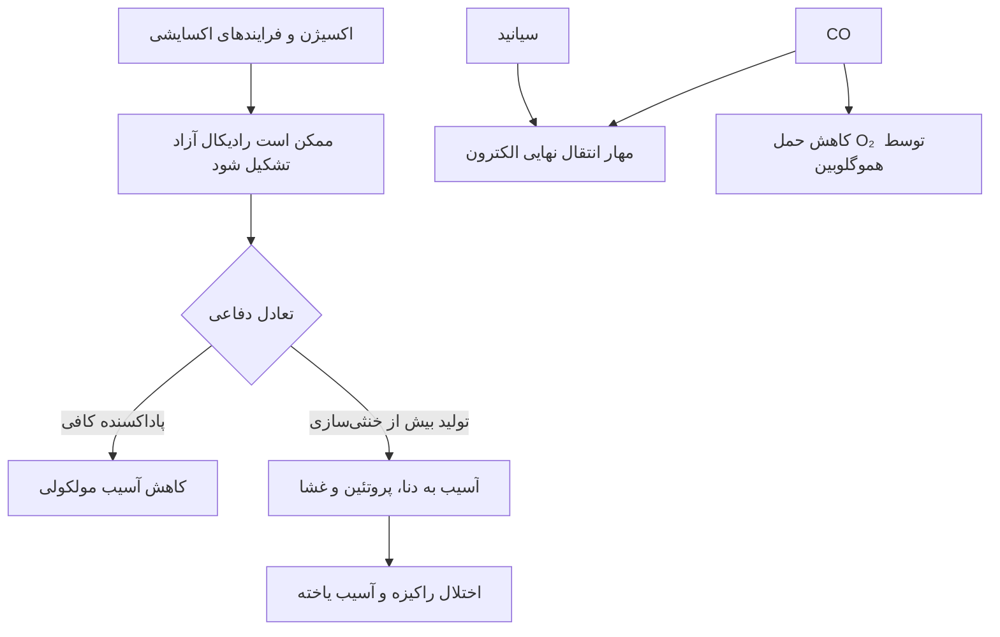

# راهنمای دیداری فصل ۵ ـ از ماده به انرژی

نقشه‌ها را از حفظ بازسازی کن؛ صرفاً نگاه‌کردن به نمودار مثل دیدن ویدئوی ورزش و انتظار عضله‌سازی است.

## ۱) نقشهٔ کلی تنفس یاخته‌ای هوازی

## ۲) نقشهٔ مکان‌ها؛ کدام فرایند کجا رخ می‌دهد؟

| جایگاه | رویداد |
|---|---|
| مادهٔ زمینهٔ سیتوپلاسم | قندکافت |
| ماتریکس راکیزه | اکسایش پیرووات و چرخهٔ کربس |
| غشای درونی راکیزه | زنجیرهٔ انتقال الکترون و ATPساز |
| فضای بین دو غشا | تجمع پروتون‌های پمپ‌شده |

## ۳) بودجهٔ قندکافت

## ۴) مسیر کربن؛ شمارش را گم نکن

| مرحله | تعداد کربن ورودی | سرنوشت کربن |
|---|---:|---|
| قندکافت | ۶ | دو پیروواتِ ۳ کربنی؛ CO₂ آزاد نمی‌شود |
| اکسایش دو پیرووات | ۶ | دو CO₂ آزاد؛ دو استیلِ ۲ کربنی باقی می‌ماند |
| دو دور کربس | ۴ کربنِ استیل | چهار CO₂ آزاد؛ مولکول چهارکربنی چرخه بازسازی می‌شود |

## ۵) خروجی حامل‌های الکترون به ازای یک گلوکز

| مرحله | NADH | FADH₂ |
|---|---:|---:|
| قندکافت | ۲ | ۰ |
| اکسایش پیرووات | ۲ | ۰ |
| دو دور کربس | ۶ | ۲ |
| **جمع** | **۱۰** | **۲** |

این جدول را با دقت بخوان: ۳ NADH و ۱ FADH₂ برای **یک دور** کربس است؛ چون یک گلوکز دو استیل‌کوآنزیم A می‌دهد، چرخه دو دور می‌زند.

## ۶) چرخهٔ کربس؛ یک دور در برابر هر گلوکز

| واحد شمارش | CO₂ | NADH | FADH₂ | ATP |
|---|---:|---:|---:|---:|
| هر دور کربس | ۲ | ۳ | ۱ | ۱ |
| به ازای هر گلوکز | ۴ | ۶ | ۲ | ۲ |

## ۷) زنجیرهٔ انتقال الکترون و شیب پروتونی

## ۸) تخمیر؛ دو مسیر، یک هدف مشترک

| شاخص | الکلی | لاکتیکی |
|---|---|---|
| محصول | اتانول + CO₂ | لاکتات |
| گاز CO₂ | تولید می‌شود | تولید نمی‌شود |
| مثال | مخمر نان | ماهیچه در فعالیت شدید؛ برخی باکتری‌ها |
| ATP مستقیم از خود تخمیر | ندارد | ندارد |

## ۹) عوامل محافظ و مختل‌کننده

## ۱۰) جدول دام‌های مقایسه‌ای

| اگر سؤال گفت… | پاسخ درست را از این سرنخ پیدا کن |
|---|---|
| ATP خالص قندکافت | ۲؛ نه ۴ |
| محل قندکافت | مادهٔ زمینهٔ سیتوپلاسم |
| محل کربس | ماتریکس راکیزه |
| محل زنجیره | غشای درونی راکیزه |
| گیرندهٔ نهایی الکترون | اکسیژن |
| تولید CO₂ | اکسایش پیرووات و کربس؛ نه قندکافت |
| بازسازی NAD⁺ در نبود اکسیژن | تخمیر |
| تخمیر الکلی | اتانول و CO₂ |
| تخمیر لاکتیکی | لاکتات؛ بدون CO₂ در این مسیر |
| سیانید | مهار زنجیره |
| CO | اختلال در حمل اکسیژن و زنجیره |

## خودآزمایی شکل‌خوانی

۱. اگر ATPساز مهار شود، پروتون‌ها از کدام فضا نمی‌توانند به‌راحتی به ماتریکس برگردند؟  
۲. اگر یک گلوکز وارد مسیر شود، چند دور کربس رخ می‌دهد؟  
۳. در کدام مرحله CO₂ از کربن پیرووات جدا می‌شود؟  
۴. چرا تخمیر به‌تنهایی تولید ATP را فراتر از قندکافت افزایش نمی‌دهد؟  
۵. در حضور اکسیژن، کدام مولکول گیرندهٔ نهایی الکترون است؟
