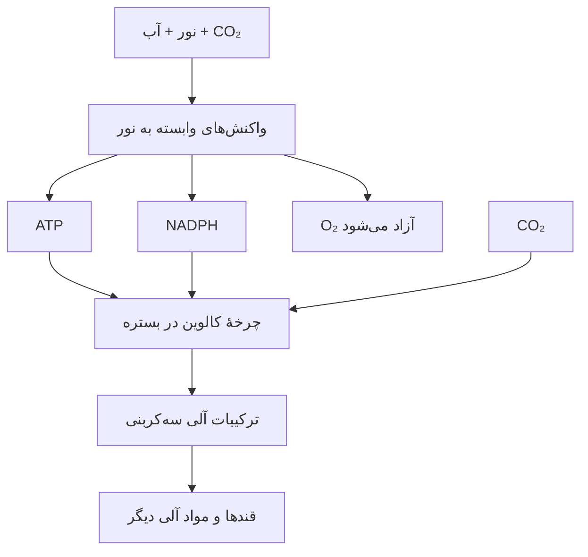
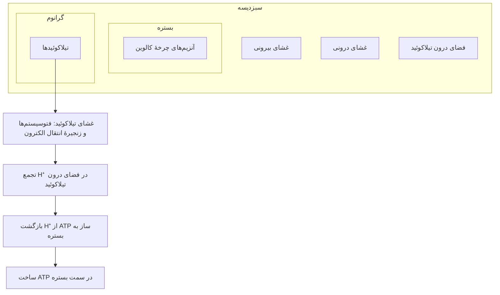
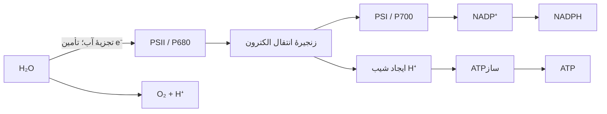
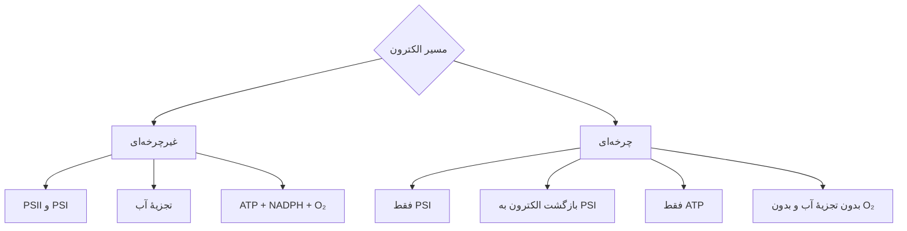
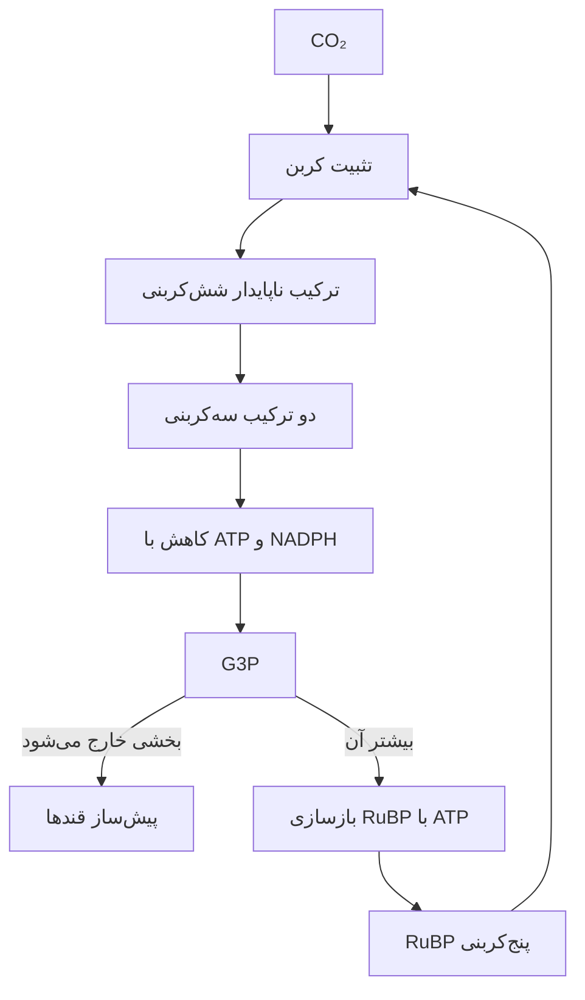
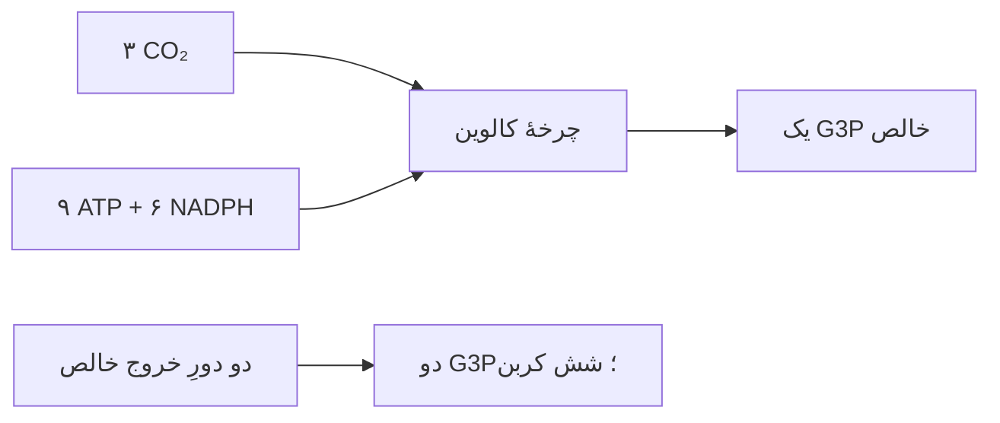
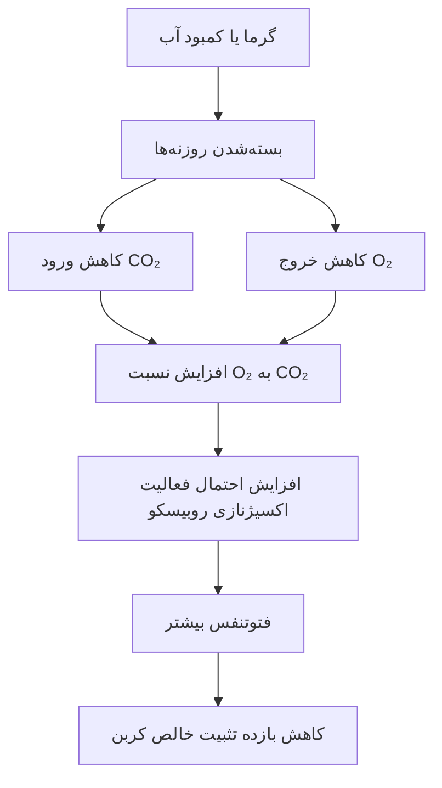
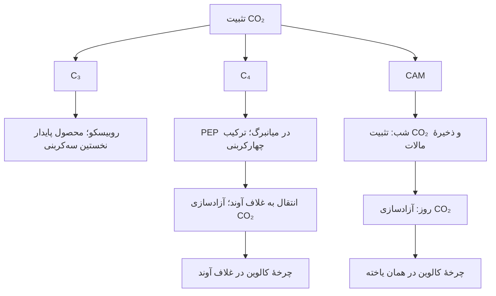

# راهنمای دیداری فصل ۶ ـ از انرژی به ماده

این فصل را با دنبال‌کردن دو مسیر ببین: مسیر انرژی/الکترون در تیلاکوئید و مسیر کربن در چرخهٔ کالوین.

## ۱) نقشهٔ کلی فتوسنتز

## ۲) سبزدیسه؛ جای هر اتفاق

**یادآوری:** چرخهٔ کالوین در بستره است؛ واکنش نوری روی غشای تیلاکوئید.

## ۳) مسیر غیرچرخه‌ای الکترون

خروجی مسیر غیرچرخه‌ای: **ATP + NADPH + O₂**.

## ۴) مسیر چرخه‌ای در برابر غیرچرخه‌ای

## ۵) چرخهٔ کالوین در سه مرحله

## ۶) حساب چرخهٔ کالوین

| خروجی خالص | CO₂ | ATP مصرفی | NADPH مصرفی |
|---|---:|---:|---:|
| یک G3P | ۳ | ۹ | ۶ |
| دو G3P (معادل کربنی یک گلوکز) | ۶ | ۱۸ | ۱۲ |

## ۷) چرا فتوتنفس بالا می‌رود؟

## ۸) سه راهبرد تثبیت کربن

## ۹) جدول طلایی C₃، C₄ و CAM

| ویژگی | C₃ | C₄ | CAM |
|---|---|---|---|
| نخستین پذیرندهٔ CO₂ | RuBP | PEP | PEP |
| نخستین محصول پایدار | ۳ کربنی | ۴ کربنی | ۴ کربنی |
| جداسازی | ندارد | مکانی | زمانی |
| محل چرخهٔ کالوین | میانبرگ | غلاف آوند | همان یاخته |
| بازشدن معمول روزنه | روز | روز | شب |
| نمونه | گندم، برنج | ذرت، نیشکر | کاکتوس، آناناس |

## ۱۰) دام‌های تصویری

- فلش الکترون را با فلش پروتون اشتباه نکن: الکترون از آب به NADP⁺ می‌رود؛ H⁺ از فضای تیلاکوئید از راه ATPساز به بستره بازمی‌گردد.
- O₂ از شکافت آب آزاد می‌شود؛ چرخهٔ کالوین اکسیژن آزاد نمی‌کند.
- مسیر چرخه‌ای فقط PSI دارد؛ اگر PSII یا فتولیز آب در شکل هست، چرخه‌ای نیست.
- در CAM، تثبیت اولیهٔ شبانه و چرخهٔ کالوین روزانه در یک یاخته رخ می‌دهند؛ در C₄، دو نوع یاخته درگیرند.
- چرخهٔ کالوین «تاریک» نامیده می‌شود، اما محصول واکنش نوری را مصرف می‌کند.
