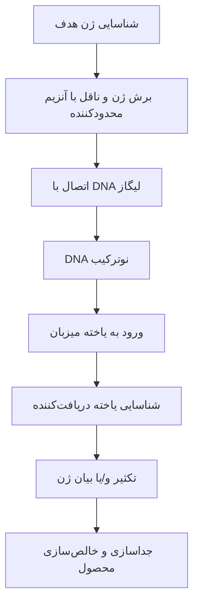
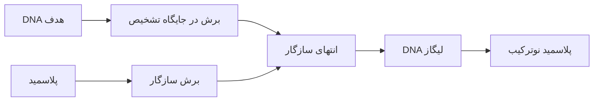
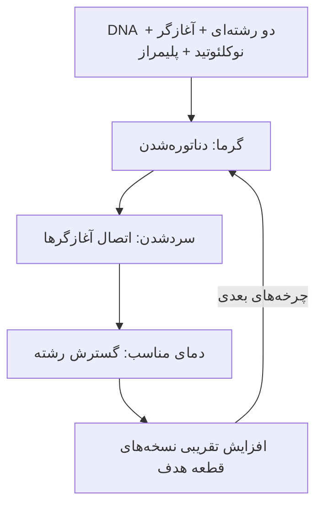
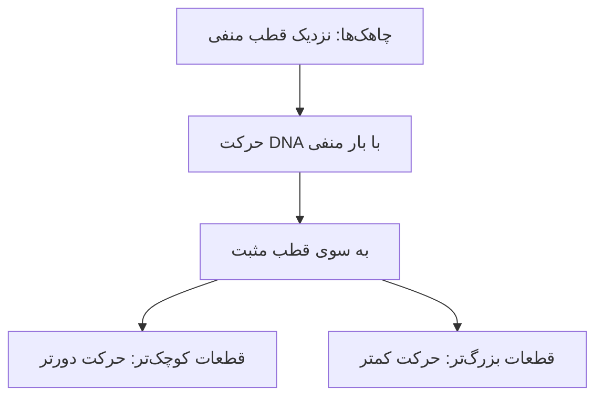
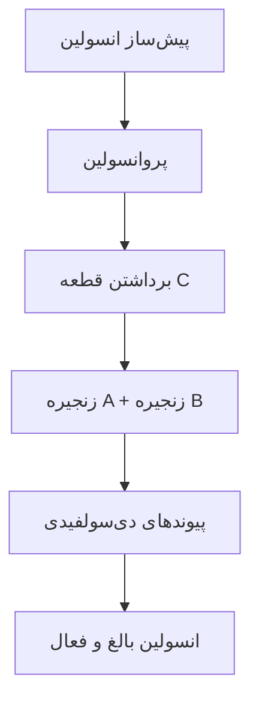
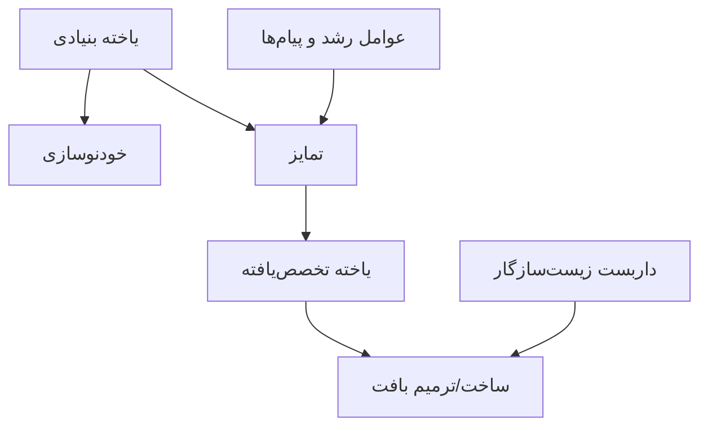
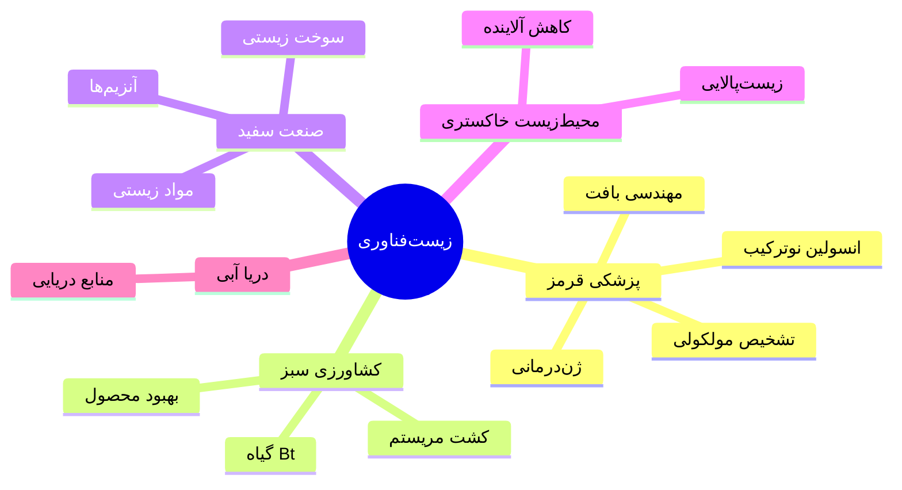
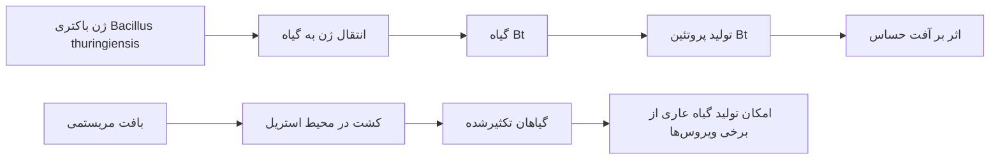
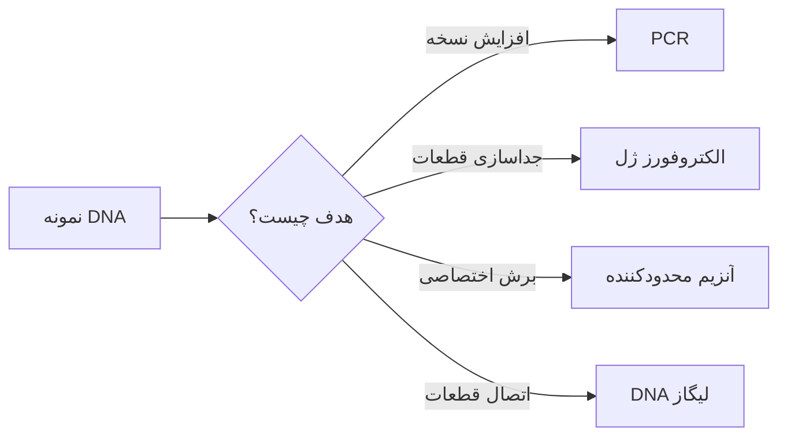

# راهنمای دیداری فصل ۷: فناوری‌های نوین زیستی

## ۱) نقشهٔ کلی مهندسی ژنتیک

**محدودکننده = قیچی؛ لیگاز = چسب؛ ناقل = وسیلهٔ حمل؛ میزبان = محل تکثیر/بیان.**

## ۲) برش و اتصال DNA

| ویژگی | انتهای چسبنده | انتهای صاف |
|---|---|---|
| شکل برش | پلکانی | هم‌سطح |
| جفت‌شدن موقت | توالی مکمل جفت می‌شود | بیرون‌زدگی تک‌رشته‌ای ندارد |
| نقش لیگاز | اتصال پایدار ستون قند ـ فسفات | اتصال پایدار ستون قند ـ فسفات |

## ۳) چرخهٔ PCR

| مرحله | رویداد | نقش کلیدی |
|---|---|---|
| دناتوره‌شدن | جدایی دو رشتهٔ الگو | گرما |
| اتصال آغازگر | جفت‌شدن آغازگرها با الگو | کاهش دما |
| گسترش | ساخت رشتهٔ مکمل | DNA پلیمراز مقاوم به گرما |

در حالت ایده‌آل پس از n چرخه (2^n) نسخه داریم؛ در عمل بازده کمتر است.

## ۴) الکتروفورز ژل

```text
قطب منفی (-)
چاهک‌ها     █████  قطعه بزرگ
            ███    قطعه متوسط
            ██     قطعه کوچک
                 ↓ جهت حرکت DNA
قطب مثبت (+)
```
DNA به قطب مثبت می‌رود؛ قطعهٔ کوچک‌تر معمولاً دورتر از چاهک می‌رود. نوارها اندازهٔ تقریبی را نشان می‌دهند، نه توالی دقیق را.

## ۵) از ژن تا پروتئین فعال

در هر مرحله امکان اختلال وجود دارد؛ «ژن منتقل شد» مساوی «پروتئین فعال تولید شد» نیست.

## ۶) پردازش انسولین

زنجیره‌های A و B دو زنجیرهٔ پلی‌پپتیدی‌اند؛ پیوند دی‌سولفیدی آن‌ها را به یک زنجیرهٔ واحد تبدیل نمی‌کند.

## ۷) یاختهٔ بنیادی و مهندسی بافت

| جزء | نقش |
|---|---|
| یاخته | ساخت اجزای زندهٔ بافت |
| داربست | پشتیبانی و چارچوب |
| عوامل رشد | هدایت بقا، تکثیر و تمایز |
| شرایط کشت | فراهم‌کردن محیط مناسب |

## ۸) کاربردهای زیست‌فناوری


## ۹) گیاه Bt و کشت مریستم

دو مسیر جدا: گیاه Bt با انتقال ژن ساخته می‌شود؛ کشت مریستم می‌تواند بدون تغییر ژنوم برای تکثیر و پاک‌سازی ویروسی به کار رود.

## ۱۰) فعل سؤال ← ابزار

| اگر سؤال می‌گوید… | به یاد بیاور… |
|---|---|
| برش در توالی مشخص | آنزیم محدودکننده |
| اتصال قطعات DNA | DNA لیگاز |
| حمل قطعه به میزبان | ناقل |
| افزایش نسخه‌های DNA | PCR |
| جداسازی بر اساس اندازه | الکتروفورز |
| ساخت رشتهٔ مکمل | DNA پلیمراز |
| بازسازی بافت | یاخته + داربست + پیام‌های رشد |
| تکثیر گیاه عاری از برخی ویروس‌ها | کشت مریستم |

## چک‌لیست مرور سریع
- [ ] ترتیب مهندسی ژنتیک را از حفظ رسم می‌کنم.
- [ ] برش و اتصال را تفکیک می‌کنم.
- [ ] سه مرحلهٔ PCR را توضیح می‌دهم.
- [ ] جهت حرکت DNA در ژل و رابطهٔ اندازه/مسافت را می‌دانم.
- [ ] ورود ژن، بیان ژن و پروتئین فعال را از هم جدا می‌کنم.
- [ ] پردازش انسولین را شرح می‌دهم.
- [ ] یاختهٔ بنیادی، داربست و عوامل رشد را تفکیک می‌کنم.
- [ ] کاربردهای رنگی زیست‌فناوری را دسته‌بندی می‌کنم.
- [ ] گیاه Bt را با کشت مریستم اشتباه نمی‌گیرم.
