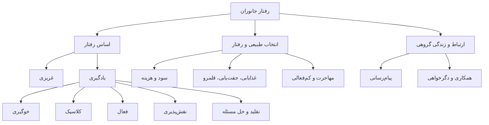
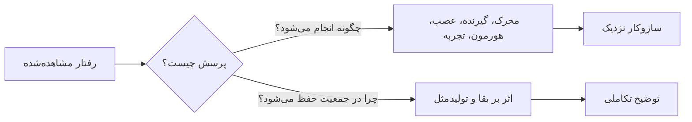
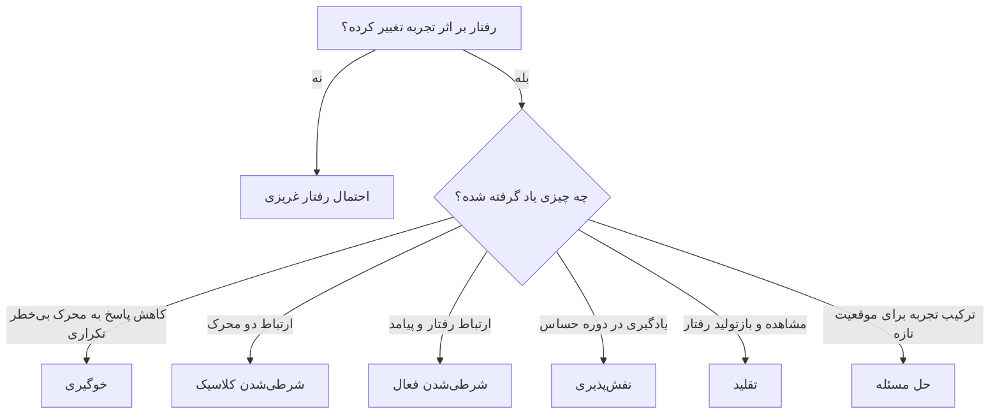
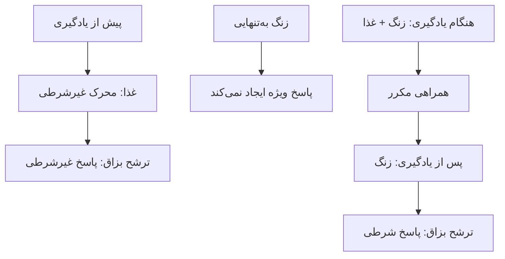
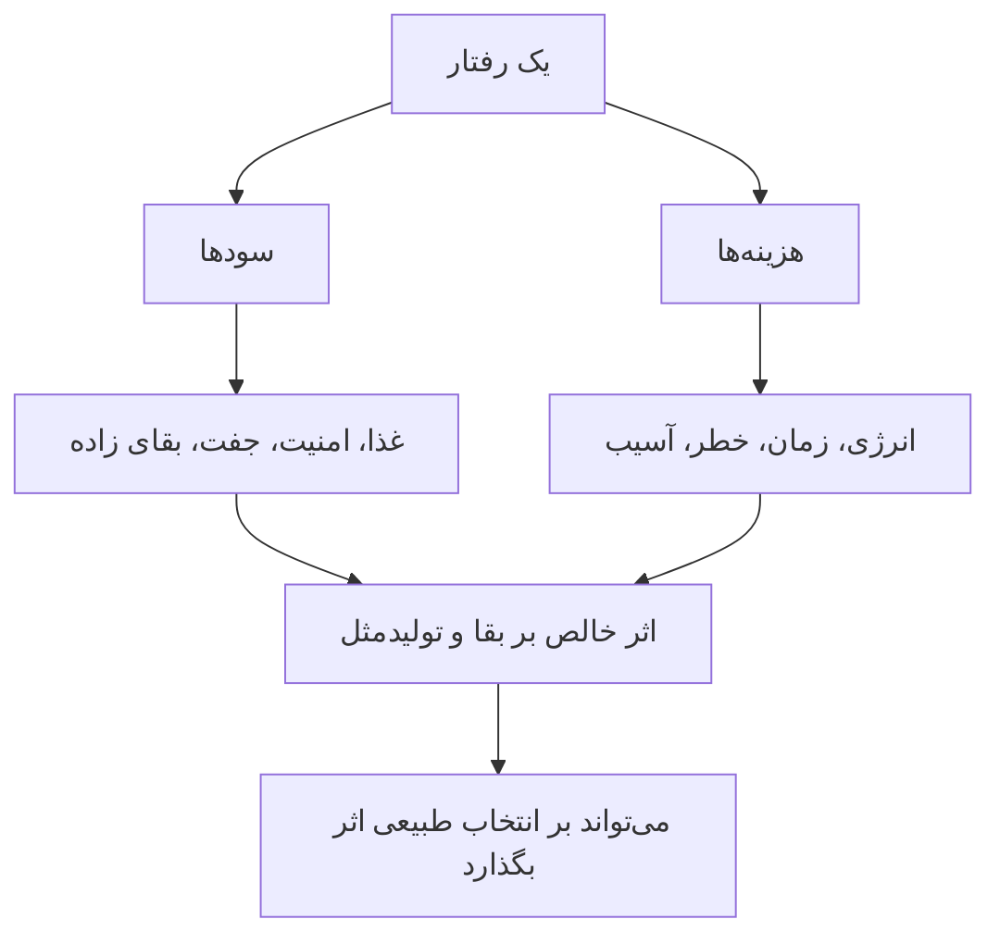
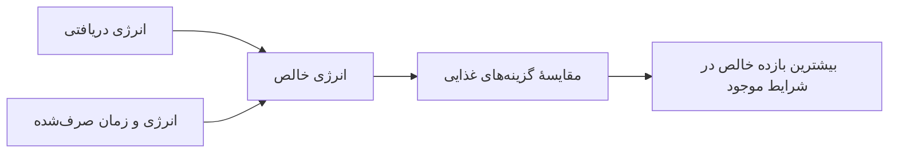
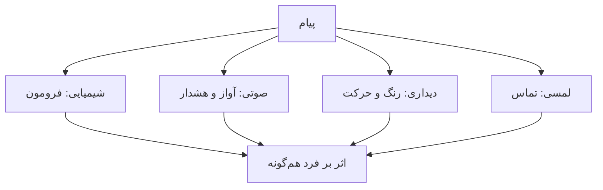
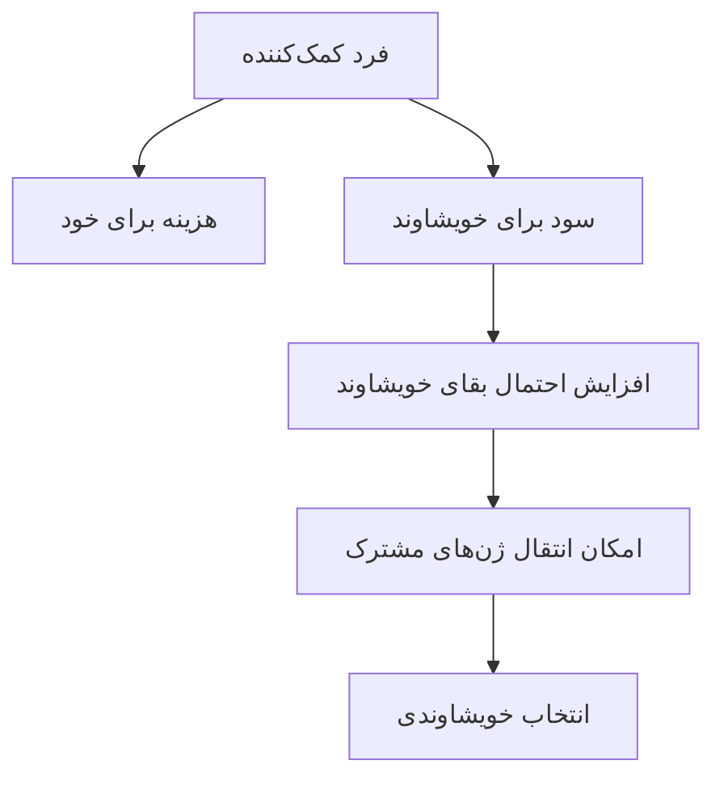

# راهنمای دیداری فصل ۸ ـ رفتارهای جانوران

## ۱) نقشهٔ کلی فصل

## ۲) چگونه یا چرا؟

## ۳) درخت تصمیم تشخیص نوع یادگیری

## ۴) پاولف: شرطی‌شدن کلاسیک

**یادآوری:** غذا محرک طبیعی/غیرشرطی است؛ زنگ پس از یادگیری محرک شرطی می‌شود.

## ۵) کلاسیک یا فعال؟

| شرطی‌شدن کلاسیک | شرطی‌شدن فعال |
|---|---|
| پیوند دو محرک | پیوند رفتار و پیامد |
| نشانه، محرک دیگر را پیش‌بینی می‌کند | رفتار با پاداش/تنبیه تغییر می‌کند |
| زنگ ← غذا | فشردن اهرم ← غذا |

## ۶) سود و هزینهٔ رفتار

## ۷) غذایابی بهینه

**تله:** بیشترین اندازه یا بیشترین انرژی خام الزاماً بهترین گزینه نیست.

## ۸) ارتباط جانوران

## ۹) دگرخواهی و انتخاب خویشاوندی

## ۱۰) جدول جمع‌بندی دام‌ها

| اگر در سؤال دیدی… | به یاد بیاور… |
|---|---|
| محرک بی‌خطر تکراری | خوگیری |
| دو محرک همراه | شرطی‌شدن کلاسیک |
| پاداش یا تنبیه | شرطی‌شدن فعال |
| دورهٔ حساس | نقش‌پذیری |
| بیشترین سود منهای هزینه | غذایابی بهینه |
| پیام شیمیایی بین هم‌گونه‌ها | فرومون |
| کمک با هزینه برای فرد | دگرخواهی |
| کمک به خویشاوند و ژن مشترک | انتخاب خویشاوندی |
| کاهش سوخت‌وساز در سرما | خواب زمستانی |
